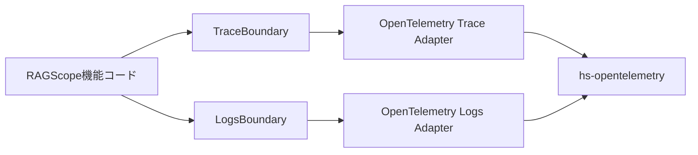
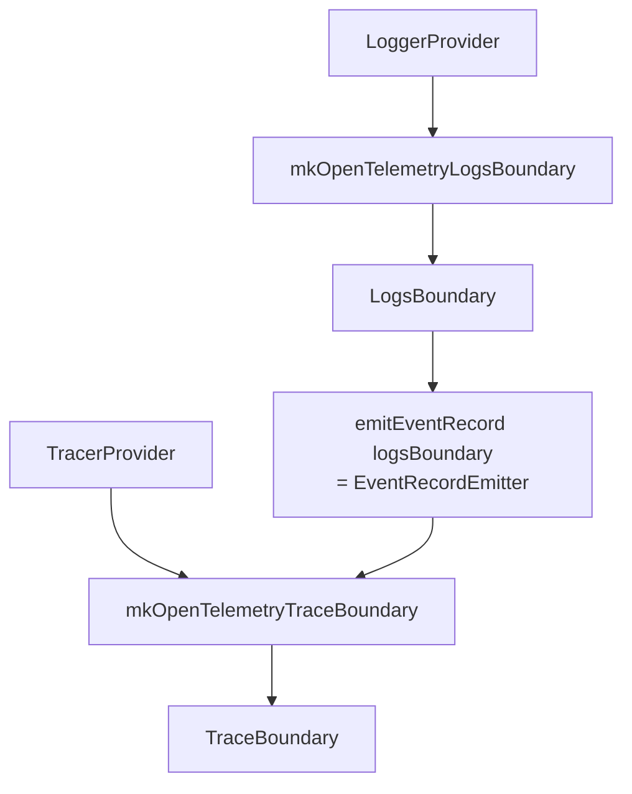

# RAGScopeのTelemetry境界

対象: `RS-0024/exception-event-once` / `9f6517a4dc9c2fbaa70479eea8cf7c1d3a7acc78`

## RAGScopeはOpenTelemetryを直接使わない

RAGScopeの機能コードから見ると、TraceとLogsは次の2つの境界として見える。

```text
TraceBoundary
LogsBoundary
```

OpenTelemetry固有の

```text
TracerProvider
Tracer
Span
LoggerProvider
Logger
LogRecordArguments
```

などはAdapter側に閉じ込める。



## TraceBoundary

現在の型は次の通り。

```haskell
newtype TraceBoundary = TraceBoundary SpanRunner
```

中身の`SpanRunner`は、

```haskell
type SpanRunner =
  forall result.
  SpanName ->
  (result -> SpanOutcome) ->
  IO result ->
  IO result
```

これを普通の日本語にすると、

> Span名と、結果の分類方法と、実際のIO処理を受け取り、その処理をSpanの中で実行して、元の結果を返す関数

である。

### なぜ`forall result`なのか

`TraceBoundary`は特定の戻り値専用ではない。

```haskell
IO Int
IO Text
IO (Either SomeFailure Value)
```

など、いろいろな処理を同じBoundaryで包める必要がある。

そのため`SpanRunner`は戻り値型`result`に対して多相になっている。

### `SpanOutcome`はapplication resultではない

```haskell
data SpanOutcome
  = SpanSucceeded
  | SpanFailed Text
```

これは機能処理そのものの戻り値ではない。

たとえば機能処理が、

```haskell
Left SomeFailure
```

を返したとしても、その値を`SpanFailed`へ置き換えるわけではない。

処理は元の

```haskell
Left SomeFailure
```

をそのまま返し、別に渡したclassifierが、

```haskell
Left _  -> SpanFailed "some_failure"
Right _ -> SpanSucceeded
```

のように「Telemetry上どう見せるか」だけ決める。

```text
application result
    Left SomeFailure
         │
         ├── そのまま呼び出し元へ返す
         │
         └── classifierでSpanOutcomeへ写す
                    ↓
             SpanFailed "..."
```

この分離は、後でexceptionとapplication-level failureを区別するときに重要になる。

## `withSpan`は薄い入口

```haskell
withSpan :: TraceBoundary -> SpanRunner
withSpan (TraceBoundary run) = run
```

`withSpan`自身はOpenTelemetryを知らない。

`TraceBoundary`の中に入っている実装関数を取り出して実行しているだけ。

つまり、

```haskell
withSpan traceBoundary spanName classify action
```

を呼んだとき、実際にどんなSpanを作るかは`traceBoundary`をどう作ったかで決まる。

## OpenTelemetry版TraceBoundaryを作る

Trace Adapterの入口は、

```haskell
mkOpenTelemetryTraceBoundary ::
  TracerProvider ->
  EventRecordEmitter ->
  TraceBoundary
```

となっている。

入力は2つ。

```text
TracerProvider
  = Spanを作るOpenTelemetry側の大元

EventRecordEmitter
  = exception EventRecordなどを記録する能力
```

そして内部でTracerを1つ作る。

```haskell
tracer =
  makeTracer
    tracerProvider
    "ragscope"
    tracerOptions { ... }
```

そのTracerとEventRecordEmitterを使う`runOpenTelemetrySpan`を、RAGScope側の`TraceBoundary`へ包む。

```text
TracerProvider
    ↓ makeTracer
Tracer
    ┐
    ├─ runOpenTelemetrySpan
EventRecordEmitter
    ┘
    ↓
mkTraceBoundary
    ↓
TraceBoundary
```

これで機能コードは、ProviderやTracerを知らずに`withSpan`だけ使える。

## なぜTrace AdapterがEventRecordEmitterを受け取るのか

今回の設計では、同期exceptionがSpan外へ伝播するとき、Trace Adapterが

```text
SpanをErrorにする
error.typeを付ける
exception EventRecordを記録する
exceptionを再throwする
```

ところまで担当している。

ただしTrace AdapterがLogs Adapterそのものへ依存するわけではない。

受け取るのは、

```haskell
type EventRecordEmitter =
  EventRecord -> IO ()
```

という関数だけ。

そのため依存は、

```text
Trace Adapter
    ↓
EventRecordEmitterという能力
```

で止まる。

`LoggerProvider`や`Logger`をTrace Adapterへ渡してはいない。

## LogsBoundary

現在のLogs側は、2種類のemit能力をまとめている。

```haskell
data LogsBoundary
  = LogsBoundary
      LogRecordEmitter
      EventRecordEmitter
```

型は、

```haskell
type LogRecordEmitter =
  LogRecord -> IO ()

type EventRecordEmitter =
  EventRecord -> IO ()
```

`LogRecord`と`EventRecord`はRAGScope側の型で、hs-opentelemetryの型ではない。

### LogRecordとEventRecord

大きな違いは、EventRecordが安定したevent nameを持つこと。

```haskell
data LogRecord = LogRecord
  { logTimestamp :: Maybe UTCTime
  , logSeverity :: Severity
  , logBody :: LogValue
  , logAttributes :: LogAttributes
  }
```

```haskell
data EventRecord = EventRecord
  { eventName :: EventName
  , eventTimestamp :: EventTimestamp
  , eventSeverity :: Severity
  , eventAttributes :: LogAttributes
  }
```

今回のexceptionは、

```text
EventName = "exception"
```

を持つ`EventRecord`として作られる。

## OpenTelemetry版LogsBoundaryを作る

Logs Adapterの入口は、

```haskell
mkOpenTelemetryLogsBoundary ::
  LoggerProvider ->
  LogsBoundary
```

となっている。

内部では、

```haskell
logger =
  OpenTelemetry.makeLogger
    loggerProvider
    "ragscope"
```

でLoggerを作る。

そのLoggerを閉じ込めた2つの関数、

```text
emitOpenTelemetryLogRecord
emitOpenTelemetryEventRecord
```

を`LogsBoundary`へ包む。

```text
LoggerProvider
    ↓ makeLogger
Logger
    ├─ emitOpenTelemetryLogRecord
    └─ emitOpenTelemetryEventRecord
              ↓
         mkLogsBoundary
              ↓
         LogsBoundary
```

## テストでTraceとLogsを接続するところ

exception統合テストでは、最終的に次の形になっている。

```haskell
let
  logsBoundary =
    mkOpenTelemetryLogsBoundary loggerProvider

  traceBoundary =
    mkOpenTelemetryTraceBoundary
      tracerProvider
      (emitEventRecord logsBoundary)
```

ここがかなり重要。

順番に読むと、

```text
LoggerProvider
    ↓
LogsBoundary
    ↓ emitEventRecordだけ取り出す
EventRecordEmitter

TracerProvider + EventRecordEmitter
    ↓
TraceBoundary
```

となる。

図にすると、



Trace Adapterは「exceptionをEventRecordとして出したい」とだけ知っている。

そのEventRecordが最終的にOpenTelemetry Logsへどう変換されるかは、LogsBoundaryの向こう側に隠れている。

## production初期化との関係

将来productionへ繋ぐ場合、大枠は次のようになる。

```text
アプリ初期化
  ↓
TracerProviderを作る
LoggerProviderを作る
  ↓
logsBoundary = mkOpenTelemetryLogsBoundary loggerProvider
  ↓
traceBoundary =
  mkOpenTelemetryTraceBoundary
    tracerProvider
    (emitEventRecord logsBoundary)
  ↓
必要な機能へBoundaryを渡す
```

ただし現在のbranchでは、このproduction wiring自体はまだ実装されていない。

現時点で実ファイルとして存在するのは、Boundary、Adapter、それらを組み合わせるテストfixtureまでである。

## 依存の向き

大きく見ると次の向きになる。

```text
RAGScope機能コード
    ↓
telemetry-boundary
    ↑ 実装を注入
opentelemetry-adapter
    ↓
hs-opentelemetry
```

機能コードからOpenTelemetry Adapterを直接呼ぶ構造ではない。

「RAGScopeが必要とする能力」をBoundaryで定義し、「OpenTelemetryでそれをどう実現するか」をAdapterが提供している。

次は、この`TraceBoundary`を使って`withSpan`を1回呼んだとき、実際にどの順番で処理が進むかを見る。
