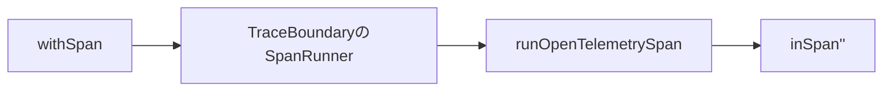
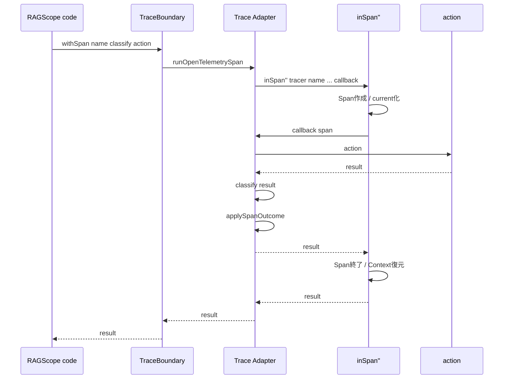
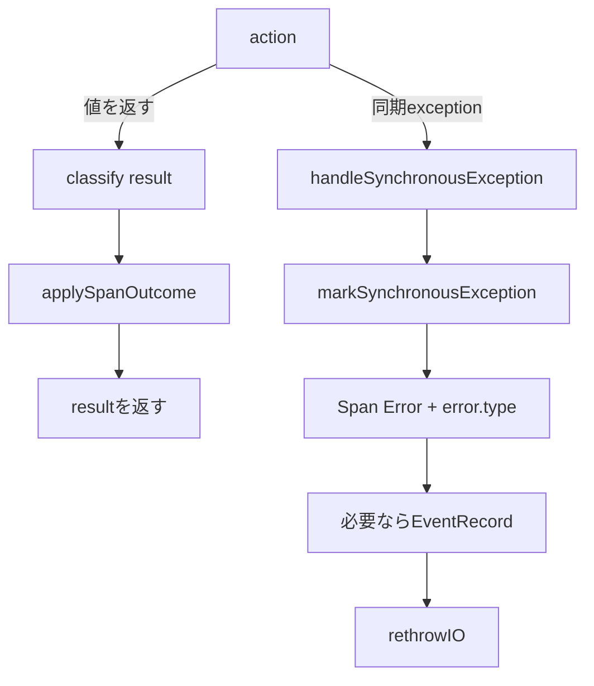

# Span実行フロー

対象: `RS-0024/exception-event-once` / `9f6517a4dc9c2fbaa70479eea8cf7c1d3a7acc78`

## `withSpan`を1回呼ぶ

RAGScope側の呼び出しはこう見える。

```haskell
withSpan
  traceBoundary
  (SpanName "some-span")
  classify
  action
```

渡しているものは3つ。

```text
Span名
結果をSpanOutcomeへ分類する関数
実際に実行したいIO action
```

`withSpan`は`TraceBoundary`の中の`SpanRunner`を取り出すだけなので、OpenTelemetry版Boundaryなら最終的に`runOpenTelemetrySpan`へ入る。



## 現在の`runOpenTelemetrySpan`

現在は次の形である。

```haskell
runOpenTelemetrySpan tracer eventRecordEmitter (SpanName spanName) classify action =
  inSpan''
    tracer
    spanName
    defaultSpanArguments
    $ \span ->
      handleSynchronousException
        eventRecordEmitter
        span
        $ do
          result <- action

          applySpanOutcome span (classify result)

          pure result
```

まずはexceptionを考えず、正常に値が返る経路だけ追う。

## 正常に値が返る場合

```text
action
  ↓
resultが返る
  ↓
classify result
  ↓
SpanOutcome
  ↓
applySpanOutcome
  ↓
元のresultを返す
```

シーケンスで見るとこうなる。



ここで大事なのは、Telemetryがapplication resultを別の値へ変換しないこと。

## `SpanSucceeded`の場合

```haskell
applySpanOutcome _ SpanSucceeded =
  pure ()
```

何もしない。

OpenTelemetry Spanの初期Statusは`Unset`なので、そのままになる。

```text
result = 42
classify 42 = SpanSucceeded

返り値 = 42
Span Status = Unset
error.type = なし
```

## application-level failureの場合

たとえばactionの型が、

```haskell
IO (Either SomeFailure Value)
```

だったとする。

そして結果が、

```haskell
Left failure
```

だった場合。

これはHaskellのexceptionではない。

普通の戻り値として`action`から返っている。

classifierが、

```haskell
classify result =
  case result of
    Left _ -> SpanFailed "some_failure"
    Right _ -> SpanSucceeded
```

なら、

```haskell
applySpanOutcome span (SpanFailed errorType)
```

へ進む。

現在の実装は、

```haskell
setStatus span $ Error ""

addAttribute
  span
  "error.type"
  errorType
```

を行う。

しかし元の`Left failure`はそのまま返す。

```text
action
  ↓
Left failure                    ← application result
  ↓ classify
SpanFailed "some_failure"       ← telemetry用の見方
  ↓
Span: Error + error.type
  ↓
Left failureをそのまま返す
```

つまり、

```text
application-level failure
```

と、

```text
Haskell exception
```

は別経路である。

## 同期exceptionの場合

今度はactionが値を返さず、

```haskell
throwIO TestException
```

した場合。

このとき、

```haskell
result <- action
```

は完了しない。

したがって、

```haskell
classify result
applySpanOutcome ...
```

にも到達しない。

代わりに外側の、

```haskell
handleSynchronousException
```

がexceptionを捕捉する。



### `handleSynchronousException`

現在は、

```haskell
handleSynchronousException eventRecordEmitter span action =
  action `catchNoPropagate` \exceptionWithContext@(ExceptionWithContext _ exception) ->
    if isSynchronousException exception
      then
        markSynchronousException
          eventRecordEmitter
          span
          exceptionWithContext
      else
        rethrowIO exceptionWithContext
```

となっている。

`catchNoPropagate`で`ExceptionWithContext SomeException`として捕捉する。

その中身が同期exceptionなら`markSynchronousException`へ渡す。

非同期exceptionなら、このRAGScope独自の同期exception処理には入れず、そのまま`rethrowIO`する。

## 同期 / 非同期をどう分けているか

```haskell
isSynchronousException :: SomeException -> Bool
isSynchronousException exception =
  case fromException exception :: Maybe SomeAsyncException of
    Just _ ->
      False
    Nothing ->
      True
```

`SomeAsyncException`として取り出せるものは非同期側、それ以外を同期側としている。

`UserInterrupt`も非同期側なので、`markSynchronousException`には入らない。

## `markSynchronousException`

この関数が、exceptionをSpan上の失敗として表現する。

まずexceptionから、

```text
exception message
exception type
```

を作る。

その後、

```haskell
setStatus
  span
  (Error exceptionMessage)
```

と、

```haskell
addAttribute
  span
  "error.type"
  exceptionType
```

を行う。

ここまでは、そのexceptionが通過した各RAGScope Spanで行う。

EventRecordだけは1件にしたいので、その後に`claimExceptionEvent`がある。

## `inSpan''`が担当していること

RAGScopeのcallbackのさらに外側にはhs-opentelemetryの`inSpan''`がいる。

今回必要な範囲では、主に次を担当する。

```text
1. 親Contextを見る
2. Spanを作る
3. そのSpanをcurrentにする
4. RAGScope callbackを実行する
5. callbackの終了を処理する
6. Spanをendする
7. 元のContextへ戻す
8. callbackの結果を返す / exceptionなら再throwする
```

正常returnなら、

```text
callbackがresultを返す
    ↓
endSpan
    ↓
Context復元
    ↓
resultを返す
```

となる。

exceptionなら、

```text
callbackからexception
    ↓
inSpan''内部でcatch
    ↓
SDK側exception handling
    ↓
endSpan
    ↓
Context復元
    ↓
exceptionを再throw
```

となる。

今回のexactly-once問題は、この「RAGScope handlerの外側に、SDK側のcatch / rethrowがもう1段ある」ことから起きている。

## nested Spanでは何が起きるか

```text
root
└─ use-case
   └─ internal
```

は、実際には`withSpan`が入れ子になっている。

概念的には、

```haskell
withSpan root $
  withSpan useCase $
    withSpan internal $
      action
```

となる。

したがってexceptionが一番内側で発生すると、stackを内側から外側へ抜ける。

```text
internalのactionでexception
    ↓
internalのhandler
    ↓
internalのinSpan''
    ↓
use-caseのhandler
    ↓
use-caseのinSpan''
    ↓
rootのhandler
    ↓
rootのinSpan''
    ↓
呼び出し元
```

この順番を頭に置いておくと、次のexactly-once問題がかなり追いやすくなる。
