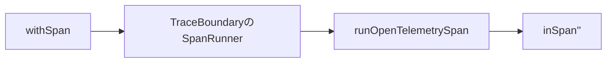

# Span実行フロー

対象: `RS-0024/exception-event-once` / `e40a998a0352214e4989a0aec5ec6ea1d65d6e8b`

## `withSpan`を1回呼ぶ

RAGScope側の呼び出しはこう見える。

```haskell
withSpan
  traceBoundary
  (SpanName "some-span")
  classify
  action
```

渡しているものは3つ。

```text
Span名
結果をSpanOutcomeへ分類する関数
実際に実行したいIO action
```

`withSpan`は`TraceBoundary`の中の`SpanRunner`を取り出すだけなので、OpenTelemetry版Boundaryなら最終的に`runOpenTelemetrySpan`へ入る。



## 現在の`runOpenTelemetrySpan`

現在は、同期exceptionだけを`inSpan''`のcallback内で一時的に値へ変換する。

```haskell
runOpenTelemetrySpan tracer eventRecordEmitter (SpanName spanName) classify action =
  mask $ \restore -> do
    exit <-
      inSpan''
        tracer
        spanName
        defaultSpanArguments
        $ \span ->
          handleSynchronousException
            eventRecordEmitter
            span
            $ restore $ do
              result <- action

              applySpanOutcome span (classify result)

              pure result

    either rethrowIO pure exit
```

ここで使うAdapter内部型は次の2つ。

```haskell
type CapturedException = ExceptionWithContext SomeException

type SpanExit result = Either CapturedException result
```

`SpanExit`の`Left`はapplication-level failureではない。

```text
Left CapturedException
  = Haskell exceptionをSDK内部だけ値として運ぶ

Right result
  = actionが普通に返したresult
```

元のresult自体が`Either failure value`でも構わない。その場合は、

```text
Right (Left failure)
```

となるので、exceptionの`Left CapturedException`とは混同しない。

## 正常に値が返る場合

```text
action
  ↓
resultが返る
  ↓
classify result
  ↓
applySpanOutcome
  ↓
Right result
  ↓
inSpan''が正常returnとして処理
  ↓
Span終了 / Context復元
  ↓
either rethrowIO pure
  ↓
pure result
```

`SpanSucceeded`なら何もしない。

```haskell
applySpanOutcome _ SpanSucceeded =
  pure ()
```

application-level failureなら、classifierが`SpanFailed errorType`へ写し、SpanをErrorにする。

```haskell
applySpanOutcome span (SpanFailed errorType) = do
  setStatus span $ Error ""
  addAttribute span "error.type" errorType
```

ただし元のapplication resultはそのまま返る。

```text
action result = Left failure
    ↓
classify = SpanFailed "some_failure"
    ↓
Span = Error
    ↓
SpanExit = Right (Left failure)
    ↓
呼び出し元にも Left failure
```

## 同期exceptionの場合

`action`が、

```haskell
throwIO TestException
```

した場合、`result <- action`は完了しない。

`handleSynchronousException`が`ExceptionWithContext SomeException`として捕捉する。

```haskell
handleSynchronousException ::
  EventRecordEmitter ->
  Span ->
  IO result ->
  IO (SpanExit result)
```

現在の本体は、

```haskell
handleSynchronousException eventRecordEmitter span action =
  (Right <$> action)
    `catchNoPropagate` \exceptionWithContext@(ExceptionWithContext _ exception) ->
      if isSynchronousException exception
        then
          Left
            <$> markSynchronousException
              eventRecordEmitter
              span
              exceptionWithContext
        else
          rethrowIO exceptionWithContext
```

同期exceptionなら、

```text
markSynchronousException
    ↓
CapturedExceptionを返す
    ↓
Left CapturedException
```

となる。

ここでは再throwしない。

## `markSynchronousException`

この関数は同期exceptionをそのSpanの失敗として記録し、必要ならexception EventRecordをemitする。

```haskell
markSynchronousException ::
  EventRecordEmitter ->
  Span ->
  CapturedException ->
  IO CapturedException
```

処理は、

```text
exception messageを作る
exception typeを作る
Span Status = Error
error.typeを付ける
EventRecordのclaimを確認
初回ならEventRecordをemit
marker付きExceptionContextを返す
```

である。

重要なのは、最後が`rethrowIO`ではなく`pure`になったこと。

```text
以前
  mark → emit → rethrowIO

現在
  mark → emit → CapturedExceptionを値として返す
```

## なぜcallback内で再throwしないのか

以前はcallbackからexceptionとして出たため、`inSpan''`自身がそのexceptionを`SomeException`としてcatchし、cleanup後に`throwIO`していた。

その経路でGHC 9.12.4の`ExceptionContext`が失われ、outer Spanで同じexceptionが未記録に見えていた。

現在は、

```text
RAGScope handler
  ↓
Left CapturedException
  ↓
inSpan''から見ると正常return
  ↓
SDKのSomeException catch / throwIO経路へ入らない
  ↓
Span終了
  ↓
Context復元
  ↓
inSpan''の外でrethrowIO
```

とする。

## EventRecord emitとrethrowの場所

ここが現在実装の中心である。

```text
EventRecord emit
  = callback内
  = 対象Spanがまだcurrent

rethrowIO
  = callback外
  = SDKがSpan終了とContext復元を終えた後
```

EventRecordをcallback外でemitするとownerがparent Spanへずれる可能性がある。

逆にrethrowをcallback内で行うと、以前のSDK exception pathへ戻ってしまう。

そのため、2つを分けている。

## `mask`と`restore`

`runOpenTelemetrySpan`の外側に、

```haskell
mask $ \restore -> do
```

がある。

ただしapplication action自体は、

```haskell
restore $ do
  result <- action
  ...
```

で元のmasking stateへ戻して実行する。

つまり、actionを常にmask状態で実行するための`mask`ではない。

同期exceptionを`Left`へ変換した後、SDKを抜けて外側の`rethrowIO`へ到達するまでの区間を守りつつ、action本体は通常どおり実行するための形である。

## 非同期exception

`SomeAsyncException`として取り出せるものは同期exception処理へ入れない。

```haskell
isSynchronousException exception =
  case fromException exception :: Maybe SomeAsyncException of
    Just _ -> False
    Nothing -> True
```

非同期exceptionなら、

```haskell
rethrowIO exceptionWithContext
```

して従来どおりSDKのexception pathへ渡す。

`UserInterrupt`などの挙動まで`SpanExit`へ変えない。

## nested Spanではどう進むか

```text
root
└─ use-case
   └─ internal
      └─ TestException
```

一番内側で同期exceptionが出ると、現在は概ね次の順で進む。

```text
internal actionでTestException
    ↓
internal handlerがcatch
    ↓
internal SpanをError
    ↓
EventRecordをemit
    ↓
marker付きCapturedExceptionをLeftで返す
    ↓
internal inSpan''が正常returnとしてSpan終了 / Context復元
    ↓
internal runOpenTelemetrySpan外側でrethrowIO
    ↓
use-case handlerが同じExceptionContextをcatch
    ↓
use-case SpanをError
    ↓
markerありなのでEventRecordはemitしない
    ↓
同じ流れでrootへ
```

この流れにより、

```text
3 Spanすべて Error
EventRecordは最初の1件だけ
元のexceptionは最終的に再throw
```

を同時に成立させることを狙っている。

次は、このexactly-onceのmarkerがなぜ必要なのかと、以前の実装でなぜ壊れたのかを見る。
