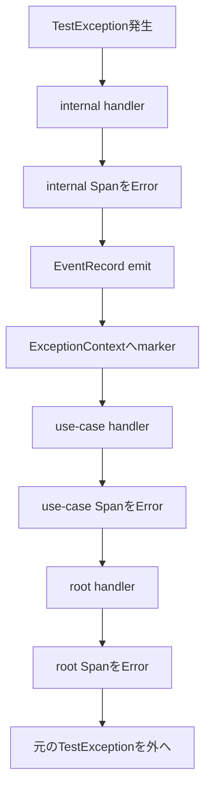
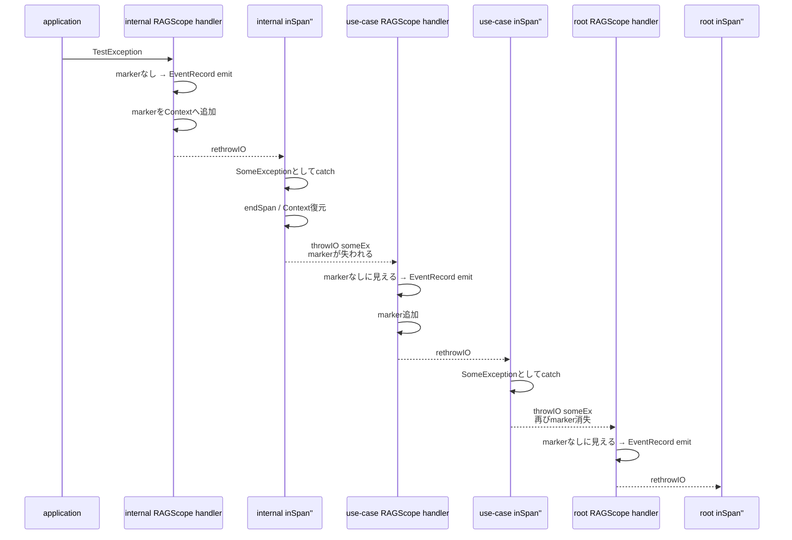

# exception伝播とEventRecord exactly-once

対象: `RS-0024/exception-event-once` / `9f6517a4dc9c2fbaa70479eea8cf7c1d3a7acc78`

## 今回やりたいこと

次のようにnested Spanの一番内側で同期exceptionが出たとする。

```text
root-span
└─ use-case-span
   └─ internal-span
      └─ TestException
```

このexceptionは3つのSpan境界をすべて外へ抜ける。

そのため、3つのSpanはそれぞれ自分の処理がexceptionで終了したことを表す。

```text
internal-span  Error + error.type
use-case-span  Error + error.type
root-span      Error + error.type
```

一方、exceptionを表すLogsの`EventRecord`は1件だけにする。

```text
exception EventRecord = 1件
owner = internal-span
```

ここでいうownerは、EventRecordに付くTraceId / SpanIdがどのSpanのものか、という意味で考えると分かりやすい。

## なぜinternal-spanがownerなのか

exceptionが最初にSpan外へ出るのは`internal-span`だから。

しかもEventRecordは、`internal-span`がcurrentな間にemitすれば、Logs SDKがcurrent Contextからinternal-spanのTraceId / SpanIdを取得する。

```text
internal-span current
    ↓
TestExceptionを捕捉
    ↓
EventRecord emit
    ↓
LogRecordにinternal-spanのTraceId / SpanId
```

EventRecordを`inSpan''`の外まで持ち出してからemitすると、その時点ではparent Contextへ戻っているためownerが変わってしまう。

## 現在の重複防止方法

現在は`ExceptionContext`へ独自annotationを付ける。

```haskell
data ExceptionEventRecorded
  = ExceptionEventRecorded
  deriving (Show)

instance ExceptionAnnotation ExceptionEventRecorded
```

考え方は単純で、

```text
annotationなし
  = まだ誰もEventRecordを記録していない

annotationあり
  = 内側のSpanですでに記録済み
```

とする。

判定は、

```haskell
claimExceptionEvent ::
  ExceptionContext ->
  Maybe ExceptionContext
```

で行う。

```text
Just updatedContext
  = 初回。markerを付けた新しいContext

Nothing
  = すでにmarkerあり
```

この判定自体はIOを使わない。

## 本来期待していた伝播

期待していたのは次の流れ。



use-caseとrootではmarkerが見えるためEventRecordを追加しない。

```text
internal
  markerなし → emit → markerありで再throw

use-case
  markerあり → emitしない → そのまま再throw

root
  markerあり → emitしない → そのまま再throw
```

これならEventRecordは1件になる。

## 実際には何が起きているか

現在のコードでは`markSynchronousException`の最後で`rethrowIO`する。

つまり、RAGScopeのhandlerからexceptionとして`inSpan''` callbackの外へ出る。

しかし`inSpan''`の外側には、hs-opentelemetry自身のexception handlerがある。

簡略化すると、SDK側は次のような流れになっている。

```haskell
restore (run $ f s)
  `catch` \someEx@(SomeException inner) -> do
    ...
    endSpan s Nothing
    writeIORef ctxRef entry
    throwIO someEx
```

ここで重要なのは、RAGScopeが再throwしたものが、そのまま次のRAGScope handlerへ届くわけではないこと。

間に、

```text
hs-opentelemetryがSomeExceptionとしてcatch
    ↓
Span終了
    ↓
Context復元
    ↓
throwIO someEx
```

が入る。

## `SomeException`で何が失われるのか

GHC 9.12.4の`Exception SomeException` instanceは、`toException`するときに付いていた`ExceptionContext`を落とす。

概念的には、

```text
SomeException
  + ExceptionContext(markerあり)

      ↓ SDKのthrowIO someEx

SomeException
  + 新しい空のExceptionContext
```

となる。

一方、`rethrowIO`は`ExceptionWithContext`として保持している既存Contextを使って再throwするため、RAGScope handler単独ならmarkerを維持できる。

問題は、その後SDKがもう一度`SomeException`としてthrowし直していること。

## 3件になる実際の流れ



結果、

```text
internal = 1件
use-case = 1件
root = 1件
合計 = 3件
```

となる。

現在の失敗テスト、

```text
expected exactly one exported LogRecord, but got 3
```

と一致する。

## Span Eventが0件なのは別の仕組み

hs-opentelemetryは通常、callbackからexceptionが出ると自動でexception Span Eventを記録する。

RAGScopeでは独自にLogsの`EventRecord`を記録するため、同期exceptionについてSDK側の自動Span Eventを抑止している。

Tracer作成時に、

```haskell
tracerExceptionHandlerOptions =
  [ ignoreSynchronousException
  , ignoreIntentionalInterruption
  ]
```

を設定している。

ここで注意すること。

```text
SDKのexception記録をignoreする
```

ことと、

```text
SDKがexceptionをcatch / rethrowしなくなる
```

ことは同じではない。

ignoreしても`inSpan''`自身のcatch / cleanup / rethrow経路は残る。

そのためignore設定だけではmarker消失問題は直らない。

## recoveryケースはなぜ成功するのか

次のケースを考える。

```text
root
└─ use-case
   └─ internal
      └─ TestException
         ↓
      internal-span外へ出る
         ↓
   use-caseのapplication codeがcatchして復旧
```

ここではexceptionは`internal-span`の`inSpan''`を抜けたあと、use-caseの`withSpan`自体を抜ける前にapplication codeがcatchする。

概念的には、

```haskell
withSpan useCase $ do
  withSpan internal
    (throwIO TestException)
    `catch` \TestException ->
      pure ()
```

となる。

流れは、

```text
internal handler
  ↓
internal Span Error
  ↓
EventRecord 1件
  ↓
internal inSpan''が再throw
  ↓
application codeがcatch
  ↓
()
  ↓
use-case actionは普通に値を返す
```

となる。

そのため、use-case側の`handleSynchronousException`までexceptionが届かない。

```text
internal = Error
use-case = Unset
root = Unset
EventRecord = 1件
```

となる。

このケースではmarkerがSDK再throwで消えていても、その後outer handlerがexceptionを見ること自体がないため重複が表面化しない。

## 「各SpanをError」と「EventRecordは1件」は別の制御

ここはかなり大事。

```text
Span Error設定
  = exceptionがそのSpan境界を外へ抜けたか

EventRecord emit
  = 同じexception propagationですでに誰かが記録したか
```

3 SpanすべてErrorにしたいので、Error設定はclaimの外側で毎回行う。

```text
internal  Error
use-case Error
root     Error
```

一方、EventRecordはclaimに成功した最初の1回だけ。

```text
internal  emit
use-case emitしない
root     emitしない
```

この2つを同じ条件にしてはいけない。

## 未採用の修正案は何を変えるのか

現在検討している案は、marker方式そのものを捨てる案ではない。

壊れているのは、marker付き`ExceptionContext`を外側へ渡す途中の経路。

そこで、hs-opentelemetry内部を通る短い区間だけexceptionを値へ変える。

```haskell
type CapturedException =
  ExceptionWithContext SomeException

type SpanExit result =
  Either CapturedException result
```

狙いは、

```text
RAGScope handler
  ↓
marker付きexceptionをLeftとして返す
  ↓
inSpan''から見るとcallback正常return
  ↓
SDKはSomeException catch / throwIO経路へ入らない
  ↓
Span終了 / Context復元
  ↓
inSpan''の外でrethrowIO
```

とすること。

つまり、

```text
EventRecord emit
  = Spanがcurrentなcallback内

rethrowIO
  = SDKがSpanを終了したcallback外
```

に分離する。

これはまだ現在コードではない。

現在コードを理解するときは、まず

```text
callback内でrethrowIOしている
    ↓
SDKのexception pathへ入っている
```

ところまで押さえる。
