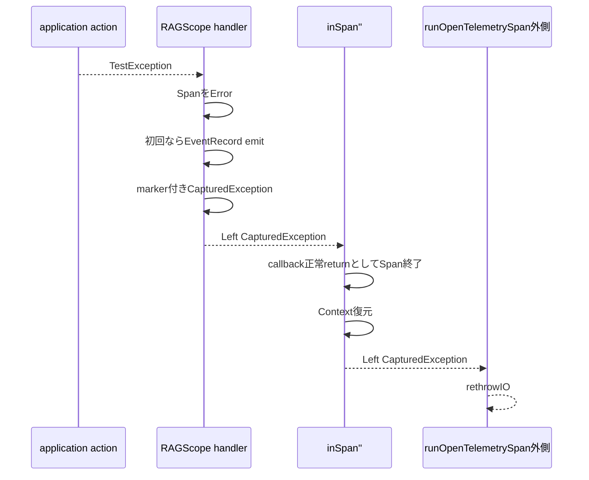

# exception伝播とEventRecord exactly-once

対象: `RS-0024/exception-event-once` / `e40a998a0352214e4989a0aec5ec6ea1d65d6e8b`

## 今回やりたいこと

nested Spanの一番内側で同期exceptionが出たとする。

```text
root-span
└─ use-case-span
   └─ internal-span
      └─ TestException
```

このexceptionが3つのSpan境界をすべて外へ抜けるなら、3 Spanはそれぞれ自分の処理がexceptionで終了したことを表す。

```text
internal-span  Error + error.type
use-case-span  Error + error.type
root-span      Error + error.type
```

一方、同じexceptionを表すLogsの`EventRecord`は1件だけにする。

```text
exception EventRecord = 1件
owner = internal-span
```

ownerとは、そのEventRecordに関連付くTraceId / SpanIdがどのSpanのものか、という意味である。

## なぜinternal-spanがownerなのか

exceptionが最初にSpan外へ出るのは`internal-span`だからである。

EventRecordを`internal-span`がcurrentな間にemitすると、Logs SDKはcurrent Contextからinternal-spanのTraceId / SpanIdを使える。

```text
internal-span current
    ↓
TestExceptionを捕捉
    ↓
EventRecord emit
    ↓
LogRecordにinternal-spanのTraceId / SpanId
```

EventRecordを`inSpan''`の外まで持ち出してからemitすると、すでにparent Contextへ戻っているためownerが変わる可能性がある。

## 重複防止に使うmarker

同じexception propagationでEventRecordを何度も記録しないため、`ExceptionContext`へ独自annotationを付ける。

```haskell
data ExceptionEventRecorded
  = ExceptionEventRecorded
  deriving (Show)

instance ExceptionAnnotation ExceptionEventRecorded
```

意味は、

```text
annotationなし
  = このexception propagationではまだEventRecord未記録

annotationあり
  = 内側のSpanですでにEventRecord記録済み
```

である。

判定は純粋関数で行う。

```haskell
claimExceptionEvent ::
  ExceptionContext ->
  Maybe ExceptionContext
```

```text
Just claimedContext
  = 初回
  = markerを追加したContext

Nothing
  = すでにmarkerあり
```

## 以前なぜ3件になっていたのか

commit `9f6517a4...`までの実装では、`markSynchronousException`の最後で`rethrowIO`していた。

```text
internal handler
    ↓
EventRecord emit
    ↓
ExceptionContextへmarker
    ↓
rethrowIO
    ↓
inSpan'' callbackからexceptionとして出る
```

その外側でhs-opentelemetryの`inSpan''`が、exceptionを`SomeException`としてcatchし、Span終了とContext復元の後に`throwIO someEx`していた。

GHC 9.12.4の`Exception SomeException`では、この再throw時に元の`ExceptionContext`が保持されない。

そのためouter Spanから見ると、

```text
marker付きexception
    ↓ SDK catch / throwIO
markerなしに見えるexception
```

となっていた。

結果は、

```text
internal  markerなし → emit
use-case markerなしに見える → emit
root     markerなしに見える → emit

合計3件
```

だった。

## 現在の修正

現在は、同期exceptionをSDK内部を通る短い区間だけ値へ変換する。

```haskell
type CapturedException =
  ExceptionWithContext SomeException

type SpanExit result =
  Either CapturedException result
```

流れは次のようになった。



`inSpan''`から見るとcallbackはexceptionを投げていない。

そのため、問題だったSDK内部の、

```text
SomeExceptionとしてcatch
↓
throwIO someEx
```

の経路へ入らない。

## EventRecord emitとrethrowを分ける

現在実装で特に重要なのはここである。

```text
EventRecord emit
  = Span callback内
  = owner Spanがcurrentな間

rethrowIO
  = inSpan''の外
  = SDKがSpan終了とContext復元を終えた後
```

両方をcallback内で行うと以前のSDK exception pathへ入る。

両方をcallback外で行うとEventRecordのownerがずれる可能性がある。

そのため、

```text
記録は内側
再throwは外側
```

に分けている。

## nested Spanでの現在の期待経路

```text
internal actionでTestException
    ↓
internal handler
    ↓
internal Span Error
    ↓
markerなし → EventRecord emit → marker追加
    ↓
Left CapturedException
    ↓
internal inSpan''正常return / Context復元
    ↓
rethrowIO
    ↓
use-case handler
    ↓
use-case Span Error
    ↓
markerあり → EventRecordなし
    ↓
Left CapturedException
    ↓
use-case inSpan''正常return / Context復元
    ↓
rethrowIO
    ↓
root handler
    ↓
root Span Error
    ↓
markerあり → EventRecordなし
    ↓
最終的に元のTestExceptionを外へ再throw
```

これにより狙っている結果は、

```text
internal = Error
use-case = Error
root = Error
EventRecord = 1件
owner = internal
元のTestExceptionを維持
```

である。

## recoveryケース

```text
root
└─ use-case
   └─ internal
      └─ TestException
         ↓
      internalを抜ける
         ↓
   use-case内のapplication codeがcatch
```

internal Spanでは、

```text
Span Error
EventRecord 1件
rethrowIO
```

まで行う。

しかしそのexceptionをuse-case action内部のapplication codeがcatchして復旧すれば、use-caseの`handleSynchronousException`までは届かない。

したがって期待は、

```text
internal = Error
use-case = Unset
root = Unset
EventRecord = 1件
```

のままである。

## Span ErrorとEventRecord exactly-onceは別条件

```text
Span Error設定
  = exceptionがそのSpan境界を外へ抜けたか

EventRecord emit
  = 同じexception propagationですでに記録済みか
```

3 SpanすべてをErrorにする場合でも、EventRecordは1件だけにできる。

```text
internal  Error + emit
use-case Error + emitしない
root     Error + emitしない
```

この2つを同じclaim条件へまとめない。

## Span Eventを0件にする仕組み

RAGScopeでは同期exceptionをLogsの`EventRecord`で記録するため、SDK側の自動exception Span Eventを抑止している。

```haskell
tracerExceptionHandlerOptions =
  [ ignoreSynchronousException
  , ignoreIntentionalInterruption
  ]
```

このignoreは、

```text
SDKの自動Span Eventを抑える
```

ためのもの。

```text
exception propagation自体を止める
```

設定ではない。

## 現時点の検証状態

commit `e40a998a...`では`SpanExit`方式のproduction変更が入っている。

ただし、このノート更新時点では変更後の`make check-app`結果をまだ確認していない。

したがって、

```text
設計・実装上の狙い
  = exactly-onceを成立させる

実測結果
  = これから既存テストで確認
```

と分けて扱う。
