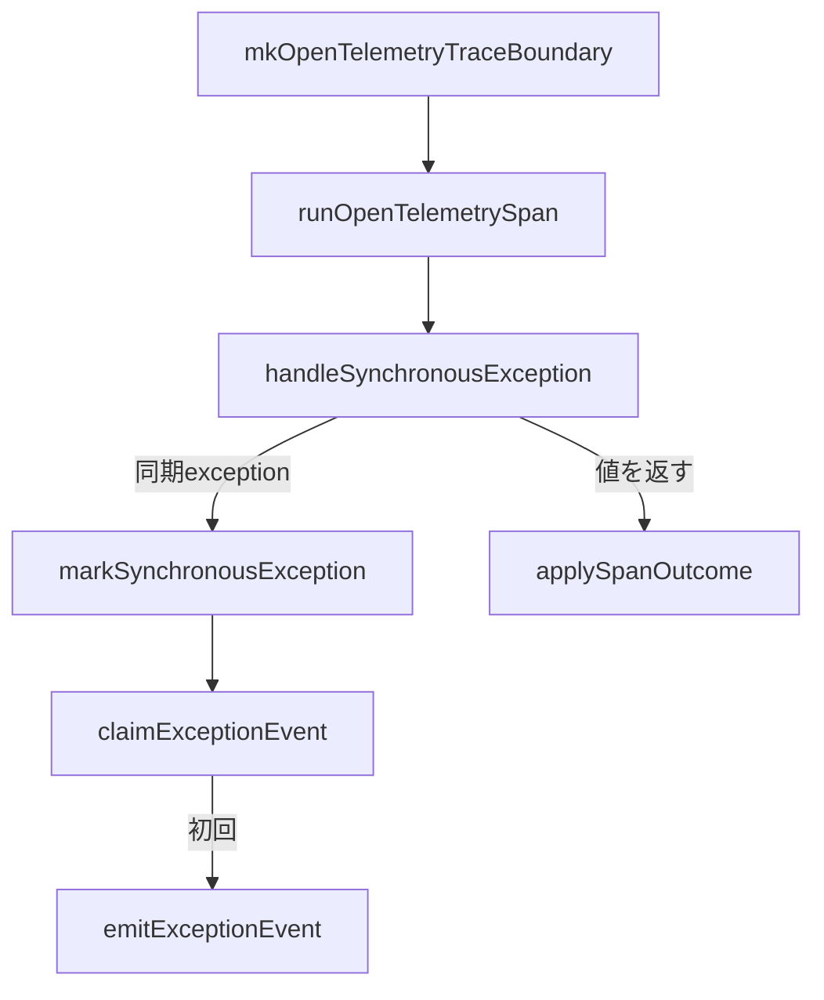

# Trace Adapterコード読解

対象ファイル: `ragscope-app/opentelemetry-adapter/RAGScope/Telemetry/OpenTelemetry/Trace.hs`

対象commit: `9f6517a4dc9c2fbaa70479eea8cf7c1d3a7acc78`

## まず呼び出し関係だけ見る



このファイルは大きく、

```text
1. Tracerを準備する
2. Spanの中でactionを実行する
3. 正常な戻り値をSpanへ反映する
4. 同期exceptionをSpanへ反映する
5. exception EventRecordの重複を防ぐ
```

を行っている。

## 1. `ExceptionEventRecorded`

```haskell
data ExceptionEventRecorded
  = ExceptionEventRecorded
  deriving (Show)

instance ExceptionAnnotation ExceptionEventRecorded
```

これはexceptionの種類ではない。

`TestException`や`IOException`の代わりになるものでもない。

`ExceptionContext`へ追加するmarkerである。

意味は、

```text
このexception propagationでは、
exception EventRecordをすでに記録した
```

という状態。

exception値そのものではなくContextに付けるのは、同じexception型でも別々のthrowは別の伝播だから。

```text
TestException A の伝播
  markerあり

後で新しくthrowされた TestException B
  markerなし
```

という状態を表せる。

## 2. `mkOpenTelemetryTraceBoundary`

型は、

```haskell
mkOpenTelemetryTraceBoundary ::
  TracerProvider ->
  EventRecordEmitter ->
  TraceBoundary
```

この関数は初期化側から、

```text
TracerProvider
EventRecordをemitする関数
```

を受け取る。

中で、

```haskell
tracer =
  makeTracer
    tracerProvider
    "ragscope"
    tracerOptions
      { tracerExceptionHandlerOptions =
          [ ignoreSynchronousException
          , ignoreIntentionalInterruption
          ]
      }
```

としてTracerを作る。

このTracerにはSDK側exception handlingの設定も入っている。

### `ignoreSynchronousException`

RAGScopeが同期exceptionを自分で、

```text
Status Error
error.type
Logs EventRecord
```

として処理するため、SDKに追加のexception Span Eventを作らせない。

### `ignoreIntentionalInterruption`

`UserInterrupt`をSpan Errorとして扱わないための設定。

## 3. `runOpenTelemetrySpan`

型は、

```haskell
runOpenTelemetrySpan ::
  Tracer ->
  EventRecordEmitter ->
  SpanRunner
```

`SpanRunner`を展開すると、実質的には、

```haskell
Tracer ->
EventRecordEmitter ->
SpanName ->
(result -> SpanOutcome) ->
IO result ->
IO result
```

という関数になる。

この関数が、RAGScopeの`withSpan`とOpenTelemetryの`inSpan''`を繋ぐ中心。

現在の本体は、

```haskell
runOpenTelemetrySpan tracer eventRecordEmitter (SpanName spanName) classify action =
  inSpan''
    tracer
    spanName
    defaultSpanArguments
    $ \span ->
      handleSynchronousException
        eventRecordEmitter
        span
        $ do
          result <- action

          applySpanOutcome span (classify result)

          pure result
```

となっている。

読む順番は、

```text
inSpan''でSpan scopeを作る
    ↓
callbackとしてSpanを受け取る
    ↓
handleSynchronousExceptionでactionを包む
    ↓
actionを1回実行
    ↓
値が返ればclassify
    ↓
applySpanOutcome
    ↓
元のresultを返す
```

でよい。

## 4. `applySpanOutcome`

```haskell
applySpanOutcome _ SpanSucceeded =
  pure ()
```

成功なら何もしない。

```haskell
applySpanOutcome span (SpanFailed errorType) = do
  setStatus span $ Error ""

  addAttribute
    span
    "error.type"
    errorType
```

application-level failureなら、SpanをErrorにして`error.type`を付ける。

ここで扱うのは、exceptionではなく「actionが普通に返したresultの分類」。

この区別を崩さない。

## 5. `handleSynchronousException`

型は、

```haskell
handleSynchronousException ::
  EventRecordEmitter ->
  Span ->
  IO result ->
  IO result
```

入力された`IO result`を実行し、exceptionが出なければそのまま`result`を返す。

exceptionが出た場合だけhandlerへ入る。

```haskell
action `catchNoPropagate` \exceptionWithContext@(ExceptionWithContext _ exception) ->
  ...
```

ここで受け取るのは、

```haskell
ExceptionWithContext SomeException
```

である。

### なぜ`catchNoPropagate`なのか

このhandlerはexceptionを処理済みにして終わるのではなく、最終的に再throwする。

そのため、捕捉した元の`ExceptionContext`を明示的に保持したい。

通常の`catch`のようにhandler実行そのものへ追加の伝播annotationを付けるのではなく、元Contextを扱うため`catchNoPropagate`を使っている。

### 分岐

```haskell
if isSynchronousException exception
  then markSynchronousException ...
  else rethrowIO exceptionWithContext
```

同期exceptionだけをRAGScope独自処理へ入れる。

非同期exceptionはそのまま再throw。

## 6. `markSynchronousException`

この関数が同期exception処理の中心。

現在の型は、

```haskell
markSynchronousException ::
  EventRecordEmitter ->
  Span ->
  ExceptionWithContext SomeException ->
  IO result
```

`IO result`になっているのは、この関数が最後に必ず再throwし、正常な値を返さないから。

### exception message

```haskell
exceptionMessage =
  Text.pack $
    displayException inner
```

Span Status DescriptionとEventRecordの`exception.message`に使う。

### exception type

```haskell
exceptionType =
  Text.pack $
    show $
      typeOf inner
```

Spanの`error.type`とEventRecordの`exception.type`に使う。

### SpanをErrorにする

```haskell
setStatus
  span
  (Error exceptionMessage)
```

```haskell
addAttribute
  span
  "error.type"
  exceptionType
```

ここはclaim判定より前。

したがって、EventRecordをすでに内側で記録していても、outer Span自身はErrorにできる。

## 7. `claimExceptionEvent`

```haskell
claimExceptionEvent ::
  ExceptionContext ->
  Maybe ExceptionContext
```

IOではない純粋な関数。

現在Contextに、

```haskell
ExceptionEventRecorded
```

があるかを見る。

```haskell
case getExceptionAnnotations @ExceptionEventRecorded exceptionContext of
  [] ->
    Just $
      addExceptionAnnotation
        ExceptionEventRecorded
        exceptionContext
  _ ->
    Nothing
```

つまり、

```text
[]
  = markerなし
  = 自分が最初
  = markerを付けたContextを返す

_ 
  = markerあり
  = 内側ですでに記録済み
  = Nothing
```

となる。

## 8. `markSynchronousException`のclaim後

すでにmarkerがある場合、

```haskell
Nothing ->
  rethrowIO exceptionWithContext
```

EventRecordを追加せず、元Contextのまま再throwする。

初回なら、

```haskell
Just claimedContext -> do
  emitExceptionEvent
    eventRecordEmitter
    exceptionType
    exceptionMessage

  rethrowIO $
    ExceptionWithContext
      claimedContext
      exception
```

となる。

順番が重要。

```text
EventRecord emit
    ↓
marker付きContextでrethrow
```

emitはまだこのSpanがcurrentな間に行われる。

## 9. `emitExceptionEvent`

```haskell
emitExceptionEvent eventRecordEmitter exceptionType exceptionMessage =
  eventRecordEmitter $
    EventRecord
      { eventName = exceptionEventName
      , eventTimestamp = EventNow
      , eventSeverity = Logs.Error
      , eventAttributes =
          Map.fromList
            [ ("exception.type", LogText exceptionType)
            , ("exception.message", LogText exceptionMessage)
            ]
      }
```

ここではOpenTelemetryの`Logger`を直接使っていない。

RAGScope側の`EventRecord`を作り、注入された`EventRecordEmitter`へ渡すだけ。

実際のOpenTelemetry LogRecordへの変換はLogs Adapter側。

## 10. `exceptionEventName`

```haskell
exceptionEventName :: EventName
exceptionEventName =
  case mkEventName "exception" of
    Right eventName ->
      eventName
    Left failure ->
      error ...
```

`EventName` constructorは外へ公開されていないため、`mkEventName`を通す。

`"exception"`は静的な非空文字列なので、ここで失敗するのはプログラム上の不整合と扱っている。

## 11. `ignoreSynchronousException`

```haskell
ignoreSynchronousException :: ExceptionHandler
ignoreSynchronousException =
  ignoreExceptionMatching @SomeException isSynchronousException
```

これは「同期exceptionを無視して何もしない」という意味ではない。

RAGScope側ですでに処理するので、SDK側の自動exception記録対象から外す設定。

RAGScope側の、

```text
handleSynchronousException
markSynchronousException
```

は普通に動く。

## 12. `ignoreIntentionalInterruption`

```haskell
ignoreIntentionalInterruption :: ExceptionHandler
ignoreIntentionalInterruption =
  ignoreExceptionMatching @AsyncException (== UserInterrupt)
```

`UserInterrupt`をOpenTelemetry SDK側でもerrorとして自動記録しないための設定。

RAGScope側の`handleSynchronousException`でも`SomeAsyncException`は同期exception扱いしないため、`UserInterrupt`はそのまま再throwされる。

## 13. `isSynchronousException`

```haskell
isSynchronousException :: SomeException -> Bool
isSynchronousException exception =
  case fromException exception :: Maybe SomeAsyncException of
    Just _ ->
      False
    Nothing ->
      True
```

ここで「同期exception」をpositiveに列挙しているわけではない。

```text
SomeAsyncExceptionとして取り出せる
  → 非同期

取り出せない
  → 同期
```

という分類。

## このファイルを一言で読むなら

```text
mkOpenTelemetryTraceBoundary
  = ProviderからRAGScope用Tracerを準備してBoundaryを作る

runOpenTelemetrySpan
  = 1 Spanの実行全体を組み立てる

applySpanOutcome
  = 普通に返ったresultをSpanへ反映する

handleSynchronousException
  = exception経路を正常値経路から分ける

markSynchronousException
  = Span Errorとexception EventRecordを処理する

claimExceptionEvent
  = EventRecordの最初の記録者か純粋に判定する

emitExceptionEvent
  = RAGScope EventRecordを作ってLogs側へ渡す
```

現在のexactly-once bugを読むときは、`claimExceptionEvent`だけを見るのではなく、

```text
markSynchronousExceptionのrethrowIO
    ↓
inSpan''内部のcatch / throwIO
    ↓
outer handleSynchronousException
```

までを1つの経路として追う。
