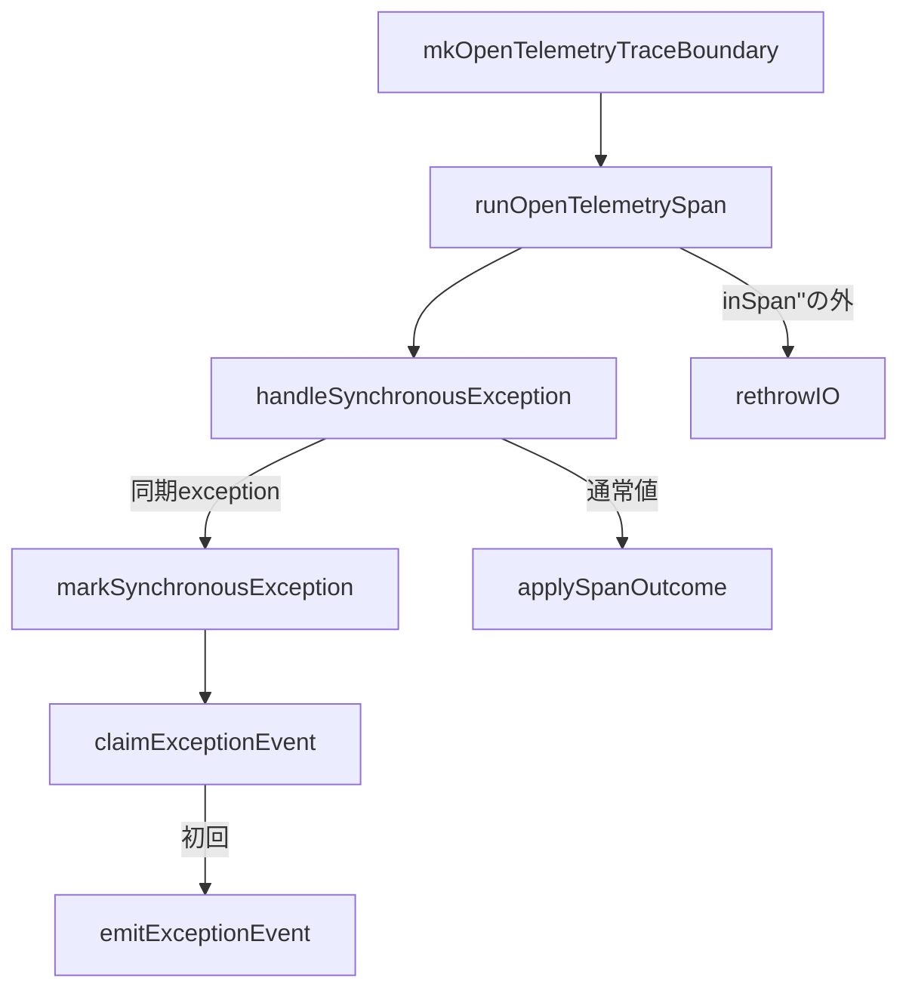

# Trace Adapterコード読解

対象ファイル: `ragscope-app/opentelemetry-adapter/RAGScope/Telemetry/OpenTelemetry/Trace.hs`

対象commit: `e40a998a0352214e4989a0aec5ec6ea1d65d6e8b`

## まず呼び出し関係だけ見る



このファイルは大きく、

```text
1. Tracerを準備する
2. Spanの中でactionを実行する
3. 普通に返ったresultをSpanへ反映する
4. 同期exceptionをSpanへ反映する
5. exception EventRecordの重複を防ぐ
6. 同期exceptionをSDK内だけ値として運び、Span終了後に再throwする
```

を行っている。

## 1. Logs境界への依存

このmoduleはTraceだけで閉じていない。

```haskell
import RAGScope.Telemetry.Logs (
  EventName,
  EventRecord (..),
  EventRecordEmitter,
  EventTimestamp (EventNow),
  LogValue (LogText),
  mkEventName,
 )
import RAGScope.Telemetry.Logs qualified as Logs
```

同期exceptionがSpan外へ出るとき、SpanをErrorにするだけでなくLogsのexception EventRecordも記録するためである。

ただし`RAGScope.Telemetry.OpenTelemetry.Logs`はimportしていない。

```text
Trace Adapter
    ↓
RAGScope.Telemetry.LogsのSDK非依存型 / EventRecordEmitter
```

までの依存である。

## 2. Adapter内部型

```haskell
type CapturedException = ExceptionWithContext SomeException
```

これは、元のexceptionと、そのexception propagationに付いている`ExceptionContext`をまとめて保持する型である。

```haskell
type SpanExit result = Either CapturedException result
```

これは`inSpan''` callbackから外へ出すためのAdapter内部表現。

```text
Left CapturedException
  = 同期exception

Right result
  = actionが普通に返した値
```

application result自体が`Either failure value`でも、

```text
Right (Left failure)
```

になるため混同しない。

## 3. `ExceptionEventRecorded`

```haskell
data ExceptionEventRecorded
  = ExceptionEventRecorded
  deriving (Show)

instance ExceptionAnnotation ExceptionEventRecorded
```

これはexceptionの種類ではない。

`ExceptionContext`へ付けるmarkerで、

```text
このexception propagationでは
exception EventRecordをすでに記録した
```

という状態を表す。

## 4. `mkOpenTelemetryTraceBoundary`

```haskell
mkOpenTelemetryTraceBoundary ::
  TracerProvider ->
  EventRecordEmitter ->
  TraceBoundary
```

初期化側から、

```text
TracerProvider
EventRecordをemitする関数
```

を受け取る。

Tracerは、

```haskell
tracer =
  makeTracer
    tracerProvider
    "ragscope"
    tracerOptions
      { tracerExceptionHandlerOptions =
          [ ignoreSynchronousException
          , ignoreIntentionalInterruption
          ]
      }
```

で作る。

`ignoreSynchronousException`は、RAGScope自身が同期exceptionをSpan StatusとLogs EventRecordで処理するため、SDKに同じexception Span Eventを追加させない設定。

`ignoreIntentionalInterruption`は`UserInterrupt`をSpan Errorとして自動記録させない設定。

## 5. `runOpenTelemetrySpan`

```haskell
runOpenTelemetrySpan ::
  Tracer ->
  EventRecordEmitter ->
  SpanRunner
```

現在の本体は、

```haskell
runOpenTelemetrySpan tracer eventRecordEmitter (SpanName spanName) classify action =
  mask $ \restore -> do
    exit <-
      inSpan''
        tracer
        spanName
        defaultSpanArguments
        $ \span ->
          handleSynchronousException
            eventRecordEmitter
            span
            $ restore $ do
              result <- action

              applySpanOutcome span (classify result)

              pure result

    either rethrowIO pure exit
```

読む順番は、

```text
maskで外側を組み立てる
    ↓
inSpan''でSpan scopeを作る
    ↓
callbackでSpanを受け取る
    ↓
handleSynchronousExceptionでactionを包む
    ↓
actionをrestoreして実行
    ↓
値ならapplySpanOutcome
exceptionならCapturedExceptionへ変換
    ↓
SpanExitをinSpan''から返す
    ↓
Span終了 / Context復元
    ↓
either rethrowIO pure
```

でよい。

## 6. `mask`と`restore`

```haskell
mask $ \restore -> do
```

と書いてあるが、application actionそのものをmask状態で固定しているわけではない。

```haskell
restore $ do
  result <- action
  ...
```

としているので、actionは元のmasking stateで動く。

この形で守りたいのは、同期exceptionを`Left`へ変換したあと、SDKを抜けて外側の`rethrowIO`へ到達するまでの処理である。

## 7. `applySpanOutcome`

成功なら何もしない。

```haskell
applySpanOutcome _ SpanSucceeded =
  pure ()
```

application-level failureなら、

```haskell
applySpanOutcome span (SpanFailed errorType) = do
  setStatus span $ Error ""
  addAttribute span "error.type" errorType
```

とする。

ここで扱うのはexceptionではなく、actionが普通に返したresultの分類。

## 8. `handleSynchronousException`

```haskell
handleSynchronousException ::
  EventRecordEmitter ->
  Span ->
  IO result ->
  IO (SpanExit result)
```

現在は、

```haskell
handleSynchronousException eventRecordEmitter span action =
  (Right <$> action)
    `catchNoPropagate` \exceptionWithContext@(ExceptionWithContext _ exception) ->
      if isSynchronousException exception
        then
          Left
            <$> markSynchronousException
              eventRecordEmitter
              span
              exceptionWithContext
        else
          rethrowIO exceptionWithContext
```

となっている。

値が返れば、

```text
result
↓
Right result
```

同期exceptionなら、

```text
ExceptionWithContext SomeException
↓
markSynchronousException
↓
CapturedException
↓
Left CapturedException
```

になる。

非同期exceptionはこの`SpanExit`経路へ入れず、そのまま`rethrowIO`する。

## 9. `markSynchronousException`

```haskell
markSynchronousException ::
  EventRecordEmitter ->
  Span ->
  CapturedException ->
  IO CapturedException
```

以前の`IO result`ではない。

現在はexceptionをその場で再throwせず、更新した`CapturedException`を返す。

まず、

```haskell
exceptionMessage =
  Text.pack $
    displayException inner

exceptionType =
  Text.pack $
    show $
      typeOf inner
```

を作る。

その後、

```haskell
setStatus
  span
  (Error exceptionMessage)

addAttribute
  span
  "error.type"
  exceptionType
```

で、そのSpan自身をErrorとして記録する。

ここはEventRecordのclaimより前なので、outer Spanでも毎回実行される。

## 10. `claimExceptionEvent`

```haskell
claimExceptionEvent ::
  ExceptionContext ->
  Maybe ExceptionContext
```

純粋関数である。

```haskell
case getExceptionAnnotations @ExceptionEventRecorded exceptionContext of
  [] ->
    Just $
      addExceptionAnnotation
        ExceptionEventRecorded
        exceptionContext
  _ ->
    Nothing
```

つまり、

```text
markerなし
  → Just marker付きContext

markerあり
  → Nothing
```

となる。

## 11. claim後

すでにmarkerがある場合は、

```haskell
Nothing ->
  pure exceptionWithContext
```

でそのまま返す。

初回なら、

```haskell
Just claimedContext -> do
  emitExceptionEvent
    eventRecordEmitter
    exceptionType
    exceptionMessage

  pure $
    ExceptionWithContext
      claimedContext
      exception
```

となる。

以前と違い、ここでは`rethrowIO`しない。

これによりmarker付き`ExceptionContext`を`Left`の値としてSDK外まで運べる。

## 12. `emitExceptionEvent`

```haskell
emitExceptionEvent eventRecordEmitter exceptionType exceptionMessage =
  eventRecordEmitter $
    EventRecord
      { eventName = exceptionEventName
      , eventTimestamp = EventNow
      , eventSeverity = Logs.Error
      , eventAttributes =
          Map.fromList
            [ ("exception.type", LogText exceptionType)
            , ("exception.message", LogText exceptionMessage)
            ]
      }
```

ここがTrace AdapterからLogs境界への直接依存が見える場所である。

OpenTelemetryの`Logger`を直接使っているのではなく、RAGScope側の`EventRecord`を作り、注入された`EventRecordEmitter`へ渡す。

この関数は`inSpan''` callback内で呼ばれるため、owner Spanがまだcurrentである。

## 13. `exceptionEventName`

```haskell
exceptionEventName :: EventName
exceptionEventName =
  case mkEventName "exception" of
    Right eventName ->
      eventName
    Left failure ->
      error ...
```

`EventName` constructorは隠されているため`mkEventName`を通す。

`"exception"`は静的な非空文字列なので、失敗した場合はプログラム上の不整合としている。

## 14. callback外の`rethrowIO`

`inSpan''`が返したあと、

```haskell
either rethrowIO pure exit
```

を実行する。

ここで初めて同期exceptionをexceptionとして戻す。

```text
callback内
  mark / emit / Left化

inSpan''
  Span終了 / Context復元

callback外
  rethrowIO
```

この配置がexactly-once修正の中心である。

## 15. `ignoreSynchronousException`

```haskell
ignoreSynchronousException :: ExceptionHandler
ignoreSynchronousException =
  ignoreExceptionMatching @SomeException isSynchronousException
```

これは同期exceptionそのものを無視する処理ではない。

SDKの自動exception Span Eventを抑止する設定である。

RAGScope側の、

```text
handleSynchronousException
markSynchronousException
```

は通常どおり動く。

## 16. `ignoreIntentionalInterruption`

```haskell
ignoreIntentionalInterruption :: ExceptionHandler
ignoreIntentionalInterruption =
  ignoreExceptionMatching @AsyncException (== UserInterrupt)
```

`UserInterrupt`をSDK側でもerrorとして自動記録しないための設定。

RAGScope側でも`SomeAsyncException`は同期exception扱いしない。

## 17. `isSynchronousException`

```haskell
isSynchronousException :: SomeException -> Bool
isSynchronousException exception =
  case fromException exception :: Maybe SomeAsyncException of
    Just _ ->
      False
    Nothing ->
      True
```

```text
SomeAsyncExceptionとして取り出せる
  → 非同期

取り出せない
  → 同期
```

という分類である。

## このファイルを一言で読むなら

```text
mkOpenTelemetryTraceBoundary
  = TracerとEventRecordEmitterを組み合わせてTraceBoundaryを作る

runOpenTelemetrySpan
  = 1 Spanの実行全体とexception再throwの位置を組み立てる

applySpanOutcome
  = 普通に返ったresultをSpanへ反映する

handleSynchronousException
  = 同期exceptionをSpanExitのLeftへ変える

markSynchronousException
  = Span Errorとexception EventRecordを処理し、CapturedExceptionを返す

claimExceptionEvent
  = EventRecordの最初の記録者か判定する

emitExceptionEvent
  = RAGScope EventRecordを作ってLogs側のEmitterへ渡す
```

現在のexactly-once実装を読むときは、

```text
markSynchronousException
    ↓
Left CapturedException
    ↓
inSpan''正常return
    ↓
either rethrowIO pure
    ↓
outer handleSynchronousException
```

までを1つの経路として追う。
