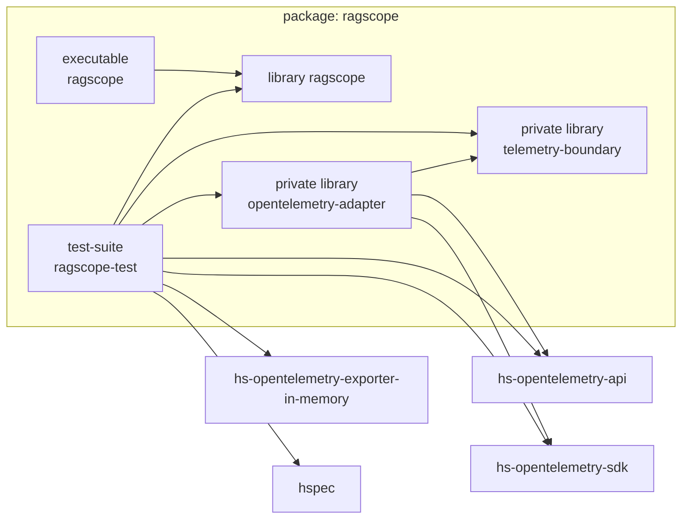
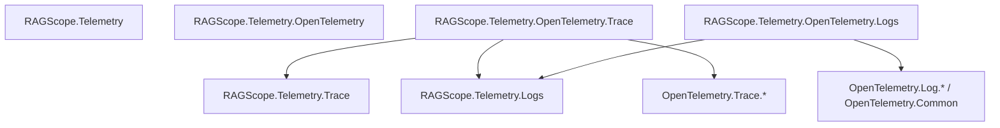

# 現在の静的依存マップ

対象: `RAGScope` branch `RS-0024/exception-event-once` / commit `e40a998a0352214e4989a0aec5ec6ea1d65d6e8b`

このノートは、現在の`ragscope.cabal`とHaskellの実importから読める静的依存だけを載せる。未実装のmodule候補は[[08 未実装の設計候補]]へ分ける。

## Cabal component



現在の直接依存は次の通り。

| component | RAGScope内の直接依存 | OpenTelemetry直接依存 |
|---|---|---|
| `library ragscope` | なし | なし |
| `telemetry-boundary` | なし | なし |
| `opentelemetry-adapter` | `ragscope:telemetry-boundary` | `hs-opentelemetry-api`, `hs-opentelemetry-sdk` |
| `executable ragscope` | `ragscope` | なし |
| `ragscope-test` | `ragscope`, `ragscope:telemetry-boundary`, `ragscope:opentelemetry-adapter` | API, SDK, in-memory exporter |

`telemetry-boundary`はCabal上OpenTelemetry packageへ依存していないため、このcomponentからSDK moduleをimportする構造は静的に作れない。

## production module



`RAGScope.Telemetry`と`RAGScope.Telemetry.OpenTelemetry`は現在ルートmoduleとして存在するが、どちらも値や型をre-exportしていない。

### `RAGScope.Telemetry.Trace`

SDK非依存のTrace境界を所有する。

```text
SpanName
SpanOutcome
SpanRunner
TraceBoundary
mkTraceBoundary
withSpan
```

このmoduleが直接importする外部moduleは`Data.Text`だけである。

### `RAGScope.Telemetry.Logs`

SDK非依存のLogs境界と値を所有する。

```text
LogRecord
EventRecord
EventName
EventTimestamp
Severity
LogValue
LogRecordEmitter
EventRecordEmitter
LogsBoundary
```

OpenTelemetry SDK型は公開しない。

### `RAGScope.Telemetry.OpenTelemetry.Trace`

現在の直接依存は次の形である。

```text
RAGScope.Telemetry.OpenTelemetry.Trace
├─ RAGScope.Telemetry.Trace
├─ RAGScope.Telemetry.Logs
└─ OpenTelemetry.Trace.*
```

特に、現在は次のmodule-level依存がある。

```text
OpenTelemetry Trace Adapter
        ↓
RAGScope.Telemetry.Logs
```

同期exceptionについて、SpanのStatus更新とexception `EventRecord`の生成を同じSpan境界で行うためである。

ただし次の依存はない。

```text
RAGScope.Telemetry.OpenTelemetry.Trace
    ✗→ RAGScope.Telemetry.OpenTelemetry.Logs
```

Trace Adapterが受け取るLogs側の能力は、

```haskell
EventRecordEmitter
  = EventRecord -> IO ()
```

である。`LoggerProvider`、`Logger`、OpenTelemetry Logs APIはTrace Adapterへ漏れていない。

### `RAGScope.Telemetry.OpenTelemetry.Logs`

現在の直接依存は次の形である。

```text
RAGScope.Telemetry.OpenTelemetry.Logs
├─ RAGScope.Telemetry.Logs
├─ OpenTelemetry.Log.Core
└─ OpenTelemetry.Common
```

`LogRecord` / `EventRecord`をOpenTelemetryの`LogRecordArguments`へ変換し、`context = Nothing`としてemitする。SDKはその時点のcurrent Contextを使ってTrace / Spanとの相関情報を付ける。

## TraceとLogsの実行時接続

統合テストでは次のように接続する。

```text
LoggerProvider
    ↓ mkOpenTelemetryLogsBoundary
LogsBoundary
    ↓ emitEventRecord
EventRecordEmitter
    ↓ mkOpenTelemetryTraceBoundary
TraceBoundary
```

静的には、Trace AdapterがLogs Adapterをimportしているのではなく、Composition側が`LogsBoundary`から`EventRecordEmitter`を取り出してTrace Adapterへ注入している。

## test module

現在のtest-suiteには次がある。

```text
OpenTelemetryBehaviorSpec
OpenTelemetryTraceSpec
OpenTelemetryLogsSpec
OpenTelemetryExceptionEventSpec
OpenTelemetryTestSupport
```

`OpenTelemetryTestSupport`がテスト用のProviderとin-memory exporterを組み立てる。

```text
Trace:
inMemoryListExporter
    ↓
SpanProcessor
    ↓
createTracerProvider
    ↓
TracerProvider

Logs:
inMemoryLogRecordExporter
    ↓
simpleLogRecordProcessor
    ↓
createLoggerProvider
    ↓
LoggerProvider
```

Provider構築は現在productionの`Main`ではなく、主にこのテストfixtureで確認できる。

## executableの現在地

現在の`app/Main.hs`は、

```haskell
main = do
  putStrLn "Hello, Haskell!"
```

だけである。

そのため現在は、productionのComposition Rootとして、

```text
Provider
→ Boundary
→ application
```

を組み立てる処理はまだ実装されていない。

Cabal上も`executable ragscope`は現在`ragscope`だけへ依存し、`telemetry-boundary`や`opentelemetry-adapter`へは直接依存していない。

## 現在存在しないもの

現在の`ragscope.cabal`のTelemetry componentには、次のmoduleはまだ存在しない。

```text
RAGScope.Telemetry.Metrics
RAGScope.Telemetry.Context
RAGScope.Telemetry.OpenTelemetry.Lifecycle
RAGScope.Telemetry.OpenTelemetry.Metrics
RAGScope.Telemetry.OpenTelemetry.Context
```

これらを将来作る可能性と、現在実装されていることは分ける。候補として残す責務は[[08 未実装の設計候補]]に記録する。

## このマップを更新する条件

次のどれかが変わったら、このノートも更新する。

```text
ragscope.cabalのcomponent / build-depends / exposed-modules
production moduleのimport方向
Trace AdapterとLogs境界の接続方法
MainのComposition Root
新しいMetrics / Context / Lifecycle等の実装
```

現在の静的依存を確認するときは、このノートより最終的に`ragscope.cabal`と実moduleを優先する。
