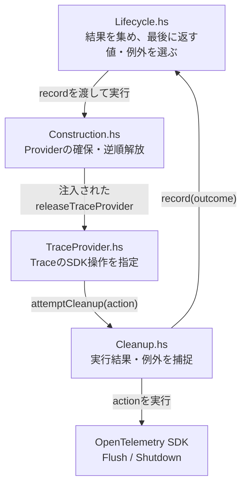
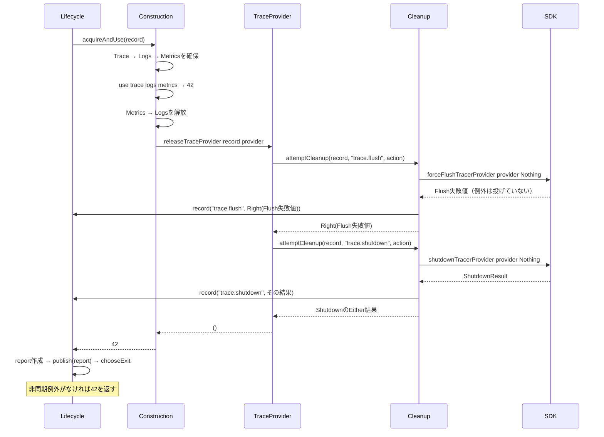
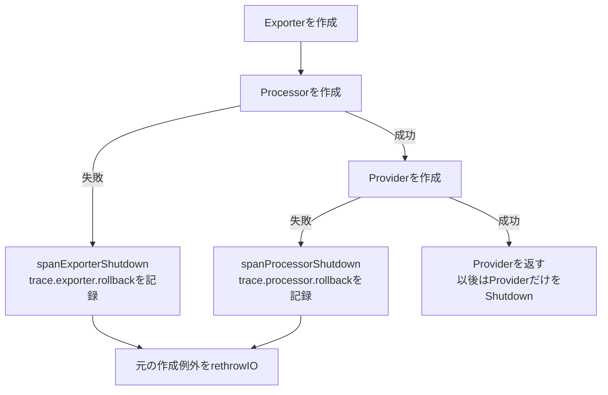
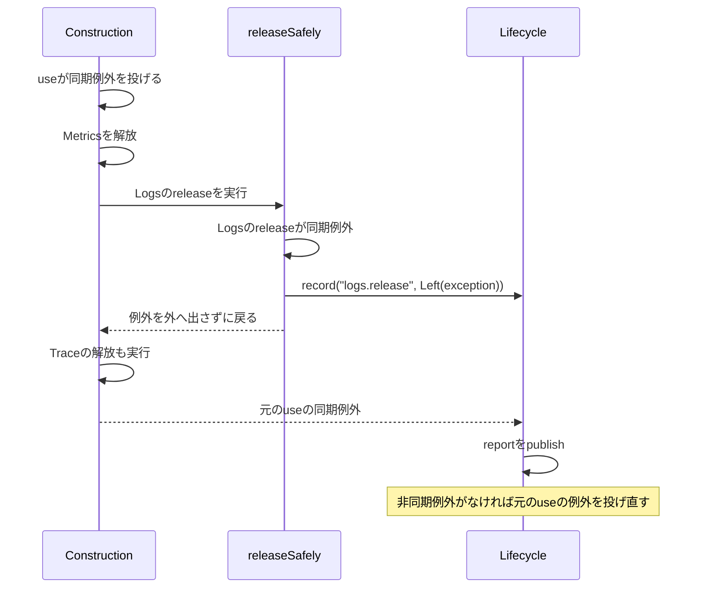

# RS-0024 OpenTelemetry SDKの確保・終了・結果記録を読む

> [!note]
> **目的：`Cleanup.hs`がなぜ必要で、誰から呼ばれ、結果がどう使われるかを理解する。** Workbenchの学習ノートであり、RAGScopeの正本ではない。根拠：正本リポジトリの作業branch `RS-0024/sdk-lifecycle-metrics`、commit `48e2fa04ca02474d0e7f68c02153a6437c2d53e9`。実装が変わったら確認し直す。

## まず1枚：5者の関係



**ポイント：** `Construction.hs`は`TraceProvider.hs`を直接呼ぶためにimportするのではなく、`ProviderOperations.releaseTraceProvider`に渡された**関数値**を呼ぶ。

SDK内のTraceデータは概念的に `TracerProvider → SpanProcessor → SpanExporter → 送信先` と流れる。**Flush**は終了済みSpanの書き出しを要求し、**Shutdown**はProviderと配下の処理の終了を要求する。Flushの呼び出しだけで送信先への永続保存は保証しない。

## 例A：`use`は`42`、Trace Flushだけ失敗値を返したら？

**まずはこのシーケンス図を読む。** `Cleanup.hs`がSDKを実行して失敗値を記録しても、最後のアプリの結果は別に扱われる。



図の`Right(Flush失敗値)`は読みやすさのための略記。実際の値は`Right (CleanupFlushResult sdkResult)`を含む`CleanupOutcome`になる。**`Right`は「SDK処理が成功した」ではなく「IOが例外を投げずに値を返した」。** `record`は`Lifecycle.hs`内の`IORef`へ保存する関数であり、OpenTelemetry Logsへの自動送信ではない。`publish`の出力先は渡された実装次第。

### なぜFlushの後にShutdownできる？

`releaseSdkTraceProvider`は、FlushとShutdownを別々の`attemptCleanup`で呼ぶ。`void`で戻り値を使わなくても、**両方の`CleanupOutcome`はすでに`record`へ渡している**。Flushの失敗値で処理を分岐してShutdownを省略するコードではない。

```haskell
void $ attemptCleanup record "trace.flush"
  (CleanupFlushResult <$> forceFlushTracerProvider provider Nothing)
void $ attemptCleanup record "trace.shutdown"
  (CleanupShutdownResult <$> shutdownTracerProvider provider Nothing)
```

## `Cleanup.hs`に戻る：型と関数はこれだけ押さえる

| 名前 | 何を表す／するか |
| --- | --- |
| `CleanupResult` | SDKの`FlushResult` / `ShutdownResult` / `ExportResult`を種類付きで保持する値 |
| `CleanupOutcome` | 操作名と`Either (ExceptionWithContext SomeException) CleanupResult`の組 |
| `CleanupStep` | 操作名と`IO CleanupResult`の組。後述の`runCleanupSteps`用 |
| `captureCleanup name action` | `tryWithContext`で1操作を実行し、`CleanupOutcome`にする |
| `attemptCleanup record name action` | `captureCleanup` → **`record outcome`** → `Either`を返す |
| `runCleanupSteps steps` | `CleanupStep`一覧を順番に実行して結果一覧を返す旧インターフェース。現在の`releaseSdkTraceProvider`は使わない |

**`Left`と`Right`を見分ける：** SDKが失敗を示す値を返したら`Right (CleanupFlushResult 失敗値)`。SDK操作が例外を投げたら`Left exception`。両方とも操作名付きで記録できる。

## 終了時だけではない：確保途中で失敗したとき

`acquireSdkTraceProvider`はExporter → Processor → Providerの順に作成する。**作成に成功したところまでしか解放できない**ので、巻き戻す対象が変わる。



巻き戻し結果も`attemptCleanup`から同じ`record`へ入る。**元の作成例外は巻き戻し結果によって置き換えない。** 各factory自身の内部で作ったものの後始末は、そのfactoryの責任。

## アプリ側と解放側の両方が失敗したら？



`releaseSafely`は**解放関数全体の予想外の例外**を捕捉する保険。個々のSDKのFlush・Shutdown結果は、解放関数の内側の`attemptCleanup`でそれぞれ記録する。

### 非同期例外だけは別の優先順位

`chooseExit`は **元の非同期例外 → Cleanup中の最初の非同期例外 → publishの非同期例外 → 元の結果（正常値・同期例外）** の順で選ぶ。同期的なCleanup失敗・報告失敗だけでは`42`や元の同期例外を置き換えない。Cleanup中の非同期割り込みが元の同期例外より優先された場合でも、元の例外は`LifecycleReport.lifecycleOriginalException`に残る。

## どこまで実装・検証されている？

- `Construction.hs`のTrace / Logs / Metricsは**3種類の関数を受け取る枠組み**。この枠組みだけでLogs・Metricsの実SDK確保・解放が完成したとは言えない。
- `TraceProvider.hs`は実SDKの確保・Flush・Shutdown関数を呼ぶ。ただし当該commitの`OpenTelemetryTraceProviderSpec.hs`は`pendingWith`で、Trace実SDK接続テストは未実装。
- `OpenTelemetryLifecycleSpec.hs`には注入したテスト用`ProviderOperations () () ()`による順序・例外のテストがある。**このノートの編集時にテストを実行したという意味ではない。**

**結論：** `TraceProvider`が「何を呼ぶか」、`Cleanup`が「実行結果をどう失わずに残すか」、`Construction`が「何をどの順で解放するか」、`Lifecycle`が「最後に何を返すか」を分担する。

### コードへ戻るリンク

[`Construction.hs`](https://github.com/takashit16833/RAGScope/blob/48e2fa04ca02474d0e7f68c02153a6437c2d53e9/ragscope-app/opentelemetry-adapter/RAGScope/Telemetry/OpenTelemetry/Construction.hs) · [`TraceProvider.hs`](https://github.com/takashit16833/RAGScope/blob/48e2fa04ca02474d0e7f68c02153a6437c2d53e9/ragscope-app/opentelemetry-adapter/RAGScope/Telemetry/OpenTelemetry/TraceProvider.hs) · [`Cleanup.hs`](https://github.com/takashit16833/RAGScope/blob/48e2fa04ca02474d0e7f68c02153a6437c2d53e9/ragscope-app/opentelemetry-adapter/RAGScope/Telemetry/OpenTelemetry/Cleanup.hs) · [`Lifecycle.hs`](https://github.com/takashit16833/RAGScope/blob/48e2fa04ca02474d0e7f68c02153a6437c2d53e9/ragscope-app/opentelemetry-adapter/RAGScope/Telemetry/OpenTelemetry/Lifecycle.hs) · [`Lifecycleテスト`](https://github.com/takashit16833/RAGScope/blob/48e2fa04ca02474d0e7f68c02153a6437c2d53e9/ragscope-app/test/RAGScope/Telemetry/OpenTelemetryLifecycleSpec.hs)
