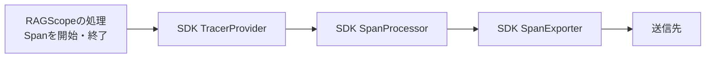
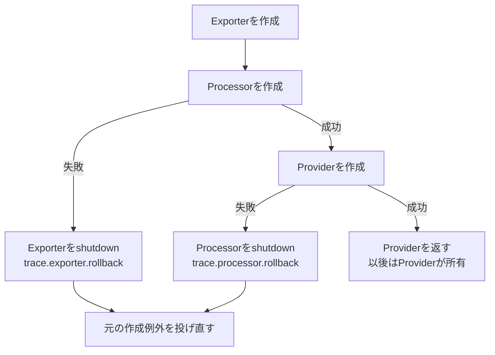

# RS-0024 OpenTelemetry SDKの確保・終了・結果記録を読む

> [!note]
> RAGScopeのSDK終了処理を理解するためのWorkbench上の学習ノート。**RAGScopeの仕様・設計の正本ではない。** 対象は正本リポジトリの`RS-0024/sdk-lifecycle-metrics`、commit `48e2fa04ca02474d0e7f68c02153a6437c2d53e9`（2026-09-17確認）。この作業ブランチの実装とテスト、OpenTelemetryの仕様を区別して説明する。後で実装が進めば必ず対象commitを確認し直す。

## まず全体像：何を理解すればよいか

中心となる問いは「**SDKのリソースを確保して使い、終了時に残っているTelemetryを送るよう要求し、解放する。その途中で失敗しても、ほかの解放処理と元のアプリケーションの結果をどう守るか？**」である。

`Cleanup.hs`だけを読むと、`CleanupResult`や例外記録の必要性が見えにくい。実際には`Construction.hs`、`Lifecycle.hs`、`TraceProvider.hs`、OpenTelemetry SDKが一つの流れを分担している。

| 担当 | 実際にすること | しないこと |
| --- | --- | --- |
| OpenTelemetry SDK | `TracerProvider`・`SpanProcessor`・`SpanExporter`を実装し、Spanの処理、Flush、Shutdownを行う | RAGScopeのアプリケーション例外の優先順位は決めない |
| `TraceProvider.hs` | TraceのExporter→Processor→Providerを確保し、`forceFlushTracerProvider`→`shutdownTracerProvider`を呼ぶ。確保途中の失敗なら作成済みの所有者を巻き戻す | 全3種類のProviderの使用期間や最終例外は決めない |
| `Construction.hs` | `ProviderOperations`を受け取り、`bracket`でTrace→Logs→Metricsを確保、逆順に解放し、ユーザー処理を挟む。予想外の解放例外も捕捉する | 個々のSDK終了関数の中身や最終例外の選択は決めない |
| `Cleanup.hs` | 個々の`IO CleanupResult`を実行して、SDKの戻り値または例外を名前付きの`CleanupOutcome`にする。渡された`record`へ結果を渡す | リソースを選択・確保せず、例外の最終優先順位も決めない |
| `Lifecycle.hs` | `record`を用意して結果を集め、`LifecycleReport`を`publish`へ渡し、戻り値または例外を選ぶ | Flush・Shutdownを直接呼ばない |

`Construction`と`TraceProvider`の依存関係を取り違えないこと。`Construction.hs`が`TraceProvider.hs`を直接importして呼んでいるのではない。`ProviderOperations`の`acquireTraceProvider` / `releaseTraceProvider`という**関数値を呼ぶ**。実SDK用の関数をそこへ設定すれば`TraceProvider`の実装が動く。

## SDK側の役者：Provider・Processor・Exporter

Traceを例にすると、おおまかに次の順でつながる。



- **Provider**：Spanを生成するTracerのもとになり、登録済みProcessorを管理する。
- **Processor**：終了したSpanを受け取り、設定に応じてその場で、またはまとめてExporterへ渡す。
- **Exporter**：Spanデータを送信先に書き出す。具体的な送信方式はExporterの実装・設定次第。
- **Flush**：すでに終了してProcessor側に渡った未送信のSpanについて、速やかな書き出しをSDKに要求する。**実行中でまだ終了していないSpanを強制終了する操作ではない**。
- **Shutdown**：Providerの使用を終了し、配下のProcessorやExporterを終了するための処理。OpenTelemetryのTrace SDK仕様ではProcessorのShutdownにFlush相当の効果も求めているが、RAGScopeは`TraceProvider.hs`でFlushとShutdownを明示的に別々に実行して**それぞれの結果を記録する**。

Flushを呼んだだけで、送信先への永続保存まで無条件に保証されるわけではない。SDKの`FlushResult`が成功・失敗などを伝え、Exporterと送信先の具体的な保証は別に確認する。

## 1. Traceを確保する：`acquireSdkTraceProvider`

`TraceProviderConfig`は3つの作成関数を保持する。

```haskell
data TraceProviderConfig = TraceProviderConfig
  { traceExporterFactory :: IO SpanExporter
  , traceProcessorFactory :: SpanExporter -> IO SpanProcessor
  , traceProviderFactory :: SpanProcessor -> IO TracerProvider
  }
```

`mkTraceProviderConfig exporterFactory processorFactory options`は最後の関数を`\processor -> createTracerProvider [processor] options`として組み立てる。`acquireSdkTraceProvider config record`は、Exporter→Processor→Providerをこの順で作成し、成功した`TracerProvider`を返す。`record :: CleanupOutcome -> IO ()`は、確保が途中で失敗したときの巻き戻し結果を残すためにも受け取る。

**所有者がどこまで移ったか**で、失敗時に終了する対象が異なる。



Processorの作成が失敗した場合は`spanExporterShutdown exporter`、Providerの作成が失敗した場合は`spanProcessorShutdown processor`を`attemptCleanup`で呼ぶ。巻き戻し結果を記録した後、`rethrowIO originalException`で**作成に失敗した元の例外**を投げ直す。Provider作成成功後はProcessorやExporterを別途Shutdownせず、Providerだけを終了する（二重終了を避ける）。Exporter作成関数の内部で確保したリソースが、その関数自身の失敗時にどう解放されるかは、各factoryの責任である。

## 2. 3種類のProviderを使う：`withProviders`

`Construction.hs`の`ProviderOperations trace logs metrics`には、Trace / Logs / Metricsそれぞれについて`acquire*Provider`と`release*Provider`が入る。型引数`trace`・`logs`・`metrics`は各リソースの型であり、SDKの実型と決め打ちされていない。テストでは`() `も使える。

```haskell
withProviders
  :: ProviderOperations trace logs metrics
  -> (LifecycleReport -> IO ())
  -> (trace -> logs -> metrics -> IO a)
  -> IO a
```

`withProviders operations publish use`は`runLifecycle`に`acquireAndUse`を渡し、その中で`bracket`を3段重ねにする。成功時の順番は次のとおり。

```text
Traceを確保 → Logsを確保 → Metricsを確保
→ use trace logs metrics
→ Metricsを解放 → Logsを解放 → Traceを解放
→ LifecycleReportをpublish → 最終結果または例外
```

例えばLogs確保で失敗すれば、`use`とMetrics確保は実行せず、すでに確保したTraceの`releaseTraceProvider`を実行する。Metrics確保で失敗すればLogsとTraceを逆順で解放する。**確保関数が返す前に作った内部リソースの巻き戻し**は、その確保関数自身（Traceなら`acquireSdkTraceProvider`）の責務で、外側の`bracket`だけに期待しない。

`releaseSafely record "logs.release" releaseLogsProvider logs`などは、個々の解放関数全体が予想外の例外を投げても`CleanupOutcome "logs.release" (Left exception)`を記録し、外側の解放処理を継続できるようにする。通常のSDK操作のFlushとShutdownは、それより内側の各`release*Provider`が独立して記録する約束である。`releaseSafely`の正常終了は、すべてのSDK操作の成功を意味しない。

## 3. Traceを解放する：SDK呼び出しとCleanupの関係

具体的なTrace解放関数は次の2回の操作を**連続して試みる**。

```haskell
releaseSdkTraceProvider record provider = do
  void $ attemptCleanup record "trace.flush" $
    CleanupFlushResult <$> forceFlushTracerProvider provider Nothing
  void $ attemptCleanup record "trace.shutdown" $
    CleanupShutdownResult <$> shutdownTracerProvider provider Nothing
```

これは説明用に改行を整えた抜粋。`Nothing`はSDK関数へ渡す任意のタイムアウト引数であり、RAGScopeがこの場で独自のタイムアウトを計算しているわけではない。`attemptCleanup`が返す`Either`を`void`で捨てているのは、**結果が`record`へ渡された後**だからである。Flush失敗を理由にShutdownを省略しない。

`attemptCleanup record name action`の中身は、`mask_`のもとで次の順番になる。

```text
captureCleanup name action
  └─ tryWithContext @SomeException action
       ├─ 例外を投げずSDK結果を返した → Right CleanupResult
       └─ 例外を投げた             → Left (ExceptionWithContext SomeException)
  ↓
CleanupOutcome name result を作る
  ↓
record outcome
  ↓
cleanupOutcomeResult outcome を値として返す
```

SDKが`FlushError`などの**失敗を表す値を正常に返す**場合でも、例外が投げられていなければ`Right (CleanupFlushResult 失敗値)`側になる。`Right`を「Flush成功」と読み違えない。`CleanupResult`にはFlush・Shutdown・ExportのSDK結果を区別するconstructorがある。ただし、このTrace解放処理が直接使っているのはFlushとShutdownだけ。

`CleanupStep`は名前と`IO CleanupResult`をまとめる型で、`runCleanupSteps`はその一覧を順番に実行して結果一覧を返す。現在のTrace解放処理は`CleanupStep`のリストを組み立てず、`attemptCleanup`を直接2回呼んでいる。`runCleanupSteps`は旧インターフェースを保持するための関数とソースコメントで説明されている。

## 4. Lifecycleが結果を集める：`runLifecycle`

`runLifecycle acquireAndUse publish`は呼び出しごとに`outcomesRef <- newIORef []`を作る。そこで生成した`record`は`modifyIORef' outcomesRef (outcome :)`で`CleanupOutcome`を先頭に追加する内部関数である。最後に`reverse <$> readIORef outcomesRef`で実行順に戻す。

```haskell
data LifecycleReport = LifecycleReport
  { lifecycleOriginalException :: Maybe CapturedException
  , lifecycleCleanupOutcomes :: [CleanupOutcome]
  }
```

`restore (acquireAndUse record)`全体（確保・利用・`bracket`による解放）の戻り値または例外を`original`として捕捉し、解放結果と合わせて`LifecycleReport`を構築する。`publish report`は**全解放の試行後に1回**実行される。`record`自体は通常のOpenTelemetry LogRecord送信でも永続保存でもなく、この一回のLifecycle内部のメモリ上の蓄積にすぎない。報告を実際にどこへ出すかは呼び出し元が渡す`publish`の実装による。`record`はユーザー処理や背景スレッドへ持ち出さない契約である。

最後の`chooseExit original outcomes reporting`は次の順で最終結果を選ぶ。

1. `original`が非同期例外なら、それを優先する。
2. そうでなければ、クリーンアップ中の`CleanupOutcome`に含まれる最初の非同期例外を優先する。
3. なければ`publish`の非同期例外を優先する。
4. どれもなければ`original`（正常値、`Either`値、同期例外）をそのまま返す・投げ直す。

したがって、**同期的なFlush・Shutdown・報告の失敗は元のアプリケーション結果を上書きしない**。ただし非同期例外（例：`UserInterrupt`）まで無視する設計ではない。元の同期例外が非同期のクリーンアップ割り込みに優先順位で負けた場合でも、元の例外は`LifecycleReport.lifecycleOriginalException`に残る。`SomeAsyncException`を見て判定しており、単に`Left`かどうかでは選ばない。

## 具体例で追う

### 例A：ユーザー処理は`42`を返したがTrace Flushが失敗値を返す

1. `withProviders`が3つを確保し、`use`が`42`を返す。
2. Metrics→Logs→Traceを解放。Traceの`forceFlushTracerProvider`が例外ではなくSDK失敗値を返したとする。
3. `attemptCleanup`は`trace.flush`の`Right (CleanupFlushResult <SDKの失敗結果>)`相当を記録する（ここでの山括弧内は説明上の表記で、Haskellの実コードではない）。
4. そのまま`trace.shutdown`も試み、その結果を別の`CleanupOutcome`として記録する。
5. `publish`に両方の結果を含むレポートを渡し、非同期例外がなければ最終的に`42`を返す。

つまり「Flushの失敗を無かったことにする」のではなく、「**失敗を記録しつつアプリの成功結果は変更しない**」。

### 例B：ユーザー処理が同期例外、さらにLogs解放も同期例外

`use`が`TestException`を投げても3つの`bracket`が解放を行う。Logsの`releaseLogsProvider`が別の同期例外を投げた場合、`releaseSafely`は`logs.release`として記録し、Trace解放まで進める。`LifecycleReport`には元の`TestException`と各終了結果が入り、最後は元の`TestException`を投げ直す。Logs側の例外で検索処理などの元の失敗理由を隠さない。

### 例C：Processorの作成中に例外

`traceExporterFactory`が成功し、`traceProcessorFactory exporter`が例外を投げた場合、まだProviderは存在しない。`acquireSdkTraceProvider`自身が`spanExporterShutdown exporter`を`trace.exporter.rollback`として記録し、Processor作成時の元の例外を投げ直す。このTrace取得が`withProviders`の一番外側で失敗した場合、`use`もLogs・Metrics取得も始まらない。`Lifecycle.hs`は巻き戻し結果を報告して元の取得例外を選ぶ。

### 例D：元は同期例外、解放中に`UserInterrupt`

解放中の非同期例外が`CleanupOutcome`として捕捉・記録された場合、`chooseExit`はその割り込みを元の同期例外より優先する。元の同期例外はレポートに保持される。これは単なるSDK失敗値とは別の扱い。

## 現在確認できる実装範囲とテスト範囲

- `Construction.hs`の3種類分の仕組みは**関数を注入する汎用構造**。Logs・Metricsの具体的なSDK確保・解放実装まで、この4モジュールだけから実装済みとは判断しない。
- `TraceProvider.hs`はTraceの実SDK関数を呼ぶ実装を持つ。一方、`OpenTelemetryTraceProviderSpec.hs`の中心テストは`pendingWith "TraceProvider tests are not implemented yet"`であり、**実SDKとの接続テストが完了したとは記さない**。
- `OpenTelemetryLifecycleSpec.hs`は`ProviderOperations () () ()`というテスト用関数を使い、確保・逆順解放、確保失敗、解放例外、割り込み、`Either`値、報告例外、部分取得の巻き戻し記録などを検証するコードを持つ。ただし、このノート作成時にテストコマンドを実行したという意味ではない。
- アプリ全体への実Provider接続、Logs・Metricsの固有SDK処理、`publish`の具体的な出力方法は、その組み立て元を別途確認しない限り断定しない。

## 読む順番と参照元

1. [`Construction.hs`](https://github.com/takashit16833/RAGScope/blob/48e2fa04ca02474d0e7f68c02153a6437c2d53e9/ragscope-app/opentelemetry-adapter/RAGScope/Telemetry/OpenTelemetry/Construction.hs)：`withProviders`と3重`bracket`で全体の順序をつかむ。
2. [`TraceProvider.hs`](https://github.com/takashit16833/RAGScope/blob/48e2fa04ca02474d0e7f68c02153a6437c2d53e9/ragscope-app/opentelemetry-adapter/RAGScope/Telemetry/OpenTelemetry/TraceProvider.hs)：`acquireSdkTraceProvider`→`releaseSdkTraceProvider`でSDKの実呼び出しと所有権を確認する。
3. [`Cleanup.hs`](https://github.com/takashit16833/RAGScope/blob/48e2fa04ca02474d0e7f68c02153a6437c2d53e9/ragscope-app/opentelemetry-adapter/RAGScope/Telemetry/OpenTelemetry/Cleanup.hs)：`CleanupResult`、`CleanupOutcome`、`attemptCleanup`で失敗がどう値になるかを読む。
4. [`Lifecycle.hs`](https://github.com/takashit16833/RAGScope/blob/48e2fa04ca02474d0e7f68c02153a6437c2d53e9/ragscope-app/opentelemetry-adapter/RAGScope/Telemetry/OpenTelemetry/Lifecycle.hs)：`record`→`LifecycleReport`→`publish`→`chooseExit`で結果の扱いを締める。
5. [`OpenTelemetryLifecycleSpec.hs`](https://github.com/takashit16833/RAGScope/blob/48e2fa04ca02474d0e7f68c02153a6437c2d53e9/ragscope-app/test/RAGScope/Telemetry/OpenTelemetryLifecycleSpec.hs)と[`OpenTelemetryTraceProviderSpec.hs`](https://github.com/takashit16833/RAGScope/blob/48e2fa04ca02474d0e7f68c02153a6437c2d53e9/ragscope-app/test/RAGScope/Telemetry/OpenTelemetryTraceProviderSpec.hs)：検証済みの期待動作と未実装テストを見分ける。

SDKの概念と契約は[OpenTelemetry Trace SDK仕様](https://opentelemetry.io/docs/specs/otel/trace/sdk/)を参照。RAGScopeの基本方針は[正本リポジトリのObservability設計](https://github.com/takashit16833/RAGScope/blob/48e2fa04ca02474d0e7f68c02153a6437c2d53e9/project-docs/design/observability/Observability%E8%A8%AD%E8%A8%88.md)が正本。SDKの実際のversionや依存境界は同commitの[`ragscope.cabal`](https://github.com/takashit16833/RAGScope/blob/48e2fa04ca02474d0e7f68c02153a6437c2d53e9/ragscope-app/ragscope.cabal)で確認する。

**一文でまとめると：** `TraceProvider`がSDK操作を選んで呼び、`Cleanup`が各操作の結果を失わずに残し、`Construction`が確保から逆順解放までの順序を守り、`Lifecycle`が全結果を報告して最終的な戻り値・例外を決める。