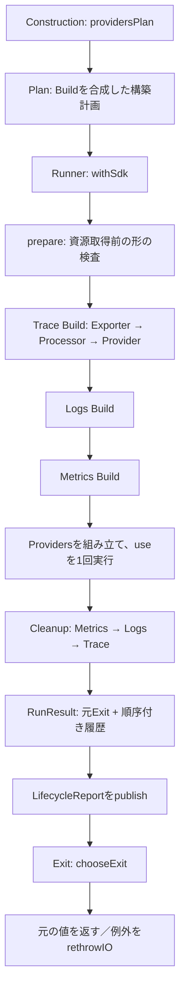
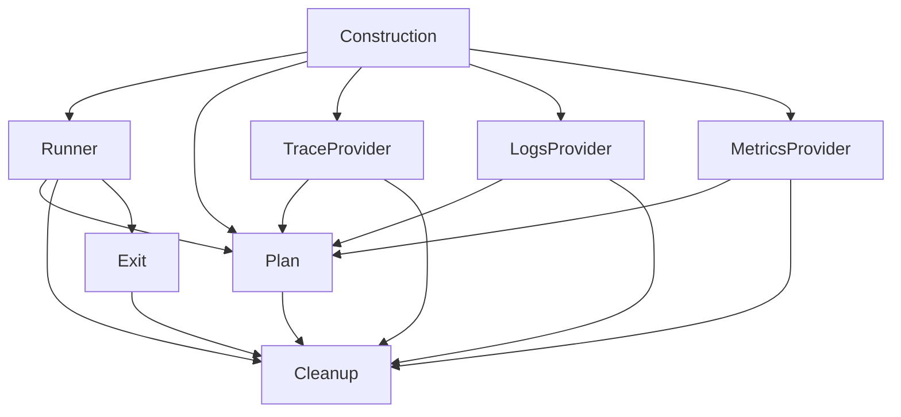

# RS-0024 SDKライフサイクル：F案完成予想図と写経マップ

> [!important] このノートの位置付け
> 2026-09-18の会話で選んだ**F案を主軸にした実装目標図と、ユーザー自身が写経するための道案内**。完成したコード、コンパイル済みの設計、RAGScopeの採用済み仕様・正式進捗ではない。現在仕様は常に正本リポジトリの対象branch/commitの実ファイルを優先する。下記で「完成形」と呼ぶものは**完成時に目指す構造**を意味する。仮の型・module名は実装時に型検査と正本との照合を経て確定する。
>
> **役割分担：** ユーザーがRAGScopeのコードを書く。AIは原則「１ステップ＝１モジュール＋そのモジュールに直接対応するテスト・Cabal登録」の写経用説明を出す。ノートを作成することは、コード変更・Ticket状態変更・設計の正式採用を意味しない。

- 正本：[`takashit16833/RAGScope`](https://github.com/takashit16833/RAGScope)、対象branch `RS-0024/sdk-lifecycle-metrics`、確認commit `48e2fa04ca02474d0e7f68c02153a6437c2d53e9`。
- 作業の要求：[RS-0024 Ticket](https://github.com/takashit16833/RAGScope/blob/48e2fa04ca02474d0e7f68c02153a6437c2d53e9/project-docs/project-management/milestones/v0.0/error-logging/RS-0024%20RAGScope%E3%82%A2%E3%83%97%E3%83%AA%E3%82%B1%E3%83%BC%E3%82%B7%E3%83%A7%E3%83%B3%E3%81%B8OpenTelemetry%20Observability%E6%9C%80%E5%B0%8F%E5%9F%BA%E7%9B%A4%E3%82%92%E5%AE%9F%E8%A3%85%E3%81%99%E3%82%8B.md)。このノートが扱うのは**SDKライフサイクルの再設計部分**であり、Ticket全体の完了を意味しない。
- 基礎資料：Workbenchの[A〜D案](https://github.com/takashit16833/Workbench/blob/feat/RS-0024-opentelemetry-observability-foundation/Notes/RS-0024-SDK%E3%83%A9%E3%82%A4%E3%83%95%E3%82%B5%E3%82%A4%E3%82%AF%E3%83%AB%E6%89%B9%E8%A9%95%E3%81%A8%E5%86%8D%E8%A8%AD%E8%A8%88%E6%A1%88.md)、[E追補](https://github.com/takashit16833/Workbench/blob/feat/RS-0024-opentelemetry-observability-foundation/Notes/RS-0024-SDK%E3%83%A9%E3%82%A4%E3%83%95%E3%82%B5%E3%82%A4%E3%82%AF%E3%83%AB%E6%89%B9%E8%A9%95%E3%81%A8%E5%86%8D%E8%A8%AD%E8%A8%88%E6%A1%88-E%E6%A1%88%E8%BF%BD%E8%A3%9C.md)、[F案原文](https://github.com/takashit16833/Workbench/blob/feat/RS-0024-opentelemetry-observability-foundation/Notes/RS-0024-SDK%E3%83%A9%E3%82%A4%E3%83%95%E3%82%B5%E3%82%A4%E3%82%AF%E3%83%AB%E5%86%8D%E8%A8%AD%E8%A8%88-F%E6%A1%88.md)、[A〜F統合議論](https://github.com/takashit16833/Workbench/blob/feat/RS-0024-opentelemetry-observability-foundation/Notes/RS-0024-SDK%E3%83%A9%E3%82%A4%E3%83%95%E3%82%B5%E3%82%A4%E3%82%AF%E3%83%AB%E8%A8%AD%E8%A8%88%E6%96%B9%E9%87%9D%E3%81%A8%E8%AD%B0%E8%AB%96%E7%B5%8C%E7%B7%AF-A-F%E7%B5%B1%E5%90%88.md)。これらも未採用の検討材料。

## 0. 最初に見る１枚：何を完成させるのか

**到達イメージ：** 「資源を作る手順」を`Plan`で記述し、ただ１つの`Runner`が計画の準備、取得、所有権移転、利用、Cleanup、結果集約、reporting、最終的な値の返却／例外再送出までを担当する。SDK固有のAPI呼び出しはProvider moduleに置く。



これは正常時の主経路。途中取得が失敗したら、**そのBuildの現在ownerをrollback → 先に完成した外側Providerを逆順close → report → 最終選択**へ分岐する。取得できていない後段を作ったり、`use`を実行したりしない。

> [!tip] 写経中の読み方
> いま作っているmoduleを以下の「モジュール地図」で探し、次に「時系列マップ」でそのmoduleが登場する位置を見る。**型を定義するステップ＝ただちに資源が確保されるわけではない**。`Plan`は予定表、`Build`は一つの資源の構築方法、`Runner`が実際のIOを開始する。

## 1. 現在地と、会話で選んだ方向を分ける

### 正本で確認した現在地（上記commit時点）

- [`Construction.hs`](https://github.com/takashit16833/RAGScope/blob/48e2fa04ca02474d0e7f68c02153a6437c2d53e9/ragscope-app/opentelemetry-adapter/RAGScope/Telemetry/OpenTelemetry/Construction.hs) の`withProviders`はTrace→Logs→Metricsを３重の`bracket`で取得し、逆順で解放する。`ProviderOperations trace logs metrics`は各acquire/releaseへ`record` callbackを渡す。
- [`TraceProvider.hs`](https://github.com/takashit16833/RAGScope/blob/48e2fa04ca02474d0e7f68c02153a6437c2d53e9/ragscope-app/opentelemetry-adapter/RAGScope/Telemetry/OpenTelemetry/TraceProvider.hs) のfactory型は`IO SpanExporter`、`SpanExporter -> IO SpanProcessor`、`SpanProcessor -> IO TracerProvider`。Processor factory失敗時はExporter rollback、Provider factory失敗時はProcessor rollback。完成Providerのreleaseはflush→shutdownをそれぞれ試す。
- [`Cleanup.hs`](https://github.com/takashit16833/RAGScope/blob/48e2fa04ca02474d0e7f68c02153a6437c2d53e9/ragscope-app/opentelemetry-adapter/RAGScope/Telemetry/OpenTelemetry/Cleanup.hs) の`attemptCleanup`は１操作のSDK結果／例外を捕捉し、即時記録する。現行Traceのflush失敗後もshutdownを試す性質は既にある。`runCleanupSteps`は移行途中の別インターフェース。
- [`Lifecycle.hs`](https://github.com/takashit16833/RAGScope/blob/48e2fa04ca02474d0e7f68c02153a6437c2d53e9/ragscope-app/opentelemetry-adapter/RAGScope/Telemetry/OpenTelemetry/Lifecycle.hs) はinvocation内`IORef`で履歴を収集、`original :: Either (ExceptionWithContext SomeException) a`を保持、reportを１回試し、`chooseExit`で値／例外を選ぶ。最外側では既に例外の遅延再送出を実践している。
- [`ragscope.cabal`](https://github.com/takashit16833/RAGScope/blob/48e2fa04ca02474d0e7f68c02153a6437c2d53e9/ragscope-app/ragscope.cabal) の`opentelemetry-adapter`はprivate library。`Plan`／`Runner`／`Exit`は現時点のmodule登録にない。SDK依存は`^>=1.0.0.0`で、実際の解決versionを固定した証拠ではない。
- [`OpenTelemetryLifecycleSpec.hs`](https://github.com/takashit16833/RAGScope/blob/48e2fa04ca02474d0e7f68c02153a6437c2d53e9/ragscope-app/test/RAGScope/Telemetry/OpenTelemetryLifecycleSpec.hs) は主としてmockで順序・結果を検証する。[`OpenTelemetryTraceProviderSpec.hs`](https://github.com/takashit16833/RAGScope/blob/48e2fa04ca02474d0e7f68c02153a6437c2d53e9/ragscope-app/test/RAGScope/Telemetry/OpenTelemetryTraceProviderSpec.hs) の`spec`は`pendingWith`。Logs／Metricsの具体的な完成Provider構築と本番起動への接続も、このcommitで完成済みとは扱わない。

### 今回の会話で採った「実装の主軸」（正本採用とは別）

| 論点 | 方向 | 意味・限界 |
|---|---|---|
| 結果と履歴 | B案の直積を取り込む | `Either CapturedException a`とCleanup履歴を一緒に運ぶ。業務の`Left`は普通の`a` |
| Build内の所有 | F案の`Seed`・`Transfer`・`Chain` | 型が合う遷移列。成功時のowner置換は**実行器が守る**。線形型による使用回数の証明ではない |
| Cleanup | F案の取得前準備・型付きoperation・個別捕捉 | SDK結果の型対応と処理継続。資源の実解放完了／停止性の自動保証ではない |
| Provider間Scope | F案の`Plan`（Applicative） | 取得前に走査できる構築計画。C案の独立試作を前提としない |
| `LinearTypes` | 初期版では導入しない | 計画と所有権は線形的にモデル化するが、実行器内の単一使用を型証明したとは主張しない |

## 2. モジュール地図：完成したとき、誰が何を知るのか

以下のファイル配置は**実装先の提案**。物理ファイル名は写経開始時に対象branchを再確認して決める。最初は既存`ragscope-app/opentelemetry-adapter/RAGScope/Telemetry/OpenTelemetry/`と同じprivate libraryの中。新しい共通Monad・別package・SDK互換Runtimeは作らない。

| module | 主な責務・持つ型／関数 | 知ってよいもの／知らないもの |
|---|---|---|
| `Cleanup.hs`（既存を改修） | `CleanupOp result`、`CleanupAction r`、`CleanupPlan r`、`SomeCleanupOutcome`、各操作の捕捉と順序付き履歴 | SDKの`FlushResult`等を知る。Providerの取得はしない。終了例外の選択はしない |
| `Plan.hs`（提案新設） | `OwnerPlans`、`Seed`、`Transfer`、`Chain`、`Build`、`Plan`、`prepare` | `CleanupPlan`を参照。TraceのSDK関数をimportしない |
| `Exit.hs`（提案新設） | 元Exitと履歴の結果モデル、reportへの投影、純粋な`chooseExit` | Cleanup結果を読む。factory、SDK shutdown、publish IOを呼ばない |
| `Runner.hs`（提案新設） | `withSdk`、`Build`／`Plan`の解釈、現在owner、pending Cleanup、`drain`、最外側`mask`、publish、最終`rethrowIO` | Plan・Cleanup・Exitを使う。Trace固有のshutdown関数は呼ばない |
| `TraceProvider.hs`（既存を改修） | `TraceProviderConfig`から`traceBuild`を作る。SDKのExporter／Processor／Provider factoryと各Cleanup APIを登録 | PlanとCleanup、OpenTelemetry SDKをimport。Runnerを直接駆動しない |
| `LogsProvider.hs`／`MetricsProvider.hs`（実装時の仮名） | 対応SDK factoryとCleanupの計画を`Build`へ変換 | 具体構成・資源型・終了順はSDK確認後に確定。現行に完成済みmoduleがある前提にしない |
| `Construction.hs`（既存を改修） | `Providers`の組立てと`providersPlan`、公開入口への接続 | Provider module・Plan・Runnerを合成。ownerや例外優先順位を手書きしない |
| `Lifecycle.hs`（既存、移行対象） | 現行の`runLifecycle`と`chooseExit`を段階移行 | 最終的な残置・互換入口・削除対象は利用箇所確認後に決める。新旧の履歴経路を無検証で混在させない |

**import方向の目標**（矢印は「左が右をimportする」）：



- `Plan -> TraceProvider -> Plan`の循環は作らない。
- `Runner`はProvider固有APIを知らず、計画に保存された関数を実行する。
- `Cleanup`にSDK結果型を置く以上、同一private library内のmodule分割だけでSDK依存をCabal上禁止できるわけではない。ただし`telemetry-boundary`とUseCaseへSDK型を漏らさない。
- `Construction`は、現在の３資源の取得順を無断で変更しない。`Plan`のApplicativeは逐次取得であり並列化ではない。

## 3. 型を上から眺める：完成形の骨格

以下は**署名と型の関係を理解するための設計断片**。constructor秘匿、`GADTs`等のextension、strictness、型推論、SDKの具体型、export listの最終形は未コンパイル。これをそのまま正本の完成実装と読まない。

### 3.1 Cleanup：取得前に準備する「操作の形」

```haskell
-- 提案。StepIdの具体的な型・値は実装時に決める。
data CleanupOp result where
  FlushOp    :: CleanupOp FlushResult
  ShutdownOp :: CleanupOp ShutdownResult
  ExportOp   :: CleanupOp ExportResult

data CleanupAction r where
  CleanupAction :: StepId -> CleanupOp result
                -> (r -> IO result) -> CleanupAction r

newtype CleanupPlan r = CleanupPlan [CleanupAction r]

data SomeCleanupOutcome where
  SomeCleanupOutcome :: StepId -> CleanupOp result
                     -> Either CapturedException result
                     -> SomeCleanupOutcome
```

`FlushOp`と`IO ShutdownResult`を結び付けることは型で拒否される。`StepId`の意味、実際に対象資源が停止したか、関数の全域性は証明されない。`prepare`はリストの構造・ID・タグ・関数の外側を**資源取得前に**評価する。取得後の`r -> IO result`の適用とSDK結果の外側WHNFは、１操作ごとの捕捉範囲で評価する。SDK内部の深い遅延値・永久blocking・資源解放完了を自動保証しない。

```haskell
-- 提案。実際のSDK APIとの接続例。
traceClose = cleanupPlan
  [ CleanupAction traceFlush FlushOp
      (\provider -> forceFlushTracerProvider provider Nothing)
  , CleanupAction traceShutdown ShutdownOp
      (\provider -> shutdownTracerProvider provider Nothing)
  ]
```

２操作を`flush >> shutdown`という一つのIO actionにまとめない。flush例外でもshutdownを独立して試すため。

### 3.2 Ownership：一つのBuild内部の一本道

```haskell
data OwnerPlans r = OwnerPlans
  { rollbackPlan :: CleanupPlan r
  , closePlan    :: CleanupPlan r
  }

data Seed a = Seed (IO a) (OwnerPlans a)
data Transfer a b = Transfer (a -> IO b) (OwnerPlans b)

data Chain a b where
  Done  :: Chain a a
  (:>>) :: Transfer a x -> Chain x b -> Chain a b

data Build b where
  Build :: Seed a -> Chain a b -> Build b
```

具体例：

```text
Seed:      acquire SpanExporter
Transfer:  SpanExporter -> IO SpanProcessor
Transfer:  SpanProcessor -> IO TracerProvider
Done:      最終資源 TracerProvider
```

Processor生成が失敗した場合はExporterの`rollbackPlan`、Provider生成が失敗した場合はProcessorの`rollbackPlan`だけを実行する。Transfer成功で現在ownerとその`OwnerPlans`を置換し、旧ownerの独立finalizerは残さない。factory内部で取得して戻せなかった資源はfactory自身が片付ける契約。`a -> IO b`がSDK内部の所有権を正しく移したことまでは型だけで証明しない。

### 3.3 Scope：独立したProviderを合成する計画

```haskell
data Plan a where
  PurePlan :: a -> Plan a
  ApPlan   :: Plan (a -> b) -> Plan a -> Plan b
  Resource :: Build a -> Plan a

-- F案で目指す読み口。Logs/Metricsの具体型・Configは仮名。
providersPlan :: SdkConfig -> Plan Providers
providersPlan config =
  Providers
    <$> resource (traceBuild (traceConfig config))
    <*> resource (logsBuild (logsConfig config))
    <*> resource (metricsBuild (metricsConfig config))
```

`Plan`は**まだ資源ではない**。同じPlanを２回実行すれば２回取得する。Applicativeは左から取得して逆順にcloseする解釈を実行器に与える。現在の３Provider構築は前段Providerの値に依存して後段Planを作らないので、初期版ではMonadを提供しない。

### 3.4 結果と公開入口：出口を一つにする

```haskell
-- 概念型。具体的な履歴表現はSomeCleanupOutcomeとの整合を取って確定。
data RunResult a = RunResult
  { originalExit    :: Either CapturedException a
  , cleanupOutcomes :: [SomeCleanupOutcome]
  }

-- F案の公開入口の提案。現在の実装には存在しない。
withSdk
  :: Plan Providers
  -> (LifecycleReport -> IO ())
  -> (Providers -> IO a)
  -> IO a
```

業務callbackが`Either FeatureFailure a`を返す場合、その`Left FeatureFailure`は**通常値**。外側の`Left CapturedException`だけが捕捉した例外。`LifecycleReport`へ投影するとき、既存の`lifecycleOriginalException`と実行順のCleanup情報を失わないこと。reporting中の例外は、report作成時点の同一reportへ後付けできるとは限らない。

> [!warning] 型の継ぎ目
> F原文の`SomeCleanupOutcome`と現行`LifecycleReport`の`[CleanupOutcome]`は同じ型ではない。実装時に`StepId`・`CleanupOp`・SDK結果をどう公開レポートへ写すか、`RunResult`の具体型・変換関数とあわせて**明示してテストする**。ここに仮の変換実装を置いて確定したことにしない。

## 4. 時系列マップ：１回のwithSdkの中で何が起きるか

| 局面 | Runnerが持つ情報 | 実行／成功時 | 失敗・中断時 |
|---|---|---|---|
| 0. `prepare` | Plan、まだ資源なし | Planと各Cleanupの外側構造を準備 | 捕捉してreport／最終選択。SDK取得ゼロ |
| 1. TraceのSeed | 先に完成したProviderなし | Exporterを現在ownerにする | factory内部の部分資源はfactory契約。後段へ進まない |
| 2. TraceのTransfer | ExporterまたはProcessorを現在ownerに保持 | 新ownerへ**置換** | 現在ownerのrollbackを試み、元例外と履歴を保持 |
| 3. Logs／Metrics Build | 完成済み外側Providerと現在Buildのowner | Trace→Logs→Metricsで取得 | Build内部rollback→完成済みProviderを逆順close。useしない |
| 4. 組立て・利用 | 全Providerとclose義務 | `Providers`を構築し`use`を１回実行 | pure組立ての評価でthrowしてもclose義務を保持し、以後はCleanupへ |
| 5. Cleanup | 元Exit、残るclose義務、履歴prefix | Metrics→Logs→Trace。各操作を捕捉→結果を追加 | 当該操作を記録し、既知の後続操作を試す。元Exitと既存履歴を捨てない |
| 6. reporting | 元Exit＋Cleanup履歴 | `LifecycleReport`を１回publish | publish例外を捕捉。再帰的に同じTelemetryへ報告しない |
| 7. 最終選択 | 元Exit、Cleanup中断、reporting中断 | `chooseExit`、値を返すか`rethrowIO` | 元の非同期例外を通常の機能失敗値に変換しない |

最外側の`withSdk`が`mask`を所有する。`restore`を使う範囲は準備・各factory・組立てと利用など**中断可能にする必要がある処理**に限定し、現在owner・解放義務・履歴を受け渡す途中に無防備な隙間を作らない。`mask`中でも割込み可能なblocking IOがある。Cleanupを一律`uninterruptibleMask`にしない。詳細な`restore`の配置はRunner実装時に確認する。

### 4.1 正常系：具体例

```text
prepare
  acquire Trace: Exporter → Processor → Provider
  acquire Logs
  acquire Metrics
  use providers                         -- 例：42
  close Metrics
  close Logs
  close Trace: flush → shutdown
  publish report                        -- cleanup結果は実行順
  chooseExit                            -- Right 42
  return 42
```

### 4.2 異常系：Metrics取得に失敗

```text
Trace取得成功 → Logs取得成功 → Metrics Buildで例外 S
  → Metrics Build内で現在ownerがあればrollback
  → Logs close → Trace close
  → RunResult (Left S) [rollback, logsの結果, traceの結果]
  → publish → 例外選択 → rethrowIO
```

rollbackの対象・結果数はMetrics Buildのどの段階で失敗したかに依存する。存在しない資源のshutdownはしない。`use`は０回。

### 4.3 異常系：業務は成功、Trace flushが失敗

```text
use -> 42
Metrics close → Logs close → Trace flush が FlushError または同期throw
Trace shutdown は引き続き試みる
report に flush と shutdown の両方の結果
通常の同期Cleanup失敗だけなら返却値は 42 のまま
```

**現行Traceも個別の`attemptCleanup`によりこの性質を持つ**。Fで新たに得るのは、予定表の準備と中央実行器への規則集約であり、現行の欠陥発見と混同しない。

### 4.4 中断・reportingの最終優先順位（現行を維持）

1. 元の取得／利用が捕捉した非同期例外。
2. Cleanup履歴中、実行順で最初の**ライフサイクルthreadに生じた**非同期例外。
3. reportingが捕捉した非同期例外。
4. いずれもなければ元の同期例外を再送出、または元の通常値を返す。

同期Cleanup例外・SDK失敗値・同期reporter例外は正常な利用結果を置き換えない。元の同期例外が後続の中断に優先順位で負けてもreportに残す。SDK workerの異常終了を`SomeAsyncException`という型だけで親threadのキャンセルへ分類しない。SDKが区別可能な結果を返す境界でのみ区別する。

## 5. 写経モード：今は何を実装しているのか

これは**コード修正をAIが実施する計画ではなく、ユーザーが写経する際の道順**。１ステップにつき原則１module。テスト、export list、Cabalのmodule登録は、そのmoduleを成立させる付随作業として同じステップに含める。完了は説明を読んだことではなく、型検査・テストと差分確認で判断する。

| 順番 | 対象module／対象 | 写経するもの | その瞬間に全体図の何ができるか／検証点 |
|---|---|---|---|
| **0** | ベースライン確認（コード変更なし） | 対象branch HEAD、既存LifecycleSpec、TraceProviderSpecのpending、SDK解決version、Cabal登録と使用箇所を確認 | 既存の振る舞いを固定。旧APIを消すタイミングを誤らない |
| **1** | `Cleanup.hs` | 型付き`CleanupOp`／`CleanupAction`／`CleanupPlan`／`SomeCleanupOutcome`、１操作を捕捉して順次試す核 | 「資源がまだない時点で決められるCleanupの形」ができる。Flush/Shutdown型の負例と、flush例外後も次操作へ進むテスト |
| **2** | `Plan.hs` | `Seed`／`Transfer`／`Chain`／`Build`／`Plan`と`prepare`の外側構造 | 「何をどの順に作るか」の設計図がデータになる。誤った型のChain接続・Flushタグ不一致を型検査。prepare異常時の取得回数０はRunner接続後に検証 |
| **3** | `Exit.hs` | 元Exit＋履歴の`RunResult`、`LifecycleReport`への投影、純粋な`chooseExit` | 「失敗でも元結果とCleanup履歴が同時に残る」。現行の優先順位、通常の業務`Left`をそのままにするテスト。旧Lifecycleとの重複・互換性を確認 |
| **4** | `Runner.hs` | `withSdk`、Plan/Build解釈、現在ownerの置換、masked handoff、逆順`drain`、publish／rethrow | **心臓部。** `()`などのmock Buildを使ってTrace→Logs→Metrics、途中失敗、履歴prefix、report１回、`throwTo`を検証。Trace実SDKの完成を待たずに動作を分離できる |
| **5** | `TraceProvider.hs` | 現行Configを`traceBuild`へ接続し、Exporter／Processor／Providerのrollback・close計画を登録 | 最初の実SDK接続。段階別失敗注入、解放回数、flush→shutdown、旧record APIと新Runnerの履歴混在禁止を検証。pendingだったTraceProviderSpecを具体テストへ |
| **6** | `LogsProvider.hs`（具体名は要確認） | Logs SDKのfactory／owner契約／close計画を確認し、`Build`として表現 | ２番目のProviderが実体化。取得途中失敗のrollback契約とSDK型の境界を検証 |
| **7** | `MetricsProvider.hs`（具体名は要確認） | Metrics SDKのfactory／owner契約／close計画を確認し、`Build`として表現 | ３番目のProviderが実体化。内部資源が複数あるなら単純なTrace移転列を流用せず正しい所有契約を確認 |
| **8** | `Construction.hs` | `Providers`、`providersPlan`、既存入口から`withSdk`への接続。旧３重`bracket`から移行 | 完成したProvider３つがひとつのPlanになる。現行LifecycleSpecの観測結果・公開入口との互換性を比較 |
| **9** | 結線・統合検証（複数module横断の例外ステップ） | `ragscope.cabal`の最終整理、旧`Lifecycle`／旧`CleanupStep`の利用箇所確認、実SDK統合、既存Telemetry境界と起動側への接続はTicketの対象として別途確認 | 移行の残骸や二重履歴経路を整理。`make check-app`および実SDK・非同期競合テスト。RS-0024全体の完了と同一視しない |

**最初に着手するのはステップ１の`Cleanup.hs`。** ステップ２はステップ１の型を使い、ステップ４で初めて`Plan`と`CleanupPlan`のIO実行がつながる。ステップ６・７はSDKの実際のfactoryと終了責務を確認したうえで型・作業量を確定する。実装中に正本HEADが進んだら、現行コードとの対応を見直す。

### ステップを毎回どう説明するか（写経用フォーマット）

1. **完成図の現在位置：** 上の図のどこを作るのか、今回のmoduleを１文で示す。
2. **入口・出口：** 今回追加／変更する型・関数の正確なsignatureと、どのmoduleから呼ばれるかを示す。
3. **写経：** そのmoduleのコードをまとまった順番で提示。原則１ステップ１moduleで過度に細分化しない。
4. **動作例：** 正常１例・失敗１例を実際の値、`Right`／`Left`、実行順で追う。
5. **確認：** 必要なテスト・Cabal変更・コマンドと、期待される結果。ユーザーがまだ実行していない検証を成功済みと記載しない。
6. **地図上の進捗：** 今回つながった矢印と、まだ仮の部分を１文で示す。次stepのmoduleへ渡す値を特定する。

## 6. 全体を通して守る検証項目

- **順序：** Trace→Logs→Metrics取得、Metrics→Logs→Trace解放。取得に失敗した段階以降のfactoryと`use`を呼ばない。
- **所有：** Processor失敗時はExporter rollback、Provider失敗時はProcessor rollback。旧ownerのshutdownを独立に重複登録しない。factory内部の未返却資源はfactoryの契約を別途試す。
- **Cleanup：** flushがSDK失敗値／同期throw／非同期throwでも、既知の次のshutdownを試み、すべての結果を実行順に記録。SDK結果constructorを成功値に潰さない。
- **結果：** 利用結果42、通常の業務`Left`、同期例外、非同期例外を区別。後続の同期Cleanup／reporting例外で通常の利用結果を変えない。
- **情報保持：** 取得途中rollback→外側close、Cleanup操作への資源適用時throw、結果WHNF評価時throwでも、既存履歴prefixと元Exitを捨てない。`RunResult (Left cleanupException) []`のように作り直さない。
- **例外：** 元中断・Cleanup中断・reporting中断の優先順位と`ExceptionWithContext`を確認。`throwIO UserInterrupt`だけでなく、別threadからMVar等で位置を合わせた`throwTo`も使う。
- **準備：** 計画の形に異常がある場合はSDK取得前に失敗。無限計画が必ず停止するとは主張しない。
- **worker：** workerの終了結果と親thread中断を、SDKが区別できる入口では別扱い。由来が不明なら断定しない。
- **境界：** UseCase／`telemetry-boundary`にSDK型を漏らさず、SDK内部のbatching／Context／exportを独自Runtimeとして実装しない。

正本の標準品質検査入口はリポジトリルートの`make check-app`（format-check、build、test、型境界の負例、Haddock）。これは**写経後にユーザーが実行して結果を確認するためのコマンド**であり、このノート作成時に実行した記録ではない。

## 7. 完成像のうち、実装前／実装中に確定する部分

| 分類 | 項目 | このノートでの扱い |
|---|---|---|
| 会話で主軸を選択 | FのPlan／Chain／事前Cleanup／単一Runner、Bの直積、初期版LinearTypesなし | 目標構造として採用方向。正本採用・実装完了とは区別 |
| 提案の具体化待ち | `StepId`、`PreparedPlan`／`Env`／`Acquisitions`を本当に使うか、Plan再帰解釈との比較 | Fの性質を維持できる最小の表現をRunner/prepare実装時に決める。巨大な型付きリストを機械的に採用しない |
| 提案の具体化待ち | `RunResult`の実体、`SomeCleanupOutcome`→`LifecycleReport`への投影、`Lifecycle.hs`との移行・公開API | 元Exit／履歴の保存と現行の観測結果を条件に、型・呼び出しを明示して決める |
| 正本の実装を要確認 | Logs/Metricsの具体factory・SDK資源型・所有契約、実際に解決されたSDK version | 仮のBuild名や型で埋めず、各実装ステップで確かめる |
| 現行で保証しない | Scope外へのSDK資源持出しを型で完全禁止すること、SDK shutdownの有限時間完了、すべてのworker例外由来の判別 | F導入の副作用として保証が生えたことにしない。新要求が確認された場合に独立して設計する |

**大切な区別：** `OwnerPlans`は各資源の解放方法、`Chain`は**Build内部の所有権移転**、`Plan`は**独立Provider間の利用範囲の合成**、`Runner`は**それらを実際に動かし、元結果と後片付けの事実を一つの流れで運ぶ場所**。これらを一つの巨大な`Lifecycle.hs`に詰め込まない。

## 8. 再開時の合図

「写経ステップ１をお願いします」と言えば、このノートの**`Cleanup.hs`**から、最新のRAGScope作業branchを再確認して説明する。ユーザーが記述・検証した結果を受けて、次の１moduleへ進む。AIは、明示的に頼まれない限りRAGScopeのコード、Ticket、Task、Subtask、branch、PRを変更しない。
