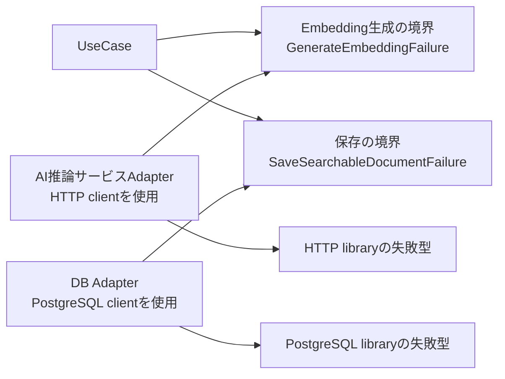
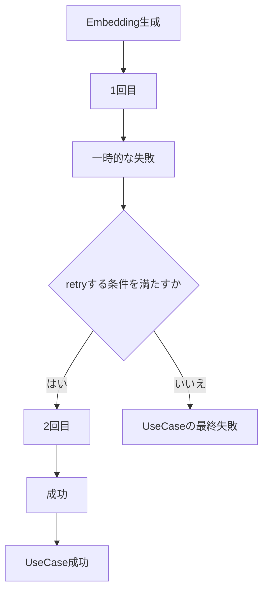
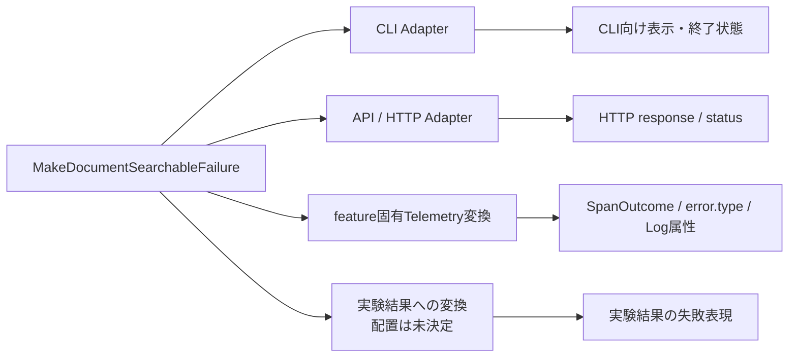
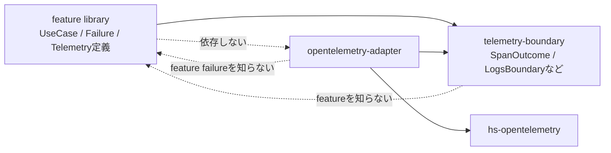
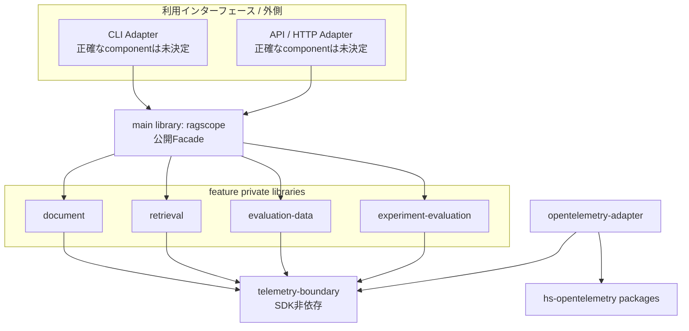
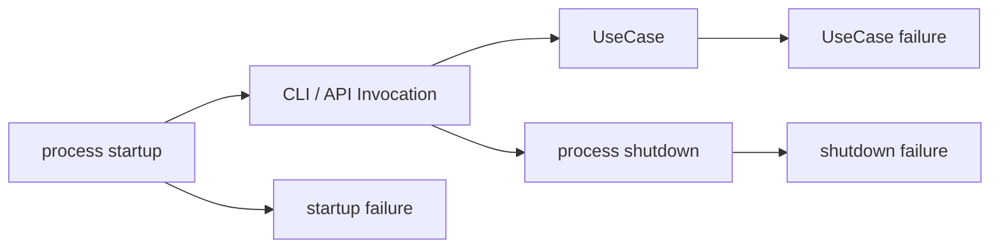

# RS-0024 失敗型と利用境界への変換設計メモ

> [!note]
> これはRAGScopeの失敗型と、CLI / API / Telemetry / 実験結果などへ失敗を変換する構造を整理した**Workbench上の設計メモ**であり、RAGScopeの正本ではない。
> 現在の正本で決定済みの内容と、このメモで採用して進めるHaskell実装案を分けて書く。
> 正確なmodule名、Cabal component名、関数名、型は、正本リポジトリへ設計・実装として反映された時点のコード、`ragscope.cabal`、テストを正本とする。

## 結論

RAGScopeでは、各UseCaseや内部処理が**その処理に固有の具体的な失敗型**を持つ。

UseCaseは、内部処理で起き得る失敗を全部外へ漏らすのではなく、retryやfallbackを行った後でも最終的に呼び出し元へ返す必要がある失敗だけを、UseCase自身の失敗型として返す。

CLI / API / Telemetry / 実験結果などは、その具体的な失敗値から、それぞれが必要とする表現へ変換する。現在は共通の`AppError`へ一度まとめない。

Haskellでの変換は、まず**普通の純粋関数**を使う。複数の失敗型を同じ処理から多相的に扱う具体的な必要が出た場合だけ、その能力に対応する小さなtype classを検討する。

```text
内部処理の具体的な失敗
        ↓
UseCaseが最終結果を判断する
        ↓
UseCase固有の失敗型
        ├─→ CLI向けの表示・終了状態
        ├─→ API向けのHTTP表現
        ├─→ TelemetryのSpanOutcome / error.type / Log属性
        └─→ 実験結果へ保存する失敗表現
```

## 現在の正本で決定済みのこと

現在の正本から、少なくとも次は決定済みである。

- 同じ利用者操作は、CLIから呼んでもAPIから呼んでも同じUseCaseとして扱う。
- RAGScopeアプリケーションが、処理順序、retry、timeout、fallback、処理を続けるか終了するかを決める。
- UseCaseや内部処理は、それぞれの処理に必要な具体的なerror typeを持つ。
- 具体的なerror typeから、API / CLI、実験結果、Telemetryの`error.type`へ、必要な境界で直接変換する。
- RAGScope共通の`RAGScopeError`やObservability専用の共通error分類を、Telemetryのために新設しない。
- Telemetryの記録やexportが失敗しても、成功していた機能処理を失敗扱いへ変更しない。
- RAGScopeアプリケーションのfeature実装はprivate Cabal libraryへ分け、main libraryは公開Facadeとする。
- UseCaseや内部処理はOpenTelemetry SDKへ直接依存せず、SDK非依存のTelemetry境界を利用する。OpenTelemetry Adapterがその境界をSDKへ接続する。

一方、次は現在の正本ではまだ固定されていない。

- 失敗を`Either`、`ExceptT`、その他のどのHaskell表現で返すか
- UseCase失敗型の正確なconstructor
- CLI / API / Telemetryへの変換を関数にするかtype classにするか
- CLI / API Adapterの正確なCabal component / module配置
- 実験結果への失敗変換をどのcomponentが所有するか
- process起動・shutdown時の失敗型の正確な構造

このメモでは、これらの未決定部分について、現在の依存方向とHaskellでの扱いやすさから実装案を置く。

## 失敗型はどこで持つか

### 内部処理の失敗

内部処理は、その処理を呼ぶ側が判断に必要な情報を失わない具体的な失敗型を返す。

例えば、文書を検索可能にするUseCaseの内部に次の処理があるとする。

```text
文書を読む
  ↓
文書チャンクを作る
  ↓
Embeddingを生成する
  ↓
文書チャンクとEmbeddingを保存する
```

それぞれの境界は、概念的には次のような型を持つ候補になる。

```haskell
readDocument
  :: DocumentSource
  -> IO (Either ReadDocumentFailure Document)

generateEmbedding
  :: DocumentChunk
  -> IO (Either GenerateEmbeddingFailure Embedding)

saveSearchableDocument
  :: [DocumentChunkWithEmbedding]
  -> IO (Either SaveSearchableDocumentFailure ())
```

正確な型名と引数は案であり、現在設計として確定していない。

重要なのは、`GenerateEmbeddingFailure`へHTTP client libraryの`HttpException`をそのまま出したり、`SaveSearchableDocumentFailure`へPostgreSQL library固有の例外型をそのまま出したりしないことである。

UseCaseが依存する境界では、UseCaseが判断に必要な意味へ変換した失敗型を使う。



この図の矢印は**静的に参照する方向**を表す。

Adapterは外部libraryの失敗を、UseCase側の境界が定義する失敗へ変換する。

```text
HttpException
    ↓ AI推論サービスAdapterで変換
GenerateEmbeddingFailure
    ↓
UseCase
```

```text
PostgreSQL clientの失敗
    ↓ DB Adapterで変換
SaveSearchableDocumentFailure
    ↓
UseCase
```

こうすると、UseCaseやfeature libraryがHTTP / PostgreSQLの具体的なpackageへ逆向きに依存しない。

## UseCase自身の失敗型

UseCaseは、最終的に呼び出し元へ返り得る失敗だけを、自分の失敗型として持つ。

例えば次の形を候補とする。

```haskell
data MakeDocumentSearchableFailure
  = DocumentReadFailed ReadDocumentFailure
  | EmbeddingFailed GenerateEmbeddingFailure
  | SaveFailed SaveSearchableDocumentFailure
```

この型は「内部で発生した失敗の履歴」ではなく、**UseCaseが回復できず、最終的に失敗として返す理由**を表す。

例えばEmbedding生成で1回目が失敗しても、retryして2回目に成功したなら、1回目の失敗を`MakeDocumentSearchableFailure`としてUseCaseの外へ返さない。



UseCase failureへ持ち上げるかどうかは、途中で失敗したかではなく、UseCaseが最終的に成功したか失敗したかで決まる。

## CLI / API / Telemetryへの変換

UseCaseの失敗型を、CLI、API、Telemetry用の共通型へ早い段階で変換しない。

元の具体的な失敗値を保持したまま、必要な利用境界で必要な形へ変換する。



### CLI

CLI AdapterがUseCase failureを知り、CLIで必要な表示や終了状態へ変換する。

候補は単純な純粋関数である。

```haskell
toCliError
  :: MakeDocumentSearchableFailure
  -> CliError
```

`CliError`の正確な型とmodule配置はCLI設計時に決める。

### API / HTTP

API / HTTP Adapterも同様に、UseCase failureからHTTP用の表現へ変換する。

```haskell
toHttpError
  :: MakeDocumentSearchableFailure
  -> HttpError
```

HTTP statusやresponse bodyはUseCase failure型へ入れない。UseCaseはHTTPでどう見せるかを知らない。

### Telemetry

Telemetryは少し配置が異なる。

UseCaseやfeature固有の失敗からTelemetryへ何を記録するかは、そのfeatureが知る。一方、OpenTelemetry SDKへどう書き込むかは`opentelemetry-adapter`が知る。

現在のRS-0024実装では、SDK非依存の`SpanOutcome`がすでに`telemetry-boundary`にある。

そのため、例えばfeature側に次のような純粋変換を置く候補がある。

```haskell
makeDocumentSearchableSpanOutcome
  :: Either MakeDocumentSearchableFailure result
  -> SpanOutcome
```

または、失敗値から`error.type`として使う安定した値だけを作り、`SpanOutcome`の組み立てを別関数へ分けてもよい。

ここで重要なのは、`opentelemetry-adapter`側が`MakeDocumentSearchableFailure`をimportしないことである。



破線は「この依存を作らない」という意味である。

feature側は`SpanOutcome`やLogs境界などRAGScope側の小さいTelemetry APIだけを知る。OpenTelemetry Adapterはfeature固有の失敗を知らず、渡されたSDK非依存の値をSDKへ写す。

## Cabalで守りたい依存方向

現在のADR-0008とRS-0024の構造を前提にすると、依存方向は次の形を目標にする。



この図では、CLI / APIが公開Facadeを通してUseCaseを利用する形を第一候補としている。

ただし、CLI / API Adapterを同じCabal package内のprivate libraryとして分け、特定feature libraryへ直接依存させる構成もCabal上は可能である。どちらを採用するかはCLI / API実装時に、そのAdapterが必要とする公開APIと`build-depends`を確認して決める。

少なくとも、次の逆方向は作らない。

```text
feature library -> CLI Adapter
feature library -> HTTP Adapter
feature library -> opentelemetry-adapter
feature library -> HTTP client library      ※UseCaseの責務として不要な場合
feature library -> PostgreSQL client library ※UseCaseの責務として不要な場合
telemetry-boundary -> feature library
opentelemetry-adapter -> feature library    ※feature固有error変換のためだけの依存
```

HTTPやDBの具体的な処理自体をfeature library内のAdapter moduleとして実装する場合は、その外部package依存をfeature libraryへ許可することになる。ADR-0008では、外部package依存を一部moduleだけへ限定したい場合は別private libraryへ分ける方針が採用済みなので、実装時に`build-depends`を見て判断する。

## `AppError`を作らない理由

### 旧`AppError` record

旧設計では、機能の失敗を次のような共通情報へ変換していた。

```haskell
data AppError = AppError
  { category :: ErrorCategory
  , code :: ErrorCode
  , message :: ErrorMessage
  , context :: Maybe ErrorContext
  , cause :: Maybe ErrorCause
  }
```

外部へ安全な共通形式で渡すには便利だが、Applicationがretry、fallback、終了判断を行う前にこの形へまとめると、元の失敗型が持っていた判断材料を失いやすい。

現在は具体的な失敗値を保持し、必要な境界でだけ変換する方がRAGScopeの処理制御に合う。

### 巨大な直和型

次のような全feature共通の直和型も現在は作らない。

```haskell
data AppError
  = MakeDocumentSearchableError MakeDocumentSearchableFailure
  | DenseSearchError DenseSearchFailure
  | ExperimentError ExperimentFailure
```

この型を1か所へ置くと、その場所が複数featureの失敗型をすべて知る必要がある。

RAGScopeではfeatureをprivate Cabal libraryへ分けて静的依存を制限するため、failureだけを理由に全featureを中央の型へ結び付ける利点が現在はない。

## type classを先に作らない理由

例えば次のtype classは、現時点では作らない。

```haskell
class ToCliError e where
  toCliError :: e -> CliError

class ToHttpError e where
  toHttpError :: e -> HttpError

class ToTelemetryError e where
  toTelemetryError :: e -> TelemetryError
```

CLI Adapterが`MakeDocumentSearchableFailure`を受け取ることをすでに知っているなら、普通の関数で十分である。

```haskell
toCliError
  :: MakeDocumentSearchableFailure
  -> CliError
```

普通の関数を第一候補にすると、次の利点がある。

- instanceの定義場所を考えなくてよい。
- orphan instanceを避けられる。
- 同じ失敗型でも、公開APIと管理APIなどで異なる変換関数を持てる。
- どのmoduleがどの変換を所有するかがimportから分かる。
- type classを使わなくても、純粋関数として単体テストできる。

将来、複数の異なる失敗型を同じrunnerが本当に多相的に扱う必要が出た場合は、その時点で必要な能力だけを切り出す。

例えば共通retry処理が必要なら、いきなり広い`AppError` type classを作るのではなく、まず判定関数を渡す形を比較する。

```haskell
runWithRetry
  :: (failure -> RetryDecision)
  -> IO (Either failure result)
  -> IO (Either failure result)
```

それでも複数箇所で同じ能力を型制約として要求する価値があるなら、`RetryClassifiable`のように責務が限定されたtype classを検討する。

## process起動・shutdownの失敗はUseCase failureと分ける

UseCase failureは、利用者が実行したUseCaseが最終的に成立しなかった理由を表す。

一方、SDK初期化、設定読み込み、DB pool構築、shutdownなど、UseCaseを呼ぶ前後のprocess lifecycleで起きる失敗は別の責務である。



`startup failure`や`shutdown failure`の正確な型はまだ決めない。少なくとも、UseCaseが返すfailure ADTへ機械的に混ぜない。

## Telemetry failureはfeature failureへ入れない

Telemetryの記録・export失敗だけを理由に、成功したUseCaseを失敗へ変えない。

そのため、例えば次のようなconstructorをUseCase failureへ追加しない。

```haskell
-- 採用しない例
data MakeDocumentSearchableFailure
  = ...
  | TelemetryFailed TelemetryFailure
```

ただし、型に入れないだけで十分ではない。

現在のLogs境界のEmitterは`LogRecord -> IO ()`や`EventRecord -> IO ()`なので、OpenTelemetry AdapterがSDKの同期例外をそのまま外へ投げれば、結果としてUseCase処理を壊せる。

したがってAdapter実装では、Telemetry固有の記録失敗をfeatureの結果から隔離する必要がある。

一方、`ThreadKilled`などの非同期例外まで一律に握りつぶす意味ではない。どの例外を隔離し、どの例外を再throwするかはAdapter実装で実際のSDK挙動を確認して決める。

## `EventNameValidationFailure`の扱い

現在のRS-0024 Logs境界には次がある。

```haskell
newtype EventName = EventName Text

data EventNameValidationFailure
  = EmptyEventName

mkEventName
  :: Text
  -> Either EventNameValidationFailure EventName
```

`EventNameValidationFailure`が存在することだけを理由に、これをUseCase failureへ追加しない。

まず確認すべきなのは、`mkEventName`を**いつ、どのmoduleが、どの値で呼ぶか**である。

RAGScope固有の`EventName`は、例えば`ragscope.document.retry`のような安定した名前をfeature固有Telemetry定義で持つ可能性が高い。この場合、空文字は利用者操作中に自然発生する機能上の失敗ではなく、Telemetry定義の組み立てミスに近い。

候補となる扱いは次のとおり。

```text
feature固有Telemetry定義
    ↓ 固定のEventName文字列
mkEventName
    ↓
有効なEventNameを保持して利用
```

どの時点で検証済み`EventName`を作るか、失敗時にprogrammer errorとして扱うか、初期化failureとして扱うかはまだ決めない。実際の呼び出し箇所を決めてから判断する。

## テストで確認したいこと

この設計を正本へ反映・実装する場合、少なくとも次を型とテストで確認したい。

- UseCase failureの各constructorから、CLI / API用の変換が意図した値になる。
- feature固有のTelemetry変換が、同じ種類の失敗から安定した同じ`error.type`を作る。
- retry途中の失敗から最終成功した場合、UseCaseはfailureを返さない。
- Adapter固有のHTTP / DB failureがUseCase公開型へ漏れていない。
- `ragscope.cabal`の`build-depends`で、featureからCLI / HTTP / OpenTelemetry Adapterへの不要な逆依存がない。
- OpenTelemetry Adapterの記録失敗だけで、成功したfeature結果が失敗へ変わらない。
- Telemetry用へ変換した後も、元のUseCase failure値を失っていない。

## 現時点で採用して進めること

1. 内部処理は、その処理の呼び出し側が判断に必要な具体的な失敗型を返す。
2. 外部library固有の失敗はAdapterでPort側の失敗型へ変換し、UseCaseへ外部library型を漏らさない。
3. UseCaseは、retry / fallback後も最終的に外へ返す失敗だけをUseCase固有failure ADTへまとめる。
4. CLI / API / Telemetry / 実験結果は、UseCase failureからそれぞれが必要な表現へ直接変換する。
5. 変換は普通の純粋関数を第一候補とする。
6. 共通`AppError` record、全featureを束ねる巨大な`AppError` ADT、広い`AppError` type classは現在作らない。
7. type classは、複数の失敗型へ同じ能力を要求する具体的な利用箇所ができた場合だけ、その能力に絞って再検討する。
8. process startup / shutdown failureとUseCase failureを分離する。
9. Telemetry failureをfeature failure channelへ入れない。
10. `EventNameValidationFailure`は、実際の`mkEventName`呼び出し位置と値の寿命を決めてからhandlingを決める。

## まだ決めないこと

- `Either`と`ExceptT`のどちらをUseCase公開APIで使うか
- 正確なUseCase failure constructor
- CLI / API AdapterのCabal componentとmodule名
- main FacadeがUseCase failure型をどこまでre-exportするか
- 実験結果への失敗変換をどのcomponentが所有するか
- Portを関数、`newtype`で包んだ関数値、関数recordのどれで表現するか
- startup / shutdown failureの正確な型
- `EventName`をいつ検証済み値へするか
- 共通retry runnerが本当に必要か、その場合に関数を渡すかtype classを使うか

これらは、具体的な呼び出し元、型、import、Cabal `build-depends`が見える時点で決める。

## 関連するWorkbench Note

- [[RS-0024 Haskellライブラリ・モジュールマップ]]
- [[OOPのinterfaceとHaskellの関数値によるDIメモ]]
- [[RS-0023 Observability設計メモ]]
- [[RS-0023 Trace設計メモ]]
- [[RS-0023 Logs設計メモ]]

## 確認したRAGScope正本

- [ADR-0006 OpenTelemetryをObservabilityの共通基盤とし、Trace・Logs・Metricsの責務を分ける](https://github.com/takashit16833/RAGScope/blob/main/project-docs/adr/ADR-0006%20OpenTelemetry%E3%82%92Observability%E3%81%AE%E5%85%B1%E9%80%9A%E5%9F%BA%E7%9B%A4%E3%81%A8%E3%81%97%E3%80%81Trace%E3%83%BBLogs%E3%83%BBMetrics%E3%81%AE%E8%B2%AC%E5%8B%99%E3%82%92%E5%88%86%E3%81%91%E3%82%8B.md)
- [ADR-0008 RAGScopeアプリケーションの機能実装をprivate libraryへ分け、main libraryをFacadeとする](https://github.com/takashit16833/RAGScope/blob/main/project-docs/adr/ADR-0008%20RAGScope%E3%82%A2%E3%83%97%E3%83%AA%E3%82%B1%E3%83%BC%E3%82%B7%E3%83%A7%E3%83%B3%E3%81%AE%E6%A9%9F%E8%83%BD%E5%AE%9F%E8%A3%85%E3%82%92private%20library%E3%81%B8%E5%88%86%E3%81%91%E3%80%81main%20library%E3%82%92Facade%E3%81%A8%E3%81%99%E3%82%8B.md)
- [ユースケース設計](https://github.com/takashit16833/RAGScope/blob/main/project-docs/design/%E3%83%A6%E3%83%BC%E3%82%B9%E3%82%B1%E3%83%BC%E3%82%B9%E8%A8%AD%E8%A8%88.md)
- [Observability設計](https://github.com/takashit16833/RAGScope/blob/main/project-docs/design/observability/Observability%E8%A8%AD%E8%A8%88.md)
- [RS-0024 Ticket](https://github.com/takashit16833/RAGScope/blob/RS-0024/logs-records/project-docs/project-management/milestones/v0.0/error-logging/RS-0024%20RAGScope%E3%82%A2%E3%83%97%E3%83%AA%E3%82%B1%E3%83%BC%E3%82%B7%E3%83%A7%E3%83%B3%E3%81%B8OpenTelemetry%20Observability%E6%9C%80%E5%B0%8F%E5%9F%BA%E7%9B%A4%E3%82%92%E5%AE%9F%E8%A3%85%E3%81%99%E3%82%8B.md)
- [現在のTrace境界実装](https://github.com/takashit16833/RAGScope/blob/RS-0024/logs-records/ragscope-app/telemetry-boundary/RAGScope/Telemetry/Trace.hs)
- [現在のLogs境界実装](https://github.com/takashit16833/RAGScope/blob/RS-0024/logs-records/ragscope-app/telemetry-boundary/RAGScope/Telemetry/Logs.hs)
- [現在のCabal構成](https://github.com/takashit16833/RAGScope/blob/RS-0024/logs-records/ragscope-app/ragscope.cabal)
