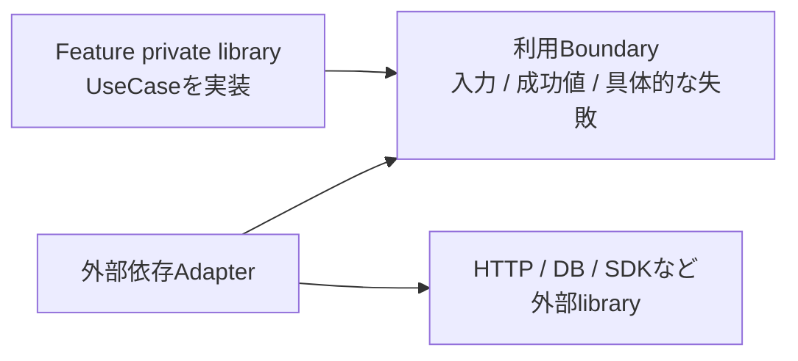
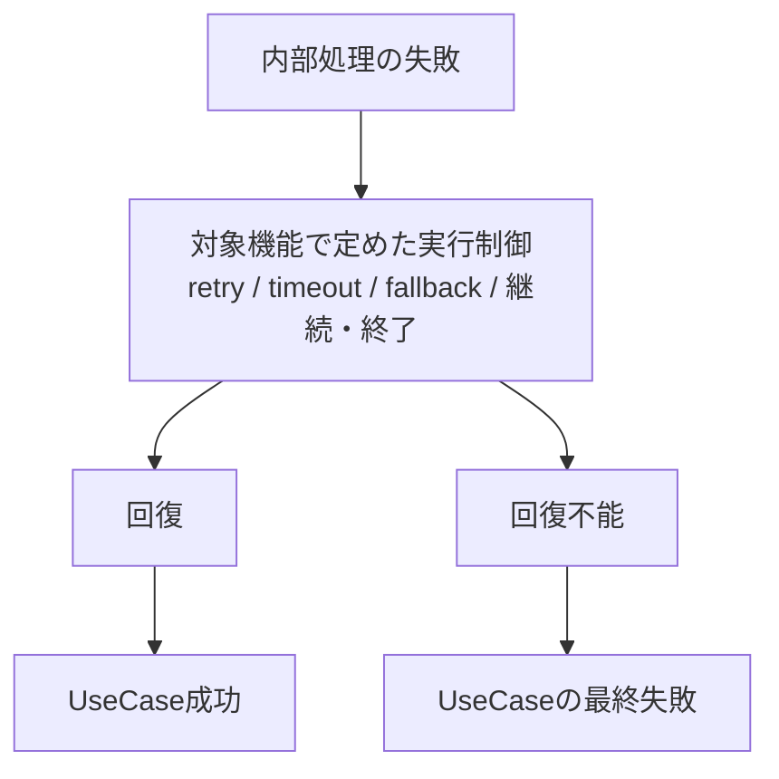
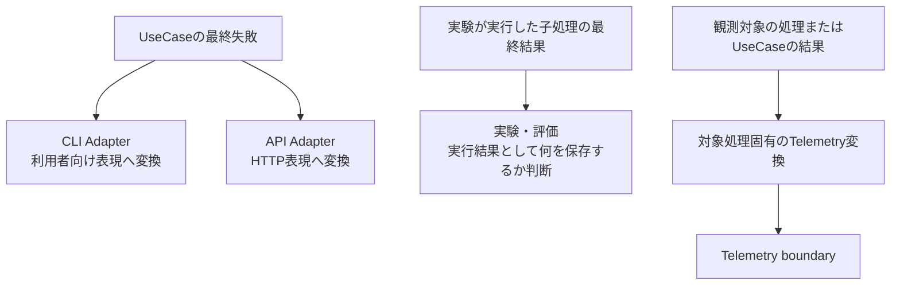
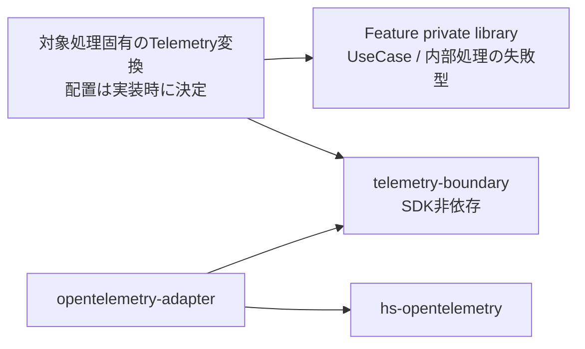
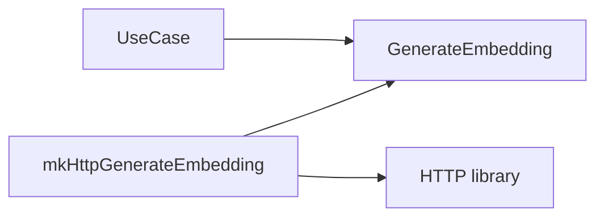
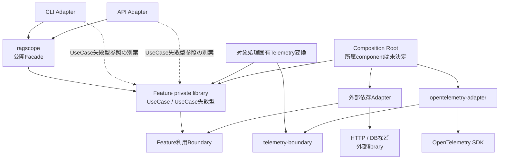
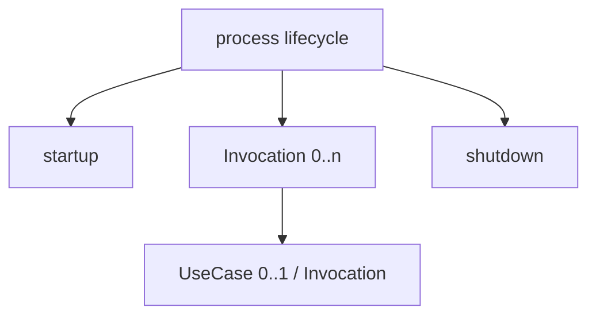

# RS-0024 失敗型と利用境界への変換設計メモ

> [!note]
> これはRAGScopeの失敗型と利用境界を、Haskellで実装するときの具体化候補まで含めて残す**Workbench上の設計メモ**であり、RAGScopeの正本ではない。
> 現在仕様・採用済み設計はRAGScope正本リポジトリを優先する。このメモの型名、関数名、module名、private library名、Mermaidの具体配置は、実装時の有力な候補・判断材料であり、コード、`ragscope.cabal`、テストへ反映された時点ではそちらを正本とする。

正本側の現在設計:

- [RAGScopeアプリケーション失敗設計](https://github.com/takashit16833/RAGScope/blob/RS-0024/logs-records/project-docs/design/RAGScope%E3%82%A2%E3%83%97%E3%83%AA%E3%82%B1%E3%83%BC%E3%82%B7%E3%83%A7%E3%83%B3%E5%A4%B1%E6%95%97%E8%A8%AD%E8%A8%88.md)
- [ADR-0010 — RAGScopeアプリケーションの失敗を処理単位の具体型で扱う](https://github.com/takashit16833/RAGScope/blob/RS-0024/logs-records/project-docs/adr/ADR-0010%20RAGScope%E3%82%A2%E3%83%97%E3%83%AA%E3%82%B1%E3%83%BC%E3%82%B7%E3%83%A7%E3%83%B3%E3%81%AE%E5%A4%B1%E6%95%97%E3%82%92%E5%87%A6%E7%90%86%E5%8D%98%E4%BD%8D%E3%81%AE%E5%85%B7%E4%BD%93%E5%9E%8B%E3%81%A7%E6%89%B1%E3%81%86.md)

## 結論

実装時の基本線は次で考える。

- 各UseCase・内部処理は、その処理の呼び出し側が判断に必要な具体的な失敗型を持つ。
- 外部library固有のerror値・例外は、必要性なくUseCaseの公開契約へ漏らさず、Adapterで利用側の失敗へ変換する。
- retry、timeout、fallback、継続・終了はRAGScopeアプリケーションコンポーネントが所有する。実際の判断・実行をどのUseCase / moduleへ置くかは対象機能ごとに決める。
- UseCaseの最終失敗は、途中で起きた失敗の履歴ではなく、実行制御を経てもUseCaseの結果を作れなかった理由を表す。
- CLI / API、実験・評価、Telemetryを「同じfailureの変換先」として横並びにしない。
- CLI / APIの表現変換、Telemetry向けの観測表現への変換は、追加のI/Oが不要なら普通の純粋関数を第一候補とする。
- `AppError` record、全featureを束ねる巨大な`AppError` ADT、広い`AppError` type classは作らない。
- type classは、本当に複数の異なる型へ同じ能力を要求する多相処理が現れた時点で、その能力だけを狭く切り出す。
- Port / BoundaryのDIは、まず関数または関数を保持する値で表す案を優先する。正確な表現は実装時に決める。
- Telemetryの記録・exportの失敗、process startup / shutdownの失敗、中断・キャンセルは、UseCaseや内部処理が失敗型の値として返す通常の失敗として機械的に扱わない。

## 現在の正本で決定済みのこと

現在の正本から、少なくとも次は決定済みである。

- アプリケーション全体の失敗を共通`AppError` / `RAGScopeError` / `ErrorCategory`へ正規化しない。
- UseCaseや内部処理は、呼び出し側が必要な扱いを行える具体的な失敗型を持つ。
- UseCase内部で呼び出す処理の失敗型を、UseCaseの最終失敗としてそのまま利用できるのは、次をすべて満たす場合だけである。
  - UseCase呼び出し側へ公開する意味を持つ。
  - 型を定義するmodule / private libraryへの静的依存が妥当である。
  - UseCaseの内部実装詳細を漏らさない。
- 外部libraryの既知のerror値・同期例外はAdapterで利用側の具体的な失敗へ変換できる。
- async exceptionや意図された中断・キャンセルは通常失敗へ変換しない。
- 想定外同期例外を既知の失敗constructorへ一律に押し込まない。
- RAGScopeアプリケーションコンポーネントがretry、timeout、fallback、継続・終了の実行制御を所有する。ただしUseCase外側の共通制御層を必須とはしない。
- retry / fallback途中で回復した失敗は、UseCaseの最終失敗ではない。
- CLI / API、実験・評価、Telemetryは同種の変換先ではない。
- 実験結果は任意の失敗の保存先ではなく、実験・評価が自身の実行結果として必要な情報を決める。
- 実験・評価の「状態」「エラー」「成功率」「タイムアウト率」の具体的な意味は、現在の失敗設計では決めない。
- Telemetryの`error.type`等は観測用の表現であり、元の失敗値を置き換えない。
- 失敗型を定義するmoduleへTelemetry都合の責務を持たせず、汎用Telemetry boundary / OpenTelemetry Adapterから個別のFeature private libraryで定義するUseCaseまたは内部処理の失敗型へ逆依存させない。
- Telemetryの記録・export失敗だけを理由に、成功していた観測対象の処理結果またはUseCase実行結果を失敗へ変更しない。
- startup / shutdown failureは個別UseCase failureへ含めない。process全体の成功・失敗や終了状態への反映は未決定である。

## このメモで保持する実装時の判断材料

正本が固定していない部分について、現時点で有力なHaskell実装案をここへ残す。実装時には必ずその時点の正本、実際の呼び出し関係、import、`build-depends`を確認して再評価する。

## 処理ごとの失敗型

内部処理は、呼び出し側が判断に必要な意味を失わない失敗型を返す。

例えば文書を検索可能にする処理を考えると、候補は次のようになる。

```haskell
readDocument
  :: DocumentSource
  -> IO (Either ReadDocumentFailure Document)

generateEmbedding
  :: DocumentChunk
  -> IO (Either GenerateEmbeddingFailure Embedding)

saveSearchableDocument
  :: [DocumentChunkWithEmbedding]
  -> IO (Either SaveSearchableDocumentFailure ())
```

失敗型のconstructor候補は、例えば次のように処理固有の意味を持たせる。

```haskell
data GenerateEmbeddingFailure
  = EmbeddingRequestTimedOut
  | EmbeddingServiceUnavailable
  | EmbeddingResponseInvalid

data ReadDocumentFailure
  = DocumentNotReadable
  | DocumentInvalidUtf8
  | DocumentEmpty
```

正確な型名・constructor・引数は案であり、各機能の設計・実装で決める。

重要なのは、`GenerateEmbeddingFailure`へHTTP clientの`HttpException`をそのまま露出したり、保存処理の失敗へDB driver固有型をそのまま露出したりしないことである。

## 外部libraryの失敗はAdapterで止める

静的依存の基本候補は次である。



実行時の変換は例えば次のようになる。

```text
HttpException
    ↓ AI推論サービスAdapterが解釈
GenerateEmbeddingFailure
    ↓
UseCase
```

Adapterで例外を扱うときは、次を区別する。

- 外部libraryが通常の失敗として定義している既知のerror値・同期例外
  - 利用側の失敗型へ変換する候補である。
- async exception、中断、キャンセル
  - 通常の失敗へ変換せず、呼び出し元へ伝播させる。
- 想定外の同期例外
  - `InternalError`のような既知constructorへ一律に押し込まない。

どの同期例外を通常失敗として扱うかは、対象libraryと、そのAdapterを利用する処理の契約を確認して決める。

## UseCaseの最終失敗

UseCase専用ADTを必ず作るわけではない。

UseCase内部で呼び出す処理の失敗を、そのままUseCaseの最終失敗として利用できるのは、正本で決まった3条件をすべて満たす場合だけである。ここでは次の2ケースを分けて考える。

### UseCase内部で呼び出す処理の失敗型をそのまま利用できる場合

UseCase内部で呼び出す処理の失敗型自体が3条件を満たしており、UseCase呼び出し側へ公開してもよい場合は、UseCaseとして「どの処理が最終失敗になったか」を区別するため、内部処理の失敗値をUseCase failureのconstructorの引数として保持する候補がある。

```haskell
-- GenerateEmbeddingFailure自体が正本の3条件を満たす場合の例。
data MakeDocumentSearchableFailure
  = EmbeddingGenerationFailed GenerateEmbeddingFailure
  | ...
```

`EmbeddingGenerationFailed` constructorはUseCase上の文脈を追加するが、`GenerateEmbeddingFailure`への静的依存や、その型が持つ意味を消すものではない。

### UseCase内部で呼び出す処理の失敗型を公開できない場合

UseCase内部で呼び出す処理の失敗型が3条件を満たさない場合は、その型の値をUseCase固有ADTのconstructorの引数として保持するだけでは問題は解消しない。

例えば、次の形は`GenerateEmbeddingFailure`への依存をそのまま残すため、3条件違反を隠す解決にはならない。

```haskell
-- 内部処理の失敗型を公開できない場合、この構造だけでは不十分。
data MakeDocumentSearchableFailure
  = EmbeddingGenerationFailed GenerateEmbeddingFailure
```

この場合は、UseCase呼び出し側へ公開する意味をUseCase側で所有し、`GenerateEmbeddingFailure`のようなUseCase内部で呼び出す処理の失敗型を公開契約から除く変換が必要になる。概念例としては次のような形である。

```haskell
-- constructor名は説明用の候補であり、採用済みではない。
data MakeDocumentSearchableFailure
  = EmbeddingGenerationTimedOut
  | EmbeddingGenerationUnavailable
  | ...
```

重要なのはconstructor名ではなく、**UseCase内部で呼び出す処理の失敗型をUseCase failureのconstructorの引数として保持しただけでは、その型への静的依存や内部実装詳細の漏出は解消しない**という点である。

UseCaseの最終失敗は「内部で起きた失敗一覧」でもない。



RAGScopeアプリケーションが実行制御を所有することは、UseCase外側へ共通runnerを必ず置くという意味ではない。例えばEmbedding要求のretry判断をUseCase内部のhelperへ置く設計も、対象機能の責務として妥当なら選択肢に入る。

## CLI / APIは純粋な変換を第一候補にする

CLI / APIはUseCaseの最終失敗を利用者向け表現へ変換する。

追加のI/Oを必要としない部分は、まず純粋関数として分けることを第一候補とする。値の変換と、表示・process終了・HTTP response送信などのeffectfulな処理を分離できるためである。

```haskell
toCliFailure
  :: MakeDocumentSearchableFailure
  -> CliFailure

toHttpFailure
  :: MakeDocumentSearchableFailure
  -> HttpFailure
```

概念的には次の2段階に分ける。

```text
UseCaseの最終失敗
        │
        │ pure
        ▼
CLI / HTTP向けの値
        │
        │ effect
        ▼
表示 / process終了 / HTTP response送信
```

こうすると、UseCaseへ`ExitCode`、HTTP `StatusCode`、response bodyなどを持ち込まずに済み、変換だけを単体テストできる。

`CliFailure` / `HttpFailure`の正確な型、module、Cabal componentはCLI / API実装時に決める。

### UseCaseの失敗型をCLI / APIからどう参照するか

上の`toCliFailure` / `toHttpFailure`は、CLI / API側から`MakeDocumentSearchableFailure`を参照できることを前提にした候補である。その依存経路は現在まだ決まっていない。

少なくとも次を比較する必要がある。

1. main libraryの公開Facadeが`MakeDocumentSearchableFailure`のようなUseCaseの失敗型を公開またはre-exportし、CLI / APIがFacade経由で参照する。
2. 同一Cabal package内のCLI / API Adapterが、そのUseCaseを実装するFeature private libraryへ直接`build-depends`し、UseCaseの失敗型を参照する。

ADR-0008はmain libraryを公開Facadeとすることを決めているが、CLI / API AdapterがFeature private libraryで定義するUseCaseの失敗型を必ずFacade経由でしか参照してはならない、とまでは決めていない。

実装時には、UseCaseの呼び出し経路、Facadeの公開API、CLI / API Adapterのcomponent、`MakeDocumentSearchableFailure`のようなUseCaseの失敗型をどこまで外部へ見せるかを合わせて決める。

## CLI / API / 実験・評価 / Telemetryを横並びにしない

以前のメモにあった次の形は採用しない。

```text
UseCase Failure
├─ CLI
├─ API
├─ 実験結果
└─ Telemetry
```

関係はそれぞれ異なる。



- CLI / API: 利用者向けの**表現変換**である。
- 実験・評価: 子処理の最終結果を受け取り、実験ドメインの**実行結果**として何を保存・評価・集計するかを決める。
- Telemetry: 観測対象の処理またはUseCaseの結果を、観測用の**Telemetry表現**へ変換する。

実験・評価は、任意のUseCase failureを受け取り、共通の実験結果エラー形式へ自動的に変換する処理ではない。

## 実験・評価の具体型はまだ固定しない

以前の検討では、例えば次のような型を考えた。

```haskell
-- 以前の検討例。採用済みの型ではない。
data EvaluationItemExecutionResult
  = EvaluationItemCompleted ...
  | EvaluationItemFailed EvaluationItemExecutionFailure
```

ここで重要なのは具体的な型名ではなく、評価データ1件の**実行結果**を実験・評価ドメインが所有する、という考え方である。

次は後続の実験・評価設計で決める。

- どの子処理の失敗を評価データごとの実行結果へ保存するか
- `state`と`error`をどの型・値で表すか
- success rate / timeout rateの分母と分子
- timeoutをどの処理単位で集計するか
- 実験基盤自身の失敗と評価対象処理の失敗をどの型で分けるか

「実行Outcome」のような独自の混在表現は使わず、文書では「実行結果」と呼ぶ。

## timeoutを1種類として扱わない

`Timeout`という名前だけでは、その失敗の意味も保存先も決められない。重要なのは、**どの処理が時間内に完了しなかったか**と、**その失敗が呼び出し元の処理の最終結果へどう影響したか**である。

| 発生したこと | 呼び出し元の処理への影響 | 実験・評価 | Telemetry |
|---|---|---|---|
| HTTP attemptがtimeoutし、その後retry成功 | UseCaseは成功し得る | retry途中の失敗だけを理由に実験結果の失敗へしない | 必要ならattempt失敗として観測する候補 |
| retry等を経ても対象処理がtimeoutで完了不能 | 呼び出し元の処理の最終失敗になり得る | 何を保存・集計するかは実験・評価設計で決める | 対象処理の最終失敗として観測する候補 |
| 実験結果の保存処理がtimeout | 実験基盤側の失敗 | 評価対象処理のtimeoutと同一視しない。具体的な集計規則は未決定 | 保存処理として観測する候補 |
| OpenTelemetry exportがtimeout | 観測対象の処理結果またはUseCase実行結果とは独立 | 自動的に実験結果へ含めない | Telemetry基盤自身の失敗 |

この分析は、旧`ErrorCategory`の`Timeout`のような単一カテゴリへ失敗を押し込まない理由にもなる。

実験・評価のtimeout率を例えば「回答生成の最終timeout率」と定義する可能性はあるが、これは現在の要求だけでは確定していない。HTTP attempt timeoutやTelemetry timeoutまで同じ率へ数える、と先取りしてはならない。

## Telemetry変換の配置

Telemetryの変換で固定したいのは**依存方向**であり、具体的なmodule名ではない。

禁止したいのは次である。

```text
UseCaseまたは内部処理の失敗型を定義するmodule
    └─ Telemetry都合のmethodやfieldを持たせる

telemetry-boundary
    └─ 個別のFeature private libraryで定義するUseCaseまたは内部処理の失敗型をimportする

opentelemetry-adapter
    └─ 個別のFeature private libraryで定義するUseCaseまたは内部処理の失敗型をimportする
```

具体的な失敗とTelemetry boundaryの両方を参照できる側で、純粋変換を置く候補がある。

```haskell
toSpanOutcome
  :: MakeDocumentSearchableFailure
  -> SpanOutcome
```

または最終結果全体を受け取るなら、次のような候補もある。

```haskell
makeDocumentSearchableSpanOutcome
  :: Either MakeDocumentSearchableFailure result
  -> SpanOutcome
```

配置は少なくとも2案ある。

1. feature private library内のTelemetry統合moduleが`telemetry-boundary`へ依存する。
2. feature private libraryと`telemetry-boundary`の両方へ依存する小さな統合private libraryを置く。

どちらを採用するかは、実際のmodule、import、`build-depends`が見える時点で決める。



重要なのは、`telemetry-boundary`と`opentelemetry-adapter`から、個別のFeature private libraryで定義するUseCaseまたは内部処理の失敗型へ逆依存させないことである。

## HaskellのPort / Boundaryは関数値を第一候補にする

OOPのinterfaceを再現するためだけにtype classを作らず、必要な能力を関数としてDIする案を優先する。

例えばEmbedding生成なら次の形が候補になる。

```haskell
newtype GenerateEmbedding =
  GenerateEmbedding
    { runGenerateEmbedding
        :: DocumentChunk
        -> IO (Either GenerateEmbeddingFailure Embedding)
    }
```

HTTP Adapterはこの値を構築する。

```haskell
mkHttpGenerateEmbedding
  :: HttpClient
  -> GenerateEmbedding
```

UseCaseは`HttpClient`や`HttpException`ではなく`GenerateEmbedding`だけを見る。



ただし、`newtype`が常に必要という意味ではない。関数そのもの、`newtype`で包んだ関数、複数能力を束ねる関数recordのどれが利用箇所に必要な能力を過不足なく表せるかは、実際の引数、戻り値、利用箇所を確認して決める。

関連: [[OOPのinterfaceとHaskellの関数値によるDIメモ]]

## type classを先に作らない

次のような広いtype classは現時点では作らない。

```haskell
class AppError e where
  ...

class ToCliError e where
  toCliError :: e -> CliFailure

class ToHttpError e where
  toHttpError :: e -> HttpFailure
```

CLI Adapterが具体的な失敗型を既に知っているなら、普通の関数で十分である。

普通の関数を第一候補にすると、少なくとも次の利点がある。

- instanceの定義場所を考えなくてよい。
- orphan instanceを避けられる。
- 同じ失敗型から、用途ごとに異なる変換関数を持てる。
- どのmoduleが変換を所有するかがimportから分かる。
- 純粋関数なら単体テストが容易である。

共通retry処理が必要になった場合も、最初からtype classにせず、判定関数を渡す形を比較する。

```haskell
runWithRetry
  :: (failure -> RetryDecision)
  -> IO (Either failure result)
  -> IO (Either failure result)
```

実際に複数の異なる失敗型を同じtype class constraintで扱う関数が必要になった場合だけ、例えば`RetryDecidable`のような狭いtype classを再検討する。

## 主要な静的依存方向の実装候補

以下は、今回の設計判断をHaskell package / moduleへ落とすときの**実装ガイド**であり、完成したpackage構成図ではない。正確なprivate library名、Composition Rootの所属component、CLI / APIからFeature private libraryで定義するUseCaseの失敗型を参照する依存経路は固定しない。



実線も含め、この図は実装候補を表す。CLI / APIからUseCaseをどのcomponent経由で呼ぶか、Feature private libraryで定義するUseCaseの失敗型をFacadeから公開・re-exportするか、CLI / API AdapterがFeature private libraryへ直接依存するかは、実装時に公開APIと`build-depends`を確認して決める。

Composition Rootについても、Feature private library、External Adapter、OpenTelemetry Adapterを接続する責務を示しているだけであり、どのcomponent / moduleが所有するか、CLI / APIとどう接続するかは未決定である。

少なくとも次の逆依存は作らない。

```text
Feature -> CLI / API Adapter
Feature -> concrete external Adapter
Feature -> OpenTelemetry Adapter
telemetry-boundary -> Feature
opentelemetry-adapter -> Feature
```

外部AdapterをFeature private library内部のmoduleとして実装するか、別private libraryへ分けるかは、外部package依存を`build-depends`でどこまで隔離したいかを見て決める。BoundaryをFeature private library内、Feature固有の別private library、複数Featureで共有するprivate libraryのどこへ置くかは、実際に必要なmodule間の参照、import、外部package依存、Cabalの`build-depends`に基づいて決める。

この図は実装の正本ではない。実装後の正確な依存は`ragscope.cabal`とimportを確認する。

## `AppError`を作らない理由

旧設計のような共通recordは、外部向けの共通形式には便利だが、実行制御前に変換すると処理固有の判断材料を失いやすい。

```haskell
data AppError = AppError
  { category :: ErrorCategory
  , code :: ErrorCode
  , message :: ErrorMessage
  , context :: Maybe ErrorContext
  , cause :: Maybe ErrorCause
  }
```

また、全Featureを中央へ束ねる巨大な直和型も作らない。

```haskell
data AppError
  = MakeDocumentSearchableError MakeDocumentSearchableFailure
  | DenseSearchError DenseSearchFailure
  | ExperimentError ExperimentFailure
```

この形では、中央の型を置く場所が複数Featureの失敗型をすべて静的に知る必要があり、private libraryで依存方向を制約するRAGScopeでは新しい結合点になる。

`AppError` type classについても、現在はアプリケーション全体の失敗型へ共通して要求する多相操作がない。type classという手段自体を禁止するのではなく、必要な能力が生じる前に広い共通制約を導入しない、という判断である。

## startup / shutdownはUseCase failureと分ける

process lifecycle、Invocation、UseCaseは異なる実行境界である。現在のユースケース設計では、InvocationはUseCaseより広く、UseCaseを呼ばないInvocationもある。



この図は、1回のstartupとshutdownの間に複数Invocationがあり得ること、各InvocationがUseCaseを呼ばない場合もあることを示す概念図であり、具体的なruntime構造を決めるものではない。

決定済みなのは、startup / shutdown failureを個別UseCase failureへ機械的に含めないことまでである。

次はまだ決めない。

- `StartupFailure` / `ShutdownFailure`の正確な型
- startup / shutdown失敗をprocess全体の成功・失敗へどう反映するか
- exit codeへどう反映するか

## Telemetryの失敗はUseCaseや内部処理の失敗型へ入れない

次のようなconstructorはUseCaseの失敗型へ追加しない。

```haskell
-- 採用しない例
data MakeDocumentSearchableFailure
  = ...
  | TelemetryFailed TelemetryFailure
```

ただし型を分けるだけでは不十分で、Adapter実装も観測対象の処理結果やUseCase実行結果を壊さない必要がある。

現在のLogs境界が`LogRecord -> IO ()`や`EventRecord -> IO ()`である場合、OpenTelemetry AdapterがSDKの通常の記録失敗をそのまま外へ投げれば、成功していた観測対象の処理へ影響できる。そのためTelemetry固有の記録失敗は、正本のObservability規則に従って観測対象の処理結果やUseCase実行結果から隔離する。

一方で、async exceptionまで握りつぶさない。`ThreadKilled`等を通常のTelemetry failureとして吸収しないことは、UseCaseや内部処理が利用する外部依存Adapterと同じ原則である。

## `EventNameValidationFailure`の扱い

現在のRS-0024 Logs境界では、`EventName` constructorを公開せず、`mkEventName`を通して非空を検証した値だけを構築できるようにしている。

概ね次の公開APIである。

```haskell
data EventNameValidationFailure
  = EmptyEventName

mkEventName
  :: Text
  -> Either EventNameValidationFailure EventName
```

`EventNameValidationFailure`が存在することだけを理由にUseCase failureへ追加しない。

まず確認すべきなのは、`mkEventName`をいつ、どのmoduleが、どの値で呼ぶかである。RAGScope固有EventNameが固定値としてFeature private library内のTelemetry定義に置かれるなら、空文字は利用者操作中の通常失敗ではなく、定義・初期化側の問題に近い可能性がある。

ただし、programmer error、初期化failure、別の扱いのどれにするかは、実際の呼び出し位置を決めてから判断する。

## テストで確認したいこと

実装時には少なくとも次を確認する。

- UseCase内部で呼び出す処理の失敗型をそのままUseCaseへ公開する場合、正本の3条件を満たしている。
- UseCase内部で呼び出す処理の失敗型が3条件を満たさない場合、その型の値をUseCase failureのconstructorの引数として保持しただけで、同じ型への静的依存や内部詳細の漏出を残していない。
- retry / fallback途中の失敗から最終成功した場合、UseCaseは最終失敗を返さない。
- Adapter固有のHTTP / DB / SDK型がUseCaseの公開型へ漏れていない。
- async exceptionや意図された中断・キャンセルを通常failureへ変換していない。
- CLI / API向けの純粋変換が期待する表示値・status等を返す。
- CLI / APIがFeature private libraryで定義するUseCaseの失敗型を参照する依存経路が、選択したFacade公開APIと`build-depends`に一致している。
- 対象処理固有のTelemetry変換が安定した`error.type`を作る。
- Telemetry変換後も元の失敗値を失っていない。
- `telemetry-boundary` / `opentelemetry-adapter`から個別のFeature private libraryで定義するUseCaseまたは内部処理の失敗型への逆依存がない。
- `ragscope.cabal`の`build-depends`で意図したprivate library間の静的依存を制約できている。
- Telemetryの記録・export失敗だけで、成功していた観測対象の処理結果またはUseCase実行結果が失敗へ変わらない。
- timeoutのテストでは、attempt timeoutと呼び出し元の処理の最終timeoutを区別している。

## 実装時にまだ決めること

- 失敗を`Either`、`ExceptT`、その他のどの表現で公開するか
- 各機能で定義する正確な失敗型とconstructor
- UseCase内部で呼び出す処理の失敗型を再利用するか、UseCase呼び出し側へ公開する失敗型へ変換するか
- BoundaryをFeature private library内、Feature固有の別private library、複数Feature共有private libraryのどこへ置くか
- 外部AdapterをFeature private library内moduleまたは別private libraryのどちらへ置くか
- CLI / API Adapterの正確なCabal component / module
- `CliFailure` / `HttpFailure`の正確な型
- CLI / API AdapterがFeature private libraryで定義するUseCaseの失敗型をFacadeの公開・re-export経由で参照するか、Feature private libraryへ直接依存するか
- main FacadeがUseCaseの失敗型をどこまで公開・re-exportするか
- Composition Rootの所属component / moduleと、CLI / APIとの接続方法
- Portを関数、`newtype`、関数recordのどれで表すか
- 具体的なUseCaseまたは内部処理のTelemetry変換をFeature private library内に置くか、統合private libraryへ分けるか
- 実験・評価の実行結果型と、状態・エラー・成功率・タイムアウト率の定義
- startup / shutdown failureの型とprocess-levelの扱い
- `EventName`をいつ検証済み値へするか
- 共通retry runnerが本当に必要か、その場合に判定関数を渡すか狭いtype classを使うか

これらは、具体的な呼び出し元、型、import、`build-depends`が見える時点で決める。

## 関連するWorkbench Note

- [[RS-0024 Haskellライブラリ・モジュールマップ]]
- [[OOPのinterfaceとHaskellの関数値によるDIメモ]]
- [[RS-0023 Observability設計メモ]]
- [[RS-0023 Trace設計メモ]]