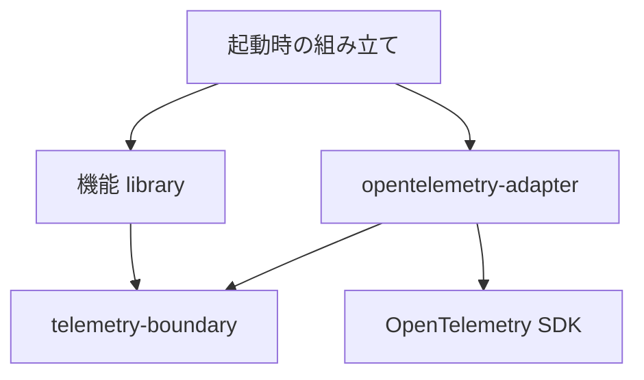

# RS-0024後続機能向けTelemetry利用API設計案

## 1. 推奨する構成

機能が観測対象の意味を型と純粋関数で定義し、共通境界が記録操作を提供し、OpenTelemetry AdapterがSDKへ接続する構成を推奨する。

- 機能固有の名前付き時点イベントは、必要な機能でADTとして表す。
- そのADTから既存の `EventRecord` への変換は、機能側の通常の純粋関数とする。
- 処理区間は既存の `withSpan` で囲み、その処理の最終結果から `SpanOutcome` を作る。Logs用ADTをそのままSpanの開始・終了命令にも使わない。
- `EventName` はコンストラクタを隠した通常の `newtype` を維持し、型レベルの文字列リテラルから、空文字列をコンパイル時に拒否して構築する。
- 機能ADTを共通のTelemetry libraryやOpenTelemetry Adapterへ集約しない。
- `ToEventRecord` 型クラス、汎用のイベント定義レコード、全Signalをまとめる万能ADTは追加しない。
- 既存の `LogsBoundary`、`TraceBoundary` は副作用の実装を差し替える境界として維持する。

「何が起きたか」を型で表し、「何を記録するか」を純粋関数で決め、「実際に記録する」を既存の関数値へ委ねる。この3つを分けることが設計の中心である。

### 評価基準

既存コードの維持、差分の小ささ、互換性は、最良案を選ぶための優先条件にしない。2026-09-16の追加依頼を受け、根本的な置換も含めて次の順で再比較した。

1. 処理結果、例外伝播、時刻、Spanの範囲という意味を正確に保てること。
2. 機能固有の不正な組み合わせを、その意味を知る型で防げること。
3. 依存方向と、変更が波及する範囲を具体的に制御できること。
4. 定義と呼び出しから値・処理の流れを追え、余分な対応関係を管理しなくてよいこと。
5. 純粋な変換、注入した操作、SDKの挙動を別々に検証できること。

8章の根本変更案まで比較した結果、共通基盤に関する推奨は維持した。機能固有の型を強くする場所は機能側であり、共通基盤まで全機能の型情報を運ぶほど安全になるとは限らない。現在のEventRecordのような共通表現へ変換する箇所を、機能の意味を知る純粋関数へ集める構成を選ぶ。新規にゼロから作る場合も、この責務分担を推奨する。

> このNoteはAIによる設計提案と実装引き継ぎであり、採用済み設計ではない。2026-09-16時点で、RAGScopeのソース・設計書・Cabal・テストは変更していない。提案のコード断片も未実装・未コンパイルである。採用する場合は、必要な内容そのものを正本リポジトリへ反映し、このNoteへの参照を正本へ持ち込まない。

## 2. 確認した正本と作業位置

RAGScopeの `RS-0024/feature-telemetry-api` を、commit `dfe5dbb61e0948202c80c995efd0ca507318d430` に固定して確認した。調査時点では親branch `feat/RS-0024-opentelemetry-observability-foundation` も同じHEADである。

Workbenchの保存先は、実在する作業branch `feat/RS-0024-opentelemetry-observability-foundation` である。調査開始時のHEADは `e39c17d20a1a2cda13337fa39ba8623606fd7568`。RAGScopeのSubtask branchとWorkbenchの保存branchを混同しない。

| 正本 | 確認した内容 |
|---|---|
| [RS-0024 Ticket][ticket] | SDK非依存境界、Cabal依存、具体的failureからの変換、例外の単一記録、対象外 |
| [Observability設計][observability] | Signalの分担、SDKとの責務分担、機能の結果と観測の分離 |
| [ログ・イベント設計][log-design] | 名前・条件・時刻・Severity・属性の機能側定義、固定名と可変値の分離 |
| [実行追跡設計][trace-design] | 処理自身の最終結果、通常failureと例外・中断の区別 |
| [RAGScopeアプリケーション失敗設計][failure-design] 5.3節 | 変換は具体的failureとTelemetry境界の両方を参照できる側に置く |
| [ADR-0008][adr8] | 1 Cabal package内のprivate named libraryによる依存制約 |
| [Telemetry.Logs][boundary-logs] / [Telemetry.Trace][boundary-trace] | 公開型、生成関数、関数値による記録・実行境界 |
| [OpenTelemetry.Logs][adapter-logs] / [Trace][adapter-trace] / [Exception][adapter-exception] | SDK変換、時刻解決、例外の伝播と単一記録 |
| [ragscope.cabal][cabal] | 実在するcomponent、公開module、依存 |
| [Telemetryテスト][tests] | SDK動作、境界動作、Logs相関、nested exceptionの検査内容 |
| [Haskellコーディング規約][haskell-rules] | 純粋関数、網羅的分岐、部分関数の回避、拡張の局所化 |
| [Makefile][makefile] / [開発環境][devcontainer] | `make check-app`、GHC 9.12.4、Cabal 3.16.1.0 |

### 確認済み・未決定・提案の区別

| 論点 | 調査時点の状態 |
|---|---|
| RAGScope独自EventNameへ実行ごとのID・件数・failure値を埋め込まない | 決定済み。ログ・イベント設計2章に明記 |
| 機能設計がEventName、記録条件、timestampの意味、Severity、attributesを定義する | 決定済み。同2章 |
| 名前のnon-empty不変条件 | 決定済み。現在の `EventName` と `mkEventName` が実現 |
| 固定名を型レベルリテラルで定義する | このNoteの提案。正本で採用済みとは扱わない |
| 機能固有ADTの具体的constructorとmapping | このSubtaskでは定義しない。個別機能の責務 |
| 通常関数・型クラス等の選択 | 正本では具体方式を固定していない。このNoteでは通常関数を推奨 |
| 変換を共通Telemetry側から機能へ依存させない | 決定済み。失敗設計5.3節 |
| 現在のTrace APIが一般的なSpan attributesを受け取るか | 受け取らない。型と実装から確認できる現在の能力範囲 |
| 新APIのGHC 9.12.4での型検査・既存テスト結果 | 今回は未実測。この実行環境に `ghc` / `cabal` は見つからなかった |

今回確認した範囲に、固定EventNameの方針と現在の `mkEventName` が論理的に両立しない矛盾はない。現行APIでも固定値は構築できる。変更理由は、設計時に分かる不正な定義を実行時の失敗分岐へ持ち込み、同時に不要な動的生成経路を公開していることにある。

## 3. 現在のAPIと、実際に変更が必要な点

### Logs

現在の主要な型は次のとおりである。正確な全定義は [Telemetry.Logs][boundary-logs] を参照する。

```haskell
mkEventName :: Text -> Either EventNameValidationFailure EventName
eventNameText :: EventName -> Text

data EventTimestamp
  = EventNow
  | EventAt UTCTime

data EventRecord = EventRecord
  { eventName :: EventName
  , eventTimestamp :: EventTimestamp
  , eventSeverity :: Severity
  , eventAttributes :: LogAttributes
  }

type EventRecordEmitter = EventRecord -> IO ()

mkLogsBoundary :: LogRecordEmitter -> EventRecordEmitter -> LogsBoundary
emitEventRecord :: LogsBoundary -> EventRecord -> IO ()
```

`EventName` のコンストラクタは非公開で、`mkEventName` は `Text.null` だけを検査する。`ragscope.*` を強制しないのは、標準名 `exception` も扱うためである。

実際に固定名の処理が冗長になっている場所は、[Exception.hs][adapter-exception] の `exceptionEventName` と [OpenTelemetryLogsSpec.hs][logs-spec] の `testEventName` である。どちらも `mkEventName` の `Right` を取り出し、`Left` では `error` を呼ぶ。現在のリテラルが空であるという不具合ではない。リテラルの変更ミスをコンパイルで検出できず、同じ防御コードが利用箇所へ必要になることが改善対象である。

`EventRecord` はすでに機能側の純粋関数から直接構築できる。ADT変換を受け入れるための新しい共通レコードやクラスは必要ない。

### Trace

```haskell
newtype SpanName = SpanName Text

data SpanOutcome
  = SpanSucceeded
  | SpanFailed Text

type SpanRunner =
  forall result.
  SpanName ->
  (result -> SpanOutcome) ->
  IO result ->
  IO result

mkTraceBoundary :: SpanRunner -> TraceBoundary
withSpan :: TraceBoundary -> SpanRunner
```

既存APIに `result -> SpanOutcome` を渡せるため、機能ごとの具体的failureを共通failure型へ変換する必要はない。元の結果はそのまま返され、`SpanOutcome` は観測だけに使われる。

現在の公開APIには、任意のSpan attributes、Span Kind、Span Linkなどの引数はない。このNoteはそれらまで利用可能になったとは主張しない。今回の固定EventName・ADT変換の課題には不要なので、`SpanSpec` や名前だけを包む `SpanDefinition` を先行追加しない。個別の処理に必要なSpan属性等が具体化した時点で、その入力・利用者・標準計装との分担からAPIを設計する。

### 変更範囲

必須のコード変更は、EventNameの定義用APIと、その現在の2利用箇所への移行である。Traceの実行方式、LogsのSDK変換、例外伝播方式は維持できる。

併せて、SDK非依存の利用例をコンパイルするテストcomponentと、固定名のコンパイル成功・失敗確認を追加する。これにより「利用できる」という説明を、SDKを直接依存へ追加しない利用側で確認する。

## 4. 機能ADTと変換関数の責務

### 観測する出来事だけを表すADT

機能側ADTには、機能設計でEventRecordとして残すと判断した出来事を表すconstructorと、その出来事に必要な具体的な値を持たせる。

業務上発生するすべての出来事、処理開始・処理終了、すべての `Left` を一律にLogs用ADTへ入れるわけではない。Domain Event、実験結果、Telemetryイベントは用途が異なる。業務の保存・通知に必要なイベントをTelemetryのために置き換えない。

constructorの引数には文書IDや具体的failureなど、その機能の型を使える。最初から `Map Text LogValue` を持たせると、ADTが属性名や値の取り違えを防ぐ効果が弱くなる。属性への変換は後段にまとめる。

例えば、以下は配置と型の関係を示す提案であり、文書機能の実在APIやconstructorを定義するものではない。

```haskell
-- 機能側のTelemetry変換module
toDocumentEventRecord :: DocumentProcessingEvent -> EventRecord
```

この関数の網羅的なパターンマッチが、各constructorについて次をまとめて決める。

- 設計で定めた固定の `EventName`
- 発生時点の扱いを表す `EventTimestamp`
- 設計で定めた `Severity`
- 実行ごとに変化する値を含む `LogAttributes`

これらを `eventNameOf`、`severityOf`、`attributesOf` のような独立した公開関数へ機械的に分割する必要はない。1つのconstructorがどのEventRecordを作るかを1箇所で読める形を基本とする。重複する内部処理だけ必要に応じて分ける。

ADTは「この種類ならこの値が必要」という制約を表せる。一方、現在の `EventRecord` は属性を汎用のMapで持つため、名前と属性の対応まで型で保証するわけではない。mappingの期待値を機能テストで検査する。

### 純粋な変換と記録の合成

```haskell
recordDocumentEvent ::
  LogsBoundary ->
  DocumentProcessingEvent ->
  IO ()
recordDocumentEvent logs =
  emitEventRecord logs . toDocumentEventRecord
```

上記は合成の説明例であり、この短いwrapperを全機能へ必ず定義するという規則ではない。呼び出し箇所で `emitEventRecord logs (toDocumentEventRecord event)` と書いてもよい。

純粋関数はイベントが起きたかを判断したり、処理を再試行したりしない。機能の実行処理が記録条件を判断し、その時点でADT値を作り、記録関数を呼ぶ。mappingに `IO` を混ぜないため、SDKなしで期待するEventRecordと比較できる。

呼び出す処理が機能イベントを通知するだけなら、上記関数を部分適用した `DocumentProcessingEvent -> IO ()` を渡せる。全体の `LogsBoundary` を渡すことを必須にしない。この形なら、その処理の引数と本体は機能ADTだけで通知を表せる。共通の `EventSink` newtypeや全機能共通の関数レコードを追加しなくても、普通の関数引数で実現できる。

これは関数単位の依存縮小である。機能library全体からTelemetryのimportをCabalで禁止する構成とは区別し、後者は8章で比較する。

`EventNow` の時刻取得は現在どおりOpenTelemetry Logs Adapterへ委ねる。`EventAt occurredAt` は、すでに分かっている発生時刻を受け渡す。後からまとめてemitする場合に `EventNow` を使うと発生時刻の意味が変わり得るので、発生時点は機能設計で選ぶ。

現在のTrace Contextはemit時にSDKが解決する。ADT値を後で別の場所からemitしても、作成時のSpanに自動的に戻るわけではない。この案ではイベントを保管するqueueや独自Context伝播を追加せず、記録すべきSpanがcurrentである範囲内でemitする。

### 既存の業務ADTを使う場合

もともと業務上の出来事を広く表すADTがあり、その一部だけを記録する必要がある場合は、機能側で `DomainEvent -> Maybe EventRecord` とする選択肢はある。その場合の `Nothing` は「記録不要」という明示的な判断である。

ただし、今回想定する「記録対象を列挙したTelemetry専用ADT」には通常 `Event -> EventRecord` で足りる。用途が違うADTを統一するためだけに、共通APIへ `Maybe` や `[EventRecord]` を追加しない。

## 5. EventNameの推奨API

### 利用側

```haskell
{-# LANGUAGE DataKinds #-}

exceptionEventName :: EventName
exceptionEventName =
  eventNameLiteral @"exception"
```

`eventNameLiteral` は `RAGScope.Telemetry.Logs` から公開する。既存の `EventRecord.eventName` と名前が衝突しない名称とする。`GHC2021` は `TypeApplications` を含むため、既存の既定言語では利用側に `DataKinds` を局所追加する。

`eventNameLiteral @""` はコンパイルエラーにする。利用側は `Either` の処理、`error`、`fromJust`、unsafe constructorを必要としない。

### 境界内部の型

以下は設計を具体化する未検証の実装スケッチである。`Logs.hs` 全文の差し替えではない。

```haskell
{-# LANGUAGE AllowAmbiguousTypes #-}
{-# LANGUAGE DataKinds #-}
{-# LANGUAGE TypeFamilies #-}
{-# LANGUAGE UndecidableInstances #-}

-- GHC2021を前提とする。
import Data.Kind (Constraint)
import Data.Proxy (Proxy (Proxy))
import Data.Text (Text)
import Data.Text qualified as Text
import GHC.TypeLits (KnownSymbol, Symbol, symbolVal)
import GHC.TypeLits qualified as TypeLits

-- コンストラクタはexportしない。
newtype EventName = EventName Text
  deriving (Eq, Show)

-- 閉じた型族。利用側が検査規則を追加・上書きしない。
type family NonEmptyEventName (name :: Symbol) :: Constraint where
  NonEmptyEventName "" =
    TypeLits.TypeError
      ('TypeLits.Text "EventName must not be empty")
  NonEmptyEventName name = ()

eventNameLiteral ::
  forall (name :: Symbol).
  (KnownSymbol name, NonEmptyEventName name) =>
  EventName
eventNameLiteral =
  EventName (Text.pack (symbolVal (Proxy @name)))

eventNameText :: EventName -> Text
eventNameText (EventName name) = name
```

`NonEmptyEventName` は当面exportしない。呼び出し側は具体的なリテラルを指定し、GHCが制約を解決する。型族を返却型や `EventRecord` の型引数へ広げない。利用側でこの制約を使う汎用wrapperが必要になった場合は、その実在する用途に応じて公開範囲を再検討する。

`KnownSymbol` はGHCが提供する型レベル文字列の扱いであり、機能のイベント変換用に独自の型クラスを追加する提案ではない。

`AllowAmbiguousTypes` は型引数を値引数・結果型へ持たず、明示的な `@"..."` で指定するために使う。`TypeFamilies` と `UndecidableInstances` は上記の検査定義を置くmoduleだけに限定する。型検査時に不要と判定された拡張を機械的に残さず、GHC 9.12.4で必要性を確認する。

GHCの型レベル文字列と `symbolVal`、明示的型適用、独自コンパイルエラーの仕組みは、[Type-Level Literals][ghc-literals]、[Visible type application][ghc-applications]、[Custom compile-time errors][ghc-errors] を確認した。これらは仕組みの根拠であり、上記コードをこのリポジトリでコンパイルした証拠ではない。

### 保証の範囲

- 通常の型検査と公開APIを通じて構築した、評価可能な `EventName` は空でない。
- EventNameの構築に実行時の任意の `Text` を渡す入口を公開しない。
- 返却されるのは現在と同じ非indexedな `EventName` であり、名前ごとにEventRecordの型を変えない。
- `symbolVal` と `Text.pack` による値への変換は残る。「文字列オブジェクトまで必ずコンパイル時に生成される」「実行時コストがゼロ」とは保証しない。
- リテラルから作った複数の固定名を実行時に選ぶことはできる。それは可変値を名前へ埋め込むことと異なる。
- 名前の誤字、同じ名前を異なる構造に割り当てるミス、`ragscope.*` 規則違反、可変IDを手書きで固定名にしてしまう誤りまでは防がない。機能設計とmappingテストの責務である。
- 現行の検査範囲はnon-emptyなので、空白のみの名前を新たに拒否する、文字種や長さを制限するといった別の仕様変更は含めない。
- `-fdefer-type-errors` などで型エラーを実行時へ延期する設定は、この保証の前提に含めない。

### 現行APIの扱い

`mkEventName`、`EventNameValidationFailure`、`EmptyEventName` は削除する案を推奨する。現在確認したproduction利用は固定名 `exception` の構築であり、任意の入力文字列からEventNameを受け付ける利用者はない。互換目的だけで動的な生成経路を残す必要はない。

`EventName` のコンストラクタ、`IsString`、`Read`、`unsafeEventName` を新たに公開しない。将来、外部からイベント定義を読み込む具体的要求が成立した場合は、その入力境界で動的検証を設計し直す。

### 候補の比較

| 方式 | 空文字列 | 任意の実行時文字列 | 実装・利用側の負担 | 判断 |
|---|---|---|---|---|
| 現行 `Text -> Either ...` | 実行時に拒否 | 受け付ける | 各固定定義で失敗分岐が残る | 動的入力には適するが今回の主用途には過剰 |
| constructor公開 / `IsString` | 無検査なら許容、検査するなら実行時例外等が必要 | 通常の値から構築できる | 見た目は短いが不変条件または全域性を損なう | 不採用 |
| `NonEmpty Char` / `Char -> Text -> EventName` | 型で防ぐ | 受け付ける | 読みやすい固定名を先頭と残りに分ける等の負担 | non-emptyだけなら良いが固定定義の意図を弱く表す |
| 全機能名を共通ADTへ列挙 | constructorで限定 | 原則受け付けない | 機能追加のたび共通境界を変更する | 機能固有の意味が共通基盤へ集まるため不採用 |
| Template Haskell / quasiquoter | コンパイル時に拒否可能 | リテラル専用入口にできる | `template-haskell` 依存と生成コード・ステージの管理が増える | 有力な次点。単純な空文字検査には仕組みが大きい |
| 型レベルリテラル + 閉じた型族 | コンパイル時に拒否 | 値引数として受け付けない | 境界内の小さな検査と利用側の `DataKinds` | 推奨。追加packageなしで固定定義とnon-emptyを両立 |

型レベルの仕組みを採る理由は高度な記法を増やすためではない。今回必要な「定義時に確定する文字列」と「空文字を実行前に拒否する」という2条件を、現在依存している `base` の範囲で満たせるためである。標準的な文字列構文を最優先するなど要求が変われば、quasiquoterは再比較できる。

## 6. Traceの変換は、処理区間と最終結果を分ける

機能側で必要になる変換は、少なくとも役割が2つある。

```haskell
-- 操作を表すADTが実際に役立つ機能だけで定義する。
documentOperationSpanName :: DocumentOperation -> SpanName

-- 元のfailureを観測用の結果へ変換する。
documentFailureSpanOutcome :: DocumentFailure -> SpanOutcome

-- 最終結果全体を分類する。
documentResultSpanOutcome ::
  Either DocumentFailure result ->
  SpanOutcome
documentResultSpanOutcome =
  either documentFailureSpanOutcome (const SpanSucceeded)
```

これらの `DocumentOperation` と `DocumentFailure` は説明用の型名であり、このSubtaskで具体定義しない。

呼び出しは既存の `withSpan` へそのまま接続できる。

```haskell
withSpan
  traceBoundary
  (documentOperationSpanName operation)
  documentResultSpanOutcome
  action
```

操作の種類が1つしかなく列挙が不要なら、固定の `SpanName` を定義すればよい。Span名を作るためだけに全機能へ操作ADTを強制しない。

`SpanFailed` の `Text` は、具体的failureの種類から決まる `error.type` である。failureの `show`、メッセージ、IDから自動生成しない。元の `Either` の `Left` を `SpanOutcome` へ置き換えず、retry / fallback / 呼び出し元への返却は元の型で行う。

処理内で一度失敗しても、最終結果が成功ならその処理のSpanは `SpanSucceeded` である。子Spanの失敗を親へ自動集約しない。classifierは時計・SDK・emitを呼ばない全域的な純粋関数とする。

Logsのemitは「ある時点で1件記録する」操作であり、`withSpan` は「IO actionの実行範囲を囲む」操作である。`Started` / `Finished` イベントを後から変換しても、処理中のcurrent Span、例外時の終了、Context復元を同じ形では実現できない。この違いから、Logs用のADTをTraceにも機械的に適用しない。

現在の `SpanName` のconstructor公開や `SpanFailed Text` を、この変更に便乗して一律に型レベルリテラルへ置換しない。標準Spanの命名規則やerror.typeの生成規則はEventNameのnon-empty検査と別論点であり、今回の変更根拠だけでは同じAPIへ揃える必要はない。

## 7. 通常関数・型クラス・関数値の比較

比較対象は「機能ADTからの純粋な変換」と「副作用の実装の注入」を分ける。

| 純粋変換の方式 | import・依存 | テストと変更 | 今回の判断 |
|---|---|---|---|
| `toFeatureEventRecord :: FeatureEvent -> EventRecord` | 機能側moduleがADTとLogs境界をimportする | 普通の値比較。関数を明示して呼ぶ | 推奨。現在の責務に必要十分 |
| `class ToEventRecord e` | クラスを共通境界へ置けば同じ依存方向にはできる | 多相利用者がなければinstanceの探索を増やすだけ | 型クラス自体が依存逆転に必須ではないため追加しない |
| `newtype EventEncoder e = EventEncoder (e -> EventRecord)` | 定義位置によっては通常関数と同じ | 変換方針を値として複数渡す用途には使える | 現在は関数をそのまま渡せる。意味を増やさないwrapperを追加しない |
| name / severity / attributesを別々の関数にする汎用レコード | 機能型を型引数にすれば逆依存は避けられる | 同じconstructorの対応が複数箇所へ分散する | 現在は全体を返す1関数が読みやすい |
| `FeatureEvent -> IO ()` を機能へ注入 | 機能内の実行処理をLogs型から切り離せる | 記録先の差し替えに便利 | 機能固有portが必要な場合の選択肢。純粋mappingとは別の判断 |

型クラスを機能側のinstanceとともに同じmoduleへ置く場合、ADT定義moduleへTelemetry依存が入り得る。ADT定義と変換を別moduleにし、クラスが共通境界・ADTが別moduleにあると、変換moduleのinstanceはorphanになり得る。通常関数ならその配置問題を増やさず、両方をimportするだけで済む。

ただし、これを「型クラスは必ず依存方向を壊す」という主張にはしない。複数の型へ同じ操作を適用する具体的な共通利用者が生まれ、instance配置も適切に決まるなら採用余地はある。

一方、既存の `LogsBoundary` と `TraceBoundary` は、同じ記録・実行操作をproductionのSDK実装とテスト実装へ差し替える役割をすでに持つ。これらの関数値による境界を、純粋mappingに新抽象化が不要なことと混同して削除しない。

## 8. 静的依存とCabalの制約

### 実在するcomponent

現在は1つのCabal package `ragscope` に、次のcomponentがある。「別packageへ分割済み」とは表現しない。

| component | 直接依存の要点 |
|---|---|
| main library `ragscope` | 現在は `base` のみ |
| private library `telemetry-boundary` | `base`、`bytestring`、`containers`、`text`、`time` |
| private library `opentelemetry-adapter` | boundary、`hs-opentelemetry-api`、`hs-opentelemetry-sdk`、その他必要な基礎library |
| executable `ragscope` | `base`、main library |
| test-suite `ragscope-test` | main、boundary、adapter、SDK、in-memory exporter、Hspec等 |

`RAGScope.Telemetry.OpenTelemetry.Exception` はadapterの `other-modules` であり、利用側へ公開されない。`RAGScope.Telemetry` と `RAGScope.Telemetry.OpenTelemetry` は現在空のexport listを持つ入口moduleで、統合されたTelemetryハンドルは存在しない。

### 将来の機能実装時の配置案

次の `document` とmodule名は後続機能向けの配置例であり、今回新規作成するものではない。

| module例 | 担当する内容 | 必要なimport |
|---|---|---|
| `RAGScope.Document.Events` | 機能の観測イベントADTと具体的payload | 必要な機能型。LogsやSDKをimportしない |
| `RAGScope.Document.Telemetry` | ADTからEventRecord、操作からSpanName、結果からSpanOutcomeへの変換 | 上記ADT・機能のfailure型・boundaryのLogs/Trace |
| `RAGScope.Document.UseCase` 等 | 実行条件の判断とboundaryの呼び出し | 必要な機能型・変換関数・boundary |
| 起動時の組み立てを担当するmodule | SDKで実装したboundaryを機能へ渡す | adapterと機能の利用API |

静的依存の向きは次である。矢印はimport / `build-depends` の向きを表す。



機能の `build-depends` へは `ragscope:telemetry-boundary` を追加し、`ragscope:opentelemetry-adapter`、`hs-opentelemetry-*` は追加しない。boundaryとadapterには機能libraryへの依存を追加しない。機能ADTのconstructor追加が共通基盤の変更を要求しないようにする。

この構成は、内側が自分たちに必要な抽象的な操作に依存し、外側のSDK実装がその操作を実現する依存方向である。実行時には注入した関数値がSDKを呼ぶが、機能moduleがSDKをimportすることにはならない。

Cabalが制約する単位はcomponentであり、同じ `document` 内の `Events` moduleだけに `telemetry-boundary` のimportを禁止することはできない。`Events` とmappingを別moduleへ置くことは責務分離であり、Cabalによる機械的な禁止とは区別する。機能の純粋な中核からTelemetry境界への依存も静的に禁止する必要が実際に生じた場合は、型・中核処理を別private libraryへ分け、外側が両方へ依存する構成をその時点で比較する。

今回の要求はSDK型の漏出防止であり、Telemetry境界そのものへの依存は禁止されていない。そのため、まだ存在しない `document-core`、`document-telemetry` を先行追加せず、全機能分の関数レコードも用意しない。

Cabalのcomponent単位の依存と内部libraryの扱いは、[Cabal Package Description][cabal-docs] と正本のADR-0008・実際のCabal定義を照合した。

### 根本変更案A: 機能専用portと外側の変換library

より厳格に分離するなら、機能libraryから共通Telemetryの型も取り除ける。以下は比較用の未実装案である。

```haskell
-- 機能libraryが所有するイベント通知port。
-- newtypeやclassにせず、この関数型を引数にしてもよい。
type FeatureEventObserver = FeatureEvent -> IO ()

-- 以下は外側のfeature-telemetry libraryが所有する。
toEventRecord :: FeatureEvent -> EventRecord

connectEvents :: LogsBoundary -> FeatureEventObserver
connectEvents logs =
  emitEventRecord logs . toEventRecord
```

この構成の静的依存は `feature-telemetry -> feature` と `feature-telemetry -> telemetry-boundary` であり、`feature -> telemetry-boundary` はない。`opentelemetry-adapter` からfeatureへも依存させない。

外側のlibraryは値を中継するだけではなく、名前・Severity・属性へのmappingを所有する。したがって責務のある分割であり、Clean Architectureの依存逆転として成立する。機能実装内では記録する名前や属性を組み立てられず、機能イベントを通知する操作だけを使える。機能テストでは `FeatureEvent` 自体を収集すればよい。

弱点はLogsだけでなくTraceも同じ分離度へ揃えようとしたときに現れる。処理区間を囲むportには、対象処理と結果分類に必要な情報を表すfeature固有の契約が必要になる。外側でUseCase全体を囲むだけでは、処理中に生じる内部Spanの範囲は指定できない。

その契約は、実在する各操作に対応した関数引数・関数レコード、または次のGADT方式で設計できる。どちらを選ぶかは、実際の操作群と結果型の関係によって変わる。今回そこを共通仕様として先に固定すると、まだ定義していない機能の観測契約まで共通基盤の都合で設計することになる。

比較結果として、イベント通知だけが必要な処理には、この案の `FeatureEvent -> IO ()` という小さい入口を推奨する。一方、全機能に外側のlibraryとTrace用portを必須にする方式は共通基盤の標準にはしない。これは移行量の問題ではなく、機能ごとに異なる処理区間を表す契約を、共通APIのためだけに二重に管理することを避ける判断である。

### 根本変更案B: 処理と結果型をGADTで対応付ける

GADTなら「この処理はこの結果型を返す」という対応を型へ持たせられる。以下は個別機能の定義を先取りしない、比較用の型の骨格である。

```haskell
-- FeatureOperation resultは機能側に置くGADTとする。
-- constructorごとにresultを具体化する。

type FeatureSpanRunner =
  forall result.
  FeatureOperation result -> IO result -> IO result

data SpanDefinition result = SpanDefinition
  { operationSpanName :: SpanName
  , classifySpanResult :: result -> SpanOutcome
  }

-- feature-telemetry側の純粋変換。
toSpanDefinition :: FeatureOperation result -> SpanDefinition result
```

外側では `toSpanDefinition operation` の名前・classifierと元のactionを `withSpan` に渡す。呼び出し側は操作に対応するclassifierを選ばなくてよく、異なる結果型のactionとの組み合わせを拒否できる。GADTのconstructorによる結果型の指定は [GHC GADTs][ghc-gadts] の仕組みに基づく。

ただし、同じ結果型を返す別のactionを誤って渡すことは防がない。どの処理が実行されるかまで固定したければ、actionを別引数にせず、operationから処理そのものを実行する解釈関数が必要になる。その場合はTelemetryだけでなく機能の実行方式まで変更する設計である。

また、GADTはclassifierの意味が正しいことや、固定名が適切なことを証明しない。誤った `SpanSucceeded` を返すmapping自体は依然として書ける。

複数の操作を一括して処理する実在の利用者があり、操作ごとに結果型が違い、その対応を1つの値として受け渡す必要があれば有力である。現在は各機能の操作群がまだこのSubtaskの入力として定義されておらず、共通のSpan実行に必要なのは任意の結果型を保存することだけである。既存のrank-nな `SpanRunner` は後者を直接表現できる。そのため、GADTを共通Trace APIの前提にはしない。機能側が上記のwrapperを必要に応じて作る余地は残る。

### 根本変更案C: 型付きイベントschemaを共通境界まで保持する

例えば `Event name payload` のようにイベント名とpayloadを型引数に持ち、EventRecordの名前・属性の組み合わせを型で制限する方式がある。これは機能ADTから汎用レコードへ変換する位置を、さらにSDK寄りへ遅らせる案である。

比較すると、SDKへ渡す段階では結局 `Text` と属性のMapへ変換しなければならない。その変換を共通adapterに書けばfeatureへの逆依存が生じる。変換関数をイベントと一緒に渡す存在型や型クラスの辞書にすれば逆依存は避けられるが、現在の「機能側の純粋関数がEventRecordを作る」と同じ変換を、包装して後ろへ運ぶ構成になる。

後段が型付きpayload自体に対して別の操作をする要求がない限り、型情報を運び続けても利用する場所が増えない。機能ADTでpayloadの整合を保ち、明示した1つのmappingで共通表現へ変換する方を推奨する。EventRecordへ変換した後のschema整合性が型で保証されない限界は、4章のとおり認めてテストする。

### 同じ基準での比較結果

| 評価対象 | 機能の純粋mapping + 共通boundary | 機能port + 外側mapping library | GADTの処理契約 + 実行解釈 |
|---|---|---|---|
| SDKへの静的依存 | featureから禁止できる | featureから禁止できる | featureから禁止できる |
| 共通Telemetry型への静的依存 | feature componentには許可する | featureから禁止できる | 外側mapping配置なら禁止できる |
| 機能イベントのpayload制約 | 機能ADTで保証 | 機能ADTで保証 | GADTだけではLogsの保証は増えない |
| 処理と結果型の対応 | classifierとactionの結果型が一致 | portの具体設計による | operationごとの結果型まで一致させられる |
| 個別機能の変更 | ADTとmappingと利用箇所 | 左記にportの変更が必要な場合がある | 操作contractと解釈関数も変更対象になる |
| テスト | 純粋mapping、boundary、SDKを分離 | さらにfeature通知だけを直接検査できる | 解釈関数・scopeの意味も検査する |
| 今回の選択 | 共通基盤の推奨 | 必要なfeature / 処理に適用可能 | 処理を値として扱う具体用途ができたら採用判断 |

Clean Architectureの [The Dependency Rule / Crossing boundaries][clean-architecture] は、内側の契約へ外側が依存し、外部の詳細を内側へ漏らさないことを論じている。この記事だけから、RAGScopeのすべてのUseCaseにfeature専用のTelemetry portが必須であるとは結論しない。本Noteは、SDKの実装詳細と、RAGScopeが所有する観測用の共通契約を区別したうえでの設計判断である。

もし「UseCaseは観測用の共通レコード・SpanOutcomeも一切知らない」を独立した設計目標として採るなら、根本変更案Aを全体構成の推奨に切り替える根拠になる。現時点ではその目標を暗黙に追加せず、共通基盤は汎用の記録・scopeに留め、機能の入口で必要な関数だけへ狭める構成を選ぶ。

## 9. FP・Haskellの構造としての評価

ADTは直和である。各constructorのpayloadは直積として「その種類の出来事に必要な値」を表す。網羅的なパターンマッチは、それぞれの選択肢から共通の `EventRecord` へ写す通常の関数になる。複数の `Maybe` を並べて「このイベントではこの属性だけ必要」と後から判定するより、不正な組み合わせを減らせる。

変換と記録の合成は次の型でそのまま表せる。

```haskell
toRecord :: event -> EventRecord
emit     :: EventRecord -> IO ()

-- 合成後の型
-- emit . toRecord :: event -> IO ()
```

入力を先に変換して記録関数へ渡す形は、消費側を別の入力へ適応させる構造を持つ。ただし、その説明のためだけに `Contravariant` の型クラスや追加packageを使う必要はない。ここでは通常の関数合成で読める。

`Event -> EventRecord` は観測に必要な情報を選ぶ写像であり、一般には元のイベントを復元できない。同型とは主張しない。イベントに演算を定義していないため、準同型であるとも主張しない。

`EventName` は空でない文字列という制約を持つが、文字列として結合できることだけを理由に `Semigroup` instanceを公開しない。2つのイベント名を結合する操作にRAGScope上の意味がなく、名前を固定する目的とも合わない。空文字列を単位元にした `Monoid` はnon-empty不変条件に反する。

`SpanRunner` の `forall result` は、1つのboundaryが異なる結果型のactionを囲めることを表す。ただし、Haskellの `IO` と非停止・例外を含む型だけから、「actionを必ず1回実行する」「結果を必ず保存する」まで保証されるわけではない。これらは実装と既存テストの契約として維持する。

`Writer [Event]` で最後に一括出力する案は、現在のemit時点のContext・発生時刻・途中例外との関係を変える。その変更を要求する事実がないため、今回の共通APIには導入しない。Free / tagless-final等も、現在は既存boundaryと純粋関数以上の解決対象がない。数学的な構造を持つことと、そのための抽象化を実装する必要があることを区別する。

## 10. 例外記録で維持する条件

現在の [Trace.hs][adapter-trace] と [Exception.hs][adapter-exception] は、例外を観測する箇所と再throwする箇所を分けている。

1. `mkSpanExceptionHandler` の生成時に `EventRecordEmitter` をcaptureする。
2. `inSpan''` callback内で同期例外を `catchNoPropagate` により捕捉する。
3. 各SpanをErrorにし、`ExceptionContext` の `ExceptionEventRecorded` annotationで初回を判定する。
4. 初回だけ、例外が最初に抜けたSpanがcurrentな間に `exceptionEventRecord` をemitする。
5. `SpanExit result = Either CapturedException result` の `Left` としてcallbackを正常returnする。
6. SDKがSpanを終了しContextを復元した後、callback外の `either rethrowIO pure spanExit` で再throwする。

EventNameの移行で変更するのは `exceptionEventName` の定義とimport・言語拡張だけである。`mask / restore`、callback内のemit、callback外のrethrow、claim順序、handlerのcapture位置、async判定、SDKの自動Span Event抑制には触れない。

機能ADTへ `SomeException` や `ExceptionEventRecorded` を持ち出さない。通常のfeature EventRecordはfeature側の変換が作り、未処理例外の標準EventRecordは引き続きadapter-privateなException moduleが作る。この2つは定義を所有する側が異なる。

ここで維持するexactly-onceは、現在のテストが扱う同一の同期例外伝播に対する記録である。export先への配送保証、すべての標準計装との重複除去、Telemetry自体が失敗した場合まで保証範囲を拡張したとは扱わない。

## 11. 検証設計

### SDK非依存の利用を確認する

既存 `ragscope-test` はSDK・adapterへ直接依存しているため、その中でimportしていないだけでは「SDK依存のない利用側が成立する」ことを分離して確認しにくい。

提案では、SDK非依存の境界テスト用に `telemetry-boundary-test` test-suiteを追加する。依存は `base`、`hspec`、`text`、`containers`、`time`、`ragscope:telemetry-boundary` を、テストの実際のimportに合わせて宣言する。adapter、OpenTelemetry、不要なmain libraryは追加しない。`hs-source-dirs` もSDKテストとは分け、adapterのソースディレクトリを含めない。

このcomponentに、テスト専用の小さなイベントADT、純粋mapping、boundaryを使うconsumerを置く。これは文書機能のADT実装ではなく、公開APIが使えることの検証用fixtureである。

- mappingの結果について、固定名、4段階のSeverity、可変payloadの属性化、`EventNow` / `EventAt` を値で比較する。
- 同じconstructorでpayloadを変えてもEventNameが変わらないことを検査する。
- `mkLogsBoundary` へテスト用emitterを渡し、mapping結果のEventRecordが渡されることを確認する。
- 異なる具体的な結果型を既存 `TraceBoundary` に渡せることをコンパイルし、元の `Left` / `Right` を保持するAPI利用例を置く。
- 実際のfeature constructor追加時は網羅的なmappingを維持する。`-Wall` の警告を無視せず、必要なら該当moduleで `-Werror=incomplete-patterns` を使う。現在の `-Wall` だけを「漏れたら必ずビルド失敗」と説明しない。

### コンパイル時の生成境界

| 入力・利用 | 期待結果 |
|---|---|
| `eventNameLiteral @"exception"` | コンパイル成功。読み出しは `"exception"` |
| 非空の `ragscope.*` リテラル | コンパイル成功。文字列を保存 |
| `eventNameLiteral @""` | コンパイル失敗。non-empty違反の診断 |
| 公開moduleから `EventName` constructorを利用 | コンパイル失敗 |
| 削除後の `mkEventName` をimport | コンパイル失敗 |
| SDK依存を持たないconsumerからSDK moduleをimport | Cabalの非公開packageとしてコンパイル失敗 |

「コンパイル失敗fixtureが任意の理由で失敗すれば成功」としない。正常fixtureを同じ環境で先に確認し、失敗fixtureはそれぞれ目的の診断を確認する。特に空文字列の失敗を、`DataKinds` の付け忘れやpackage解決失敗と取り違えない。

失敗fixtureを通常の成功すべきtest-suiteの `other-modules` へそのまま追加しない。実装時には専用の検査スクリプト等から `-fno-code` で型検査し、生成物は一時ディレクトリへ置く。型レベルAPIの判定はGHC 9.12.4で行う。検査のためだけに未要求の大きなテストframeworkを追加しない。

Cabalの依存検査と型エラー検査は別である。boundaryソースを直接 `-i` で読み込むだけの検査は型の確認には使えるが、実際のCabal component境界が守られている証拠にはしない。

### SDK接続の回帰

既存テストの意味を変えずに実行する。

| テスト | 維持する主な結果 |
|---|---|
| `OpenTelemetryLogsSpec` | EventName、bodyなし、Severity、EventNow、現在Spanへの相関 |
| `OpenTelemetryTraceSpec` | 結果の保存、最終failureのError / error.type、親子Context、UserInterrupt、action 1回 |
| `OpenTelemetryExceptionEventSpec` | nested 3 SpanのError、例外EventRecord 1件、Span Event 0件、最内側Spanへの相関、元例外、外側回復 |
| `OpenTelemetryBehaviorSpec` | 利用しているSDKのContext・例外handlerの前提 |

最終確認はリポジトリルートの `make check-app` とする。これはFourmolu検査、`cabal build all`、`cabal test all`、`cabal haddock all` を実行する。compile-fail検査を追加する場合はその実行入口も明記し、通常テストだけで実行されたと誤認しないようにする。

今回実施したのは正本の読取り、型・import・Cabal・テスト内容の照合、言語機構の資料確認、およびWorkbench文書の検査である。Haskellコードの変更・ビルド・テストは実施していない。

## 12. 写経モードでの実装順序と影響範囲

実装担当AIは、最初に現在の `RS-0024/feature-telemetry-api` のHEADと未commit差分をユーザー環境で確認する。本Noteの基準commitより進んでいれば、関係する変更を読んでから差分を作る。

1. GHC 9.12.4で、提案の生成関数・非空リテラル・空リテラルについて最小の型検査を行う。未検証の拡張やexportの挙動を確認する。
2. `Telemetry.Logs` のEventName生成APIを置き換える差分を提示する。ユーザーがコピー・検証する。
3. `Exception.hs` と `OpenTelemetryLogsSpec.hs` の固定名定義を新APIへ移行する差分を提示する。
4. SDK非依存consumerのテストとcompile-fail検査を追加する差分を提示する。
5. 既存回帰テストと `make check-app` の実測結果を確認する。
6. 採用した設計を正本の適切な文書へ反映する案を提示し、ユーザーが反映・commit・pushする。Workbenchだけを正式な設計の唯一の保存先にしない。

| ファイル・領域 | 予定する変更 |
|---|---|
| `telemetry-boundary/RAGScope/Telemetry/Logs.hs` | `eventNameLiteral`、非空検査、旧生成API削除、利用契約のHaddock |
| `opentelemetry-adapter/RAGScope/Telemetry/OpenTelemetry/Exception.hs` | 固定名の生成のみ移行 |
| `test/RAGScope/Telemetry/OpenTelemetryLogsSpec.hs` | 固定名fixtureのみ移行 |
| `ragscope.cabal` | SDK非依存の境界テストcomponentを追加。production依存の追加は不要 |
| 境界テスト用ディレクトリ・型検査用fixture | 公開API利用、mapping、名前生成の成功・失敗 |
| `Telemetry.Trace` とOpenTelemetry Trace実装 | 本提案を実現するための変更は不要 |

設計採用時のHaskell固有の説明は、公開APIのHaddockとテストを第一の正本にする。複数moduleにまたがる利用方法と依存配置を別の設計書に置く場合は、RAGScopeアプリケーション固有の責務として配置する。Haskellの型族・拡張・module名を、Haskell/Python共通のObservability設計へ網羅的に追記しない。重要な比較判断を保存するADRの要否・配置・番号は、その時点の文書管理規約とテンプレートを確認して決める。

### 今回完了と扱わないもの

個別機能のイベント・Span・属性の全列挙、機能処理への組込み、SDK lifecycle / Metrics、Trace Context伝播、Telemetry失敗隔離はこの提案の実装範囲外である。既存Ticket全体の完了条件を、この設計Noteを保存したことだけで完了扱いにしない。

## 13. 推奨を再評価する条件

現時点の結論は「機能側の純粋mapping + 既存boundary + 静的な非空EventName」である。主な根拠は、固定名を求めるログ設計、すでに存在する汎用のEventRecordとSpanRunner、機能へ逆依存しない失敗設計、および現在のCabal依存である。

次の事実や要求が変わった場合は、その論点だけを再比較する。

| 新しい事実・要求 | 再比較する設計 |
|---|---|
| 外部設定等から任意のEventNameを読む必要が生じる | 動的検証の入口をどこへ置くか |
| GHC 9.12.4の実測で提案した制約・export・診断に問題が出る | 生成APIの修正、quasiquoter等との再比較 |
| 多数のイベント型を型に関係なく扱う共通利用者が実在する | 通常関数の引数化と型クラスの比較 |
| 機能中核からTelemetry境界への依存もCabalで禁止する必要が生じる | feature内部のprivate library分割とfeature固有port |
| 個別Spanに必要な属性・Kind等が具体化する | その用途のSpan入力と標準計装の分担 |
| 同じイベント型に複数の明確な記録方針を実行時選択する必要が生じる | 関数値・関数レコードの注入 |

単に「FPでは型クラスを使うことが多い」「将来拡張できそう」「Clean Architectureなら層を増やす」という理由だけで、今の依存・型・実行経路を複雑にしない。

[ticket]: <https://github.com/takashit16833/RAGScope/blob/dfe5dbb61e0948202c80c995efd0ca507318d430/project-docs/project-management/milestones/v0.0/error-logging/RS-0024 RAGScopeアプリケーションへOpenTelemetry Observability最小基盤を実装する.md>
[observability]: https://github.com/takashit16833/RAGScope/blob/dfe5dbb61e0948202c80c995efd0ca507318d430/project-docs/design/observability/Observability設計.md
[log-design]: https://github.com/takashit16833/RAGScope/blob/dfe5dbb61e0948202c80c995efd0ca507318d430/project-docs/design/observability/ログ・イベント設計.md
[trace-design]: https://github.com/takashit16833/RAGScope/blob/dfe5dbb61e0948202c80c995efd0ca507318d430/project-docs/design/observability/実行追跡設計.md
[failure-design]: https://github.com/takashit16833/RAGScope/blob/dfe5dbb61e0948202c80c995efd0ca507318d430/project-docs/design/RAGScopeアプリケーション失敗設計.md
[adr8]: <https://github.com/takashit16833/RAGScope/blob/dfe5dbb61e0948202c80c995efd0ca507318d430/project-docs/adr/ADR-0008 RAGScopeアプリケーションの機能実装をprivate libraryへ分け、main libraryをFacadeとする.md>
[boundary-logs]: https://github.com/takashit16833/RAGScope/blob/dfe5dbb61e0948202c80c995efd0ca507318d430/ragscope-app/telemetry-boundary/RAGScope/Telemetry/Logs.hs
[boundary-trace]: https://github.com/takashit16833/RAGScope/blob/dfe5dbb61e0948202c80c995efd0ca507318d430/ragscope-app/telemetry-boundary/RAGScope/Telemetry/Trace.hs
[adapter-logs]: https://github.com/takashit16833/RAGScope/blob/dfe5dbb61e0948202c80c995efd0ca507318d430/ragscope-app/opentelemetry-adapter/RAGScope/Telemetry/OpenTelemetry/Logs.hs
[adapter-trace]: https://github.com/takashit16833/RAGScope/blob/dfe5dbb61e0948202c80c995efd0ca507318d430/ragscope-app/opentelemetry-adapter/RAGScope/Telemetry/OpenTelemetry/Trace.hs
[adapter-exception]: https://github.com/takashit16833/RAGScope/blob/dfe5dbb61e0948202c80c995efd0ca507318d430/ragscope-app/opentelemetry-adapter/RAGScope/Telemetry/OpenTelemetry/Exception.hs
[cabal]: https://github.com/takashit16833/RAGScope/blob/dfe5dbb61e0948202c80c995efd0ca507318d430/ragscope-app/ragscope.cabal
[tests]: https://github.com/takashit16833/RAGScope/tree/dfe5dbb61e0948202c80c995efd0ca507318d430/ragscope-app/test/RAGScope/Telemetry
[logs-spec]: https://github.com/takashit16833/RAGScope/blob/dfe5dbb61e0948202c80c995efd0ca507318d430/ragscope-app/test/RAGScope/Telemetry/OpenTelemetryLogsSpec.hs
[haskell-rules]: https://github.com/takashit16833/RAGScope/blob/dfe5dbb61e0948202c80c995efd0ca507318d430/project-docs/rules/Haskellコーディング規約.md
[makefile]: https://github.com/takashit16833/RAGScope/blob/dfe5dbb61e0948202c80c995efd0ca507318d430/Makefile
[devcontainer]: https://github.com/takashit16833/RAGScope/blob/dfe5dbb61e0948202c80c995efd0ca507318d430/.devcontainer/Dockerfile
[ghc-literals]: https://downloads.haskell.org/ghc/9.12.2/docs/users_guide/exts/type_literals.html
[ghc-applications]: https://downloads.haskell.org/ghc/9.12.2/docs/users_guide/exts/type_applications.html
[ghc-errors]: https://downloads.haskell.org/ghc/9.12.2/docs/users_guide/exts/type_errors.html
[cabal-docs]: https://cabal.readthedocs.io/en/stable/cabal-package-description-file.html#sublibs
[ghc-gadts]: https://downloads.haskell.org/ghc/9.12.2/docs/users_guide/exts/gadt.html
[clean-architecture]: https://blog.cleancoder.com/uncle-bob/2012/08/13/the-clean-architecture.html
