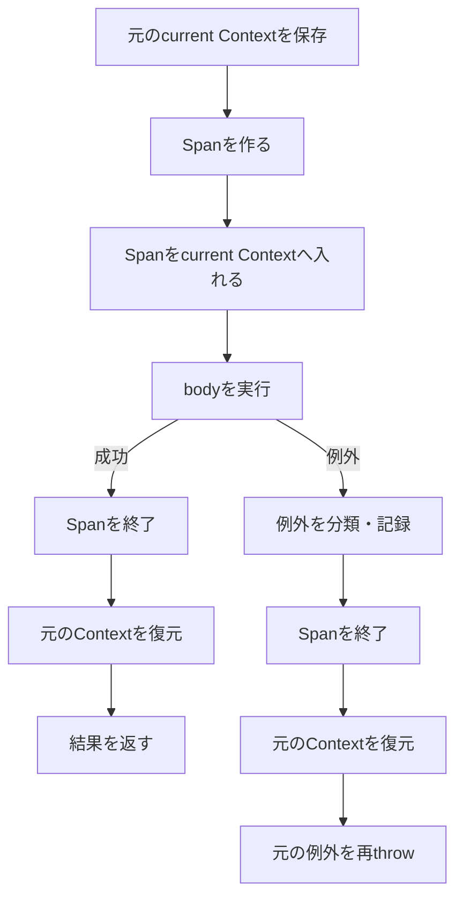

## 型

```haskell
inSpanInternal
  :: MonadUnliftIO m
  => Tracer
  -> Text
  -> SpanArguments
  -> AttributeMap
  -> (Span -> m a)
  -> m a
```

- `Tracer`: Spanを作る元
- `Text`: Span名
- `SpanArguments`: Span作成時の設定
- `AttributeMap`: caller情報など追加属性
- `(Span -> m a)`: 作成したSpanを受け取って実行するbody

## processorがない場合

```haskell
| not (tracerProviderHasProcessor (tracerProvider t)) =
    liftIO (getContext >>= \ctx -> createSpanHelper t ctx n args extraAttrs (-1)) >>= f
```

SpanProcessorがない場合は通常のContext差し替えや例外記録を省略するfast path。

1. `getContext`で現在のContextを取得
2. そのContextを使ってSpanを作る
3. 作ったSpanを`f`へ渡す

## 通常経路の入口

```haskell
| otherwise = withRunInIO $ \run -> EUnsafe.mask $ \restore -> do
```

`withRunInIO`は`m a`をIOとして実行する`run`を得る。

`mask`はSpan作成やContext差し替えの途中で非同期例外が割り込むのを防ぐ。bodyは後で`restore`して通常の例外受付状態で実行する。

## 元のcurrent Contextを保存

```haskell
(!tidInt, ctxRef) <- ensureContextRefFast
entry <- readIORef ctxRef
let ctx = ceContext entry
```

- `ctxRef`: current Contextを保持する`IORef`
- `entry`: `ctxRef`に入っていた元の値
- `ctx`: `entry`から取り出した現在の`Context`
- `tidInt`: 現在の実行スレッドを識別する値

`entry`を残しておくことで、body終了後に元のContextへ戻せる。

## Spanを作る

```haskell
s <- createSpanHelper t ctx n args extraAttrs tidInt
```

現在の`ctx`を使ってSpan `s`を作る。この時点ではcurrent Contextはまだ元のまま。

## 作ったSpanをcurrentにする

```haskell
writeIORef ctxRef $! entry {ceContext = insertSpan s ctx}
```

`insertSpan s ctx`で元のContextへSpan `s`を入れ、そのContextを`ctxRef`へ書き戻す。

ここからbody終了まで、`getContext` / `getActiveSpan`から見えるcurrent Spanは`s`になる。

## bodyを実行

```haskell
a <- restore (run $ f s) `EUnsafe.catch` \someEx@(SomeException inner) -> do
```

- `f s`: Spanをbodyへ渡す
- `run`: `m a`をIOとして実行
- `restore`: bodyでは通常通り例外を受けられるようにする
- `catch`: bodyから外へ出た例外を捕捉する

## 例外を分類する

```haskell
let ExceptionResponse classification exAttrs = resolveException t someEx
```

`resolveException`で例外をTracing上どう扱うか分類する。

```text
ErrorException    -> Error + exception Span Event
RecordedException -> exception Span Eventのみ
IgnoredException  -> 何もしない
```

RAGScopeが欲しい`Error + exception Span Eventなし`という組み合わせは、この3分類にはない。

## 例外時のcleanup

```haskell
endSpan s Nothing
writeIORef ctxRef entry
EUnsafe.throwIO someEx
```

1. Spanを終了
2. `entry`を書き戻して元のContextを復元
3. 元の例外を再throw

`catch`は例外を握りつぶすためではなく、Telemetryの後始末をしてから同じ例外を外へ返すために使っている。

## 成功時のcleanup

```haskell
endSpan s Nothing
writeIORef ctxRef entry
pure a
```

1. Span終了
2. 元のContextを復元
3. bodyの結果`a`を返す
