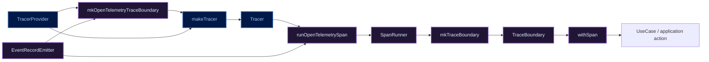
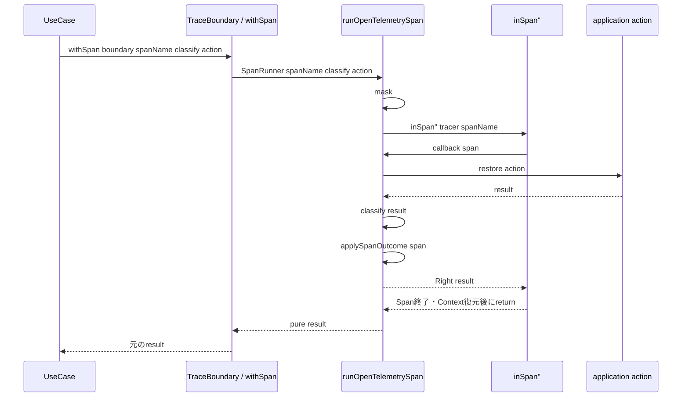
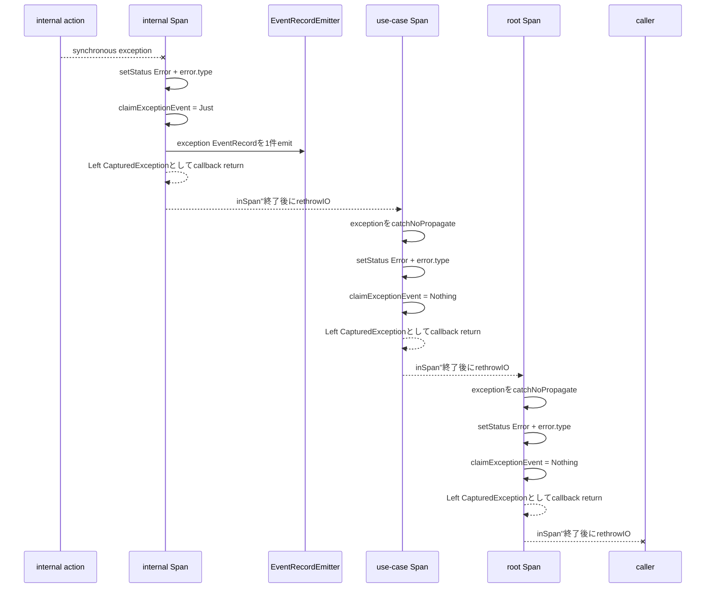

# mkOpenTelemetryTraceBoundaryとTrace Adapter実行フロー

> [!note]
> `RAGScope.Telemetry.OpenTelemetry.Trace`を読むための学習メモ。
> 2026-09-15時点の正本リポジトリ `RS-0024/exception-event-once`、commit `e40a998a0352214e4989a0aec5ec6ea1d65d6e8b` の実装とテストを基準にしている。
> RAGScopeの現在仕様・現在実装の正本ではないため、コードが変わった場合は正本リポジトリの実ファイルを再確認する。

関連ノート:

- [[Haskellの関数値によるDIとTelemetry境界メモ]]
- [[OpenTelemetry SDK構造メモ]]

関連Task:

- [[RS-0024 subtask 未処理例外のEventRecordをexactly-onceで記録する]]

## まず結論

`mkOpenTelemetryTraceBoundary`の役割は、OpenTelemetry SDK側の`TracerProvider`と、RAGScope Logs境界側の`EventRecordEmitter`を受け取り、UseCase側がSDKを知らずに使える`TraceBoundary`を作ることである。

```haskell
mkOpenTelemetryTraceBoundary ::
  TracerProvider ->
  EventRecordEmitter ->
  TraceBoundary
```

中でやっていることは大きく3段階に分かれる。

```text
TracerProvider
    ↓ makeTracer
Tracer
    ↓ runOpenTelemetrySpanへ部分適用
SpanRunner
    ↓ mkTraceBoundary
TraceBoundary
```

`mkOpenTelemetryTraceBoundary`自身はSpanを直接実行しない。

ここで作った`TraceBoundary`の中に、

- どの`Tracer`を使うか
- 例外EventRecordをどうemitするか
- Span実行時にどの処理をするか

が関数値として閉じ込められる。

## 型の関係

まずSDK非依存側の型を見る。

```haskell
type SpanRunner =
  forall result.
  SpanName ->
  (result -> SpanOutcome) ->
  IO result ->
  IO result

newtype TraceBoundary = TraceBoundary SpanRunner

mkTraceBoundary :: SpanRunner -> TraceBoundary
withSpan :: TraceBoundary -> SpanRunner
```

`TraceBoundary`は設定recordではなく、**Spanの中で任意の`IO result`を実行する能力を包んだ値**である。

`withSpan`はその能力を取り出すだけである。

```haskell
withSpan (TraceBoundary run) = run
```

OpenTelemetry Adapter側では、次の関数がこの`SpanRunner`を実装する。

```haskell
runOpenTelemetrySpan ::
  Tracer ->
  EventRecordEmitter ->
  SpanRunner
```

### 構築関係の図



凡例:

- 紫系: RAGScope内のprivate library / module側
- 青系: OpenTelemetry SDK側

`ragscope.cabal`では`telemetry-boundary`と`opentelemetry-adapter`はいずれも`visibility: private`である。

## mkOpenTelemetryTraceBoundaryを1行ずつ読む

現在の実装は次の形である。

```haskell
mkOpenTelemetryTraceBoundary tracerProvider eventRecordEmitter =
  mkTraceBoundary $
    runOpenTelemetrySpan
      tracer
      eventRecordEmitter
 where
  tracer =
    makeTracer
      tracerProvider
      "ragscope"
      tracerOptions
        { tracerExceptionHandlerOptions =
            [ ignoreSynchronousException
            , ignoreIntentionalInterruption
            ]
        }
```

### 1. `makeTracer`で`Tracer`を作る

```haskell
tracer =
  makeTracer
    tracerProvider
    "ragscope"
    tracerOptions
      { tracerExceptionHandlerOptions =
          [ ignoreSynchronousException
          , ignoreIntentionalInterruption
          ]
      }
```

`TracerProvider`から、Spanを作るための`Tracer`を得る。

`"ragscope"`はTracerのinstrumentation scope名であり、`service.name`とは別物である。この違いは[[OpenTelemetry SDK構造メモ]]を参照する。

ここでは`tracerOptions`のうち、例外handlerだけを差し替えている。

```text
ignoreSynchronousException
  = RAGScope側で同期例外をSpan Error + Logs EventRecordとして扱うため、
    hs-opentelemetry側の自動exception Span Eventを抑える

ignoreIntentionalInterruption
  = UserInterruptを意図された中断として扱い、
    hs-opentelemetry側の自動exception処理から除外する
```

特に重要なのは、RAGScopeでは同期例外をOpenTelemetryのSpan Eventとして自動記録させるのではなく、

```text
Span
  → Status = Error
  → error.type

Logs
  → EventRecord name = "exception"
```

という2つのSignalへ明示的に分けていることである。

### 2. `runOpenTelemetrySpan`へ依存を部分適用する

型を段階的に見ると分かりやすい。

```haskell
runOpenTelemetrySpan
  :: Tracer
  -> EventRecordEmitter
  -> SpanRunner
```

`Tracer`だけ渡すと、

```haskell
runOpenTelemetrySpan tracer
  :: EventRecordEmitter
  -> SpanRunner
```

さらに`EventRecordEmitter`まで渡すと、

```haskell
runOpenTelemetrySpan tracer eventRecordEmitter
  :: SpanRunner
```

になる。

つまり、`Tracer`と`EventRecordEmitter`を引数として毎回UseCaseへ渡すのではなく、ここで関数へ閉じ込めている。

この時点でできた関数は、

```text
Span名
分類関数
実行したいaction
```

だけ受け取れば実行できる`SpanRunner`になっている。

### 3. `mkTraceBoundary`で意味のある型へ包む

```haskell
mkTraceBoundary
  (runOpenTelemetrySpan tracer eventRecordEmitter)
```

`SpanRunner`を`TraceBoundary`へ包む。

```haskell
newtype TraceBoundary = TraceBoundary SpanRunner
```

このためUseCase側から見ると、OpenTelemetryの`TracerProvider`、`Tracer`、`Span`、`ExceptionContext`などは見えない。

## 実行時はwithSpanからrunOpenTelemetrySpanへ入る

UseCase側は概念的には次のように使う。

```haskell
withSpan
  traceBoundary
  spanName
  classify
  action
```

`withSpan`が`TraceBoundary`から`SpanRunner`を取り出すため、最終的には`runOpenTelemetrySpan`が呼ばれる。



## runOpenTelemetrySpanの全体構造

```haskell
runOpenTelemetrySpan tracer eventRecordEmitter (SpanName spanName) classify action =
  mask $ \restore -> do
    exit <-
      inSpan''
        tracer
        spanName
        defaultSpanArguments
        $ \span ->
          handleSynchronousException
            eventRecordEmitter
            span
            $ restore
            $ do
              result <- action

              applySpanOutcome span (classify result)

              pure result

    either rethrowIO pure exit
```

この関数を理解するポイントは、次の3層を分けて見ることである。

```text
外側
  mask

Span scope
  inSpan''

application action周辺
  handleSynchronousException
    + restore
```

そして同期例外だけは、SDK内部を例外のまま通さず、

```haskell
SpanExit result = Either CapturedException result
```

として一度値へ変換する。

## `mask`と`restore`

### `mask`は何をする関数か

`mask`は**非同期例外を一時的にmaskする**関数である。

代表的な非同期例外は、別threadから`throwTo`で飛んでくる例外や`UserInterrupt`などである。

```haskell
mask ::
  ((forall a. IO a -> IO a) -> IO b)
  -> IO b
```

少し変わった型だが、概念的には次のように読める。

```text
mask $ \restore ->
  非同期例外をmaskした状態で実行する処理

restore someAction
  = maskへ入る前のmask状態でsomeActionを実行する
```

`mask`は`catch`ではない。

- 例外を捕捉する関数ではない
- 同期例外を無効化する関数でもない
- async exceptionが届くタイミングを制御するための関数

である。

### このコードでrestoreされる範囲

現在のコードでは、厳密には`action`だけではなく次のブロック全体が`restore`される。

```haskell
restore $ do
  result <- action
  applySpanOutcome span (classify result)
  pure result
```

したがって、

- `action`
- `classify result`
- `applySpanOutcome`

は`mask`へ入る前のmask状態で実行される。

一方、外側の`inSpan''`呼び出しと、`inSpan''`から戻った後の

```haskell
either rethrowIO pure exit
```

は`mask`のscope内にある。

このコードから確実に言えるのは、**Span管理全体はmask scopeへ置きつつ、application actionを含む主要処理は元のmask状態へ戻している**ということである。

`mask`そのものがSpan cleanupを行うわけではない。Spanの生成・current Context化・終了・Context復元は`inSpan''`側の責務である。

### `uninterruptibleMask`ではない

`mask`は`uninterruptibleMask`とは異なる。

`uninterruptibleMask`はinterruptible operationでも非同期例外を受け取らない状態にできるため、使い方によってはthreadが止まり続ける危険がある。

この実装で使っているのは通常の`mask`である。

## `inSpan''`の役割

このコードから見た`inSpan''`の役割は、

```text
Spanを開始する
  ↓
そのSpanをcurrent Contextにする
  ↓
callbackへSpan値を渡す
  ↓
callbackを実行する
  ↓
Spanを終了する
  ↓
以前のContextへ復元する
```

というSpan scopeを作ることである。

現在のテストでは、

- nested Spanでchildがcurrentになる
- child終了後にparent Contextへ戻る
- parent終了後に元のContextへ戻る
- child Spanのparentが実際のparent Spanになる

ことを確認している。

## 通常returnと同期例外を分ける

### 通常return

`action`が値を返した場合は、

```haskell
result <- action
applySpanOutcome span (classify result)
pure result
```

と進む。

`classify`は元のresultをTelemetry用の`SpanOutcome`へ写す純粋な分類関数である。

```haskell
data SpanOutcome
  = SpanSucceeded
  | SpanFailed Text
```

重要なのは、`SpanOutcome`へ変換して元のresultを捨てるわけではないことである。

```text
result
  ├─ 呼び出し側へそのまま返す
  └─ classify
       ↓
     SpanOutcome
       ↓
     Spanへ反映
```

### applySpanOutcome

```haskell
applySpanOutcome _ SpanSucceeded =
  pure ()
```

成功時は何もしない。現在のテストではOpenTelemetry SpanのStatusは既定の`Unset`のままとなる。

```haskell
applySpanOutcome span (SpanFailed errorType) = do
  setStatus span $ Error ""
  addAttribute span "error.type" errorType
```

戻り値として表現された機能失敗では、

```text
Status = Error ""
error.type = classifyが返した値
```

を設定する。

これは「例外」とは別の経路である。

## 同期例外はhandleSynchronousExceptionで扱う

```haskell
handleSynchronousException eventRecordEmitter span action =
  (Right <$> action)
    `catchNoPropagate` \exceptionWithContext@(ExceptionWithContext _ exception) ->
      if isSynchronousException exception
        then
          Left
            <$> markSynchronousException
              eventRecordEmitter
              span
              exceptionWithContext
        else
          rethrowIO exceptionWithContext
```

通常returnなら、

```text
result
  ↓
Right result
```

となる。

同期例外なら、

```text
ExceptionWithContext SomeException
  ↓
markSynchronousException
  ↓
Left CapturedException
```

となる。

非同期例外なら`SpanExit`へ入れず、`rethrowIO`する。

### `isSynchronousException`

```haskell
isSynchronousException exception =
  case fromException exception :: Maybe SomeAsyncException of
    Just _ -> False
    Nothing -> True
```

`SomeException`を`SomeAsyncException`として取り出せるかで判定している。

```text
SomeAsyncExceptionとして取り出せる
  → async

取り出せない
  → sync
```

ここで「asyncならすべてSpanがUnsetになる」とまでは言えない。

現在明示的にテストされ、Tracerのhandlerでも特別扱いされているのは`UserInterrupt`である。

## `catchNoPropagate`とは何か

`catchNoPropagate`は通常の`catch`に近いが、handlerへ

```haskell
ExceptionWithContext e
```

を渡す。

またGHCのAPI説明では、**捕捉した例外をhandler自身のexception contextへ伝播させないvariant**であり、自前の例外処理関数を作って、その後に例外をrethrowする場合の利用が想定されている。

RAGScopeではこの`ExceptionContext`が重要である。

同期例外EventRecordをすでに記録したかどうかを、

```haskell
ExceptionEventRecorded
```

というannotationとして`ExceptionContext`へ付けるからである。

## `ExceptionWithContext`と`ExceptionContext`

```haskell
type CapturedException =
  ExceptionWithContext SomeException
```

`ExceptionWithContext`は概念的には、

```text
実際のexception
+
そのexception propagationに付随するContext
```

を一緒に運ぶ値である。

現在のコードでは、

```haskell
data ExceptionEventRecorded
  = ExceptionEventRecorded

instance ExceptionAnnotation ExceptionEventRecorded
```

という値をmarkerとして使う。

markerは例外型そのものへ持たせない。

同じ例外型でも、別々に発生した例外まで「記録済み」にしたくないためである。

## markSynchronousException

同期例外がSpanを抜けると、この関数が現在のSpanを失敗状態へする。

```haskell
markSynchronousException
  :: EventRecordEmitter
  -> Span
  -> CapturedException
  -> IO CapturedException
```

処理は4段階である。

```text
1. exception.message / exception.typeを作る
2. SpanをErrorにする
3. EventRecordのownerをclaimする
4. 初回ownerならEventRecordをemitする
```

### exception情報を作る

```haskell
exceptionMessage =
  Text.pack $ displayException inner

exceptionType =
  Text.pack $ show $ typeOf inner
```

Spanへは、

```haskell
setStatus span (Error exceptionMessage)
addAttribute span "error.type" exceptionType
```

を設定する。

戻り値による`SpanFailed`ではStatus descriptionを空文字にしていたのに対し、同期例外では`displayException`の内容をStatus descriptionへ入れている点も違いである。

## claimExceptionEventでexactly-once ownerを決める

```haskell
claimExceptionEvent ::
  ExceptionContext ->
  Maybe ExceptionContext
```

中では、

```haskell
getExceptionAnnotations @ExceptionEventRecorded exceptionContext
```

でmarkerを探す。

markerがなければ、

```haskell
Just $
  addExceptionAnnotation
    ExceptionEventRecorded
    exceptionContext
```

として、このSpanが最初のownerになる。

すでにmarkerがあれば、

```haskell
Nothing
```

を返す。

したがって、

```text
Just claimedContext
  = このSpanが最初のowner

Nothing
  = 内側のSpanがすでにEventRecordを記録済み
```

という意味になる。

## emitExceptionEvent

最初のownerだけが次のEventRecordをemitする。

```text
event.name       = exception
severity         = Error
exception.type   = 例外型
exception.message= displayException
```

実際の値は、

```haskell
EventRecord
  { eventName = exceptionEventName
  , eventTimestamp = EventNow
  , eventSeverity = Logs.Error
  , eventAttributes =
      Map.fromList
        [ ("exception.type", LogText exceptionType)
        , ("exception.message", LogText exceptionMessage)
        ]
  }
```

である。

`Trace Adapter`は`LogsBoundary`全体には依存せず、

```haskell
EventRecordEmitter = EventRecord -> IO ()
```

という必要最小限の能力だけ受け取る。

## なぜSpanExitで一度「値」にするのか

ここが現在の実装で特に重要な部分である。

```haskell
type CapturedException =
  ExceptionWithContext SomeException

type SpanExit result =
  Either CapturedException result
```

同期例外をcallback内ですぐrethrowせず、いったん

```haskell
Left CapturedException
```

として`inSpan''`から正常returnさせる。

その後、`inSpan''`の外で、

```haskell
either rethrowIO pure exit
```

として元の例外をrethrowする。

### なぜcallback内でrethrowしないのか

このSubtaskでの実測では、以前の実装でcallback内から`rethrowIO`すると、`hs-opentelemetry`内部の`SomeException` catch / `throwIO`経路を通り、GHC 9.12.4では外側のSpan境界から`ExceptionEventRecorded` markerを含む元の`ExceptionContext`を確認できなくなった。

その結果、nested Spanすべてが「まだEventRecordを記録していない」と判断し、3件記録されていた。

現在は、

```text
callback内
  SpanをErrorへする
  ownerをclaimする
  ownerならEventRecordをemitする
  ↓
  Left CapturedExceptionを普通の戻り値として返す

inSpan''
  Span終了
  Context復元
  普通にreturn

callback外
  rethrowIO
```

と分けている。

### `rethrowIO`

`rethrowIO`は`ExceptionWithContext`を使って例外を再throwする関数である。

GHCのAPIでは、既存のcontextを渡してrethrowし、新しいbacktraceを付け直さないためのutilityとして定義されている。

この実装では、`ExceptionEventRecorded` annotationを含む`ExceptionContext`を外側のSpan境界へ運ぶためにも重要である。

## nested Spanでの同期例外フロー

`root -> use-case -> internal`という3 Spanの最内側で例外が発生した場合を図にすると次になる。



結果は次の通りになる。

```text
internal Span  = Error
use-case Span  = Error
root Span      = Error
EventRecord    = 1件
owner          = internal Span
最終結果       = 元の例外をcallerへrethrow
```

EventRecordを`internal` Spanのcallback内でemitするため、その時点のcurrent Contextは`internal` Spanである。現在の統合テストはEventRecordのTraceId / SpanIdがこのowner Spanと一致することも確認する。

## application codeが途中でrecoverした場合

`internal` Spanを抜けた同期例外を、`use-case` Spanのaction内部でapplication codeがcatchして復旧した場合は、外側のSpan境界まで例外が届かない。

```text
internal Span
  → exceptionが境界を抜ける
  → Error
  → EventRecord owner

use-case action
  → exceptionをcatch
  → 正常return

use-case Span
  → SpanSucceeded

root Span
  → SpanSucceeded
```

現在の統合テストでは、

```text
internal = Error
use-case = Unset
root     = Unset
EventRecord = 1件
```

を確認している。

## 自動exception Span Eventを抑える関数

### ignoreSynchronousException

```haskell
ignoreSynchronousException =
  ignoreExceptionMatching @SomeException isSynchronousException
```

同期例外はRAGScope側ですでに、

```text
Span Status
error.type
Logs EventRecord
```

へ反映する。

同じ事実をhs-opentelemetryの自動exception Span Eventとして重複記録させないために設定している。

### ignoreIntentionalInterruption

```haskell
ignoreIntentionalInterruption =
  ignoreExceptionMatching @AsyncException (== UserInterrupt)
```

`UserInterrupt`は意図された中断として扱う。

現在のテストでは、

```text
UserInterruptを外へrethrow
Span Status = Unset
error.typeなし
Span Event = 0件
Contextは元へ復元
```

を確認している。

## exceptionEventName

```haskell
exceptionEventName :: EventName
exceptionEventName =
  case mkEventName "exception" of
    Right eventName -> eventName
    Left failure ->
      error $
        "exceptionEventName: failed to construct static exception EventName: "
          <> show failure
```

`"exception"`という固定文字列から`EventName`を1度構築する定義である。

動的なユーザー入力ではないため、ここで失敗した場合は通常の機能失敗ではなく、コード側の前提が壊れている状態として`error`にしている。

## 関数ごとの責務一覧

| 関数 / 型 | 入力 | 主な呼び出し先 | 役割 |
|---|---|---|---|
| `mkOpenTelemetryTraceBoundary` | `TracerProvider`, `EventRecordEmitter` | `makeTracer`, `runOpenTelemetrySpan`, `mkTraceBoundary` | SDK依存を閉じ込めた`TraceBoundary`を構築する |
| `runOpenTelemetrySpan` | `Tracer`, `EventRecordEmitter`, `SpanName`, `classify`, `action` | `mask`, `inSpan''`, `handleSynchronousException`, `applySpanOutcome` | 1つのactionをSpan scopeで実行する |
| `applySpanOutcome` | `Span`, `SpanOutcome` | `setStatus`, `addAttribute` | 通常returnしたresultの観測表現をSpanへ反映する |
| `handleSynchronousException` | emitter, Span, action | `catchNoPropagate`, `markSynchronousException`, `rethrowIO` | sync exceptionだけを`SpanExit`へ変換する |
| `markSynchronousException` | emitter, Span, `CapturedException` | `setStatus`, `addAttribute`, `claimExceptionEvent`, `emitExceptionEvent` | SpanをErrorにし、初回だけEventRecordを記録する |
| `claimExceptionEvent` | `ExceptionContext` | `getExceptionAnnotations`, `addExceptionAnnotation` | exactly-once ownerを決める |
| `emitExceptionEvent` | emitter, exception type/message | `EventRecordEmitter` | generic exception EventRecordを作ってemitする |
| `exceptionEventName` | なし | `mkEventName` | 固定EventName `exception`を構築する |
| `ignoreSynchronousException` | SDKが捕捉した例外 | `ignoreExceptionMatching` | SDKの自動sync exception Span Eventを抑える |
| `ignoreIntentionalInterruption` | SDKが捕捉した例外 | `ignoreExceptionMatching` | `UserInterrupt`の自動exception処理を抑える |
| `isSynchronousException` | `SomeException` | `fromException` | `SomeAsyncException`かどうかでsync / asyncを分ける |
| `CapturedException` | 型alias | `ExceptionWithContext SomeException` | 元exceptionとcontextを一緒に保持する |
| `SpanExit result` | 型alias | `Either CapturedException result` | SDK内部を通常returnで抜けるためのtransport |
| `ExceptionEventRecorded` | annotation型 | `ExceptionContext` | EventRecord記録済みmarker |

## 読むときに混同しやすい点

### `SpanFailed`とthrowされたexceptionは別

```text
actionが値を返す
  ↓
classify result
  ↓
SpanSucceeded / SpanFailed


actionがexceptionをthrowする
  ↓
handleSynchronousException
  ↓
markSynchronousException
```

別経路である。

### EventRecordとSpan Eventは別

現在の同期例外では、RAGScopeが記録するのはLogs側の`EventRecord`である。

hs-opentelemetryが自動的に作るexception Span Eventは重複を避けるため抑制する。

### `mask`と`catch`は別

```text
mask
  = async exceptionを受け取るタイミングを制御

catchNoPropagate
  = 実際にexceptionを捕捉してhandlerを実行
```

役割が違う。

### `SomeException`と`SomeAsyncException`も別

`SomeException`は広いexistential wrapperであり、その中身がasync exceptionかどうかを`fromException`で判定している。

## テストから確認できる現在の保証

`OpenTelemetryTraceSpec`では少なくとも次を確認している。

```text
成功result
  → 元のresultを保持
  → Span Status = Unset
  → error.typeなし

戻り値としての失敗
  → 元のLeftを保持
  → Span Status = Error
  → error.typeあり

未処理同期例外
  → Span Error
  → 元例外をrethrow
  → Context復元
  → 自動exception Span Eventなし

nested Span
  → childがcurrent
  → child終了後parentへ復元
  → parent終了後元Contextへ復元
  → parent-child関係が一致

UserInterrupt
  → 外へrethrow
  → Span Status = Unset
  → error.typeなし
  → Span Eventなし

wrapped action
  → 実行回数は1回
```

`OpenTelemetryExceptionEventSpec`ではさらに、

```text
root -> use-case -> internalを同期例外が全部抜ける
  → 3 SpanすべてError
  → exception EventRecordは1件
  → ownerは最初に抜けたinternal Span

internalを抜けた例外をuse-case action内でrecover
  → internalだけError
  → use-case / rootはUnset
  → EventRecordは1件のまま
```

を確認している。

## 読む順番

このmoduleを追い直すときは、次の順番だと理解しやすい。

```text
RAGScope.Telemetry.Trace
  TraceBoundary / SpanRunner / withSpan
        ↓
mkOpenTelemetryTraceBoundary
        ↓
runOpenTelemetrySpan
        ↓
applySpanOutcome
        ↓
handleSynchronousException
        ↓
markSynchronousException
        ↓
claimExceptionEvent / emitExceptionEvent
        ↓
OpenTelemetryTraceSpec
        ↓
OpenTelemetryExceptionEventSpec
```

`mkOpenTelemetryTraceBoundary`だけ見ると短いが、実際には、

> SDK依存を閉じ込めた`SpanRunner`を構築し、通常result・同期例外・意図された中断をそれぞれ別経路で扱うTrace実行能力を`TraceBoundary`として渡す

ための入口になっている。
