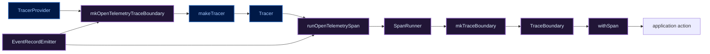
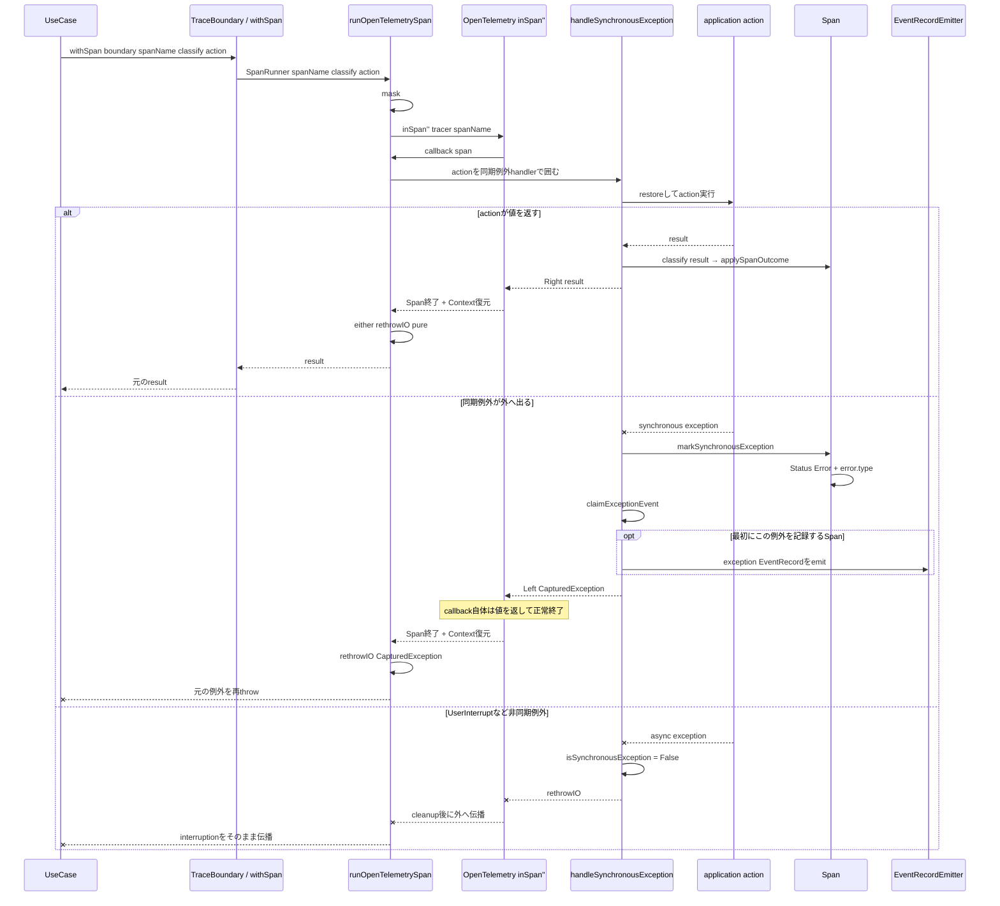

# mkOpenTelemetryTraceBoundaryとTrace Adapter実行フロー

> [!note]
> `RAGScope.Telemetry.OpenTelemetry.Trace`の流れを把握するための学習メモ。
> 2026-09-15時点の正本リポジトリ `RS-0024/exception-event-once`、commit `e40a998a0352214e4989a0aec5ec6ea1d65d6e8b` の実装を基準にしている。
> 現在仕様・現在実装を確認するときは正本リポジトリの実ファイルを優先する。

関連ノート:

- [[Haskellの関数値によるDIとTelemetry境界メモ]]
- [[OpenTelemetry SDK構造メモ]]

## `mkOpenTelemetryTraceBoundary`は何をする関数か

型は次。

```haskell
mkOpenTelemetryTraceBoundary ::
  TracerProvider ->
  EventRecordEmitter ->
  TraceBoundary
```

やっていることはシンプルで、

1. `TracerProvider`からOpenTelemetryの`Tracer`を作る
2. `Tracer`と`EventRecordEmitter`を`runOpenTelemetrySpan`へ渡して`SpanRunner`を作る
3. その`SpanRunner`を`TraceBoundary`へ包む

という流れである。

```text
TracerProvider
    ↓ makeTracer
Tracer
    ↓
runOpenTelemetrySpan tracer eventRecordEmitter
    ↓
SpanRunner
    ↓ mkTraceBoundary
TraceBoundary
```

つまり、`mkOpenTelemetryTraceBoundary`自身がSpanを実行するわけではない。

**OpenTelemetryを使ってSpanを実行できる関数を組み立てて、`TraceBoundary`として返す構築関数**である。

## 構築時の流れ

現在の実装は次。

```haskell
mkOpenTelemetryTraceBoundary tracerProvider eventRecordEmitter =
  mkTraceBoundary $
    runOpenTelemetrySpan
      tracer
      eventRecordEmitter
 where
  tracer =
    makeTracer
      tracerProvider
      "ragscope"
      tracerOptions
        { tracerExceptionHandlerOptions =
            [ ignoreSynchronousException
            , ignoreIntentionalInterruption
            ]
        }
```

### 1. `makeTracer`

```haskell
tracer = makeTracer tracerProvider "ragscope" ...
```

`TracerProvider`から、Spanを作るための`Tracer`を作る。

このとき例外handlerとして、

```text
ignoreSynchronousException
ignoreIntentionalInterruption
```

を設定している。

- `ignoreSynchronousException`
  - RAGScope側で同期例外を処理するため、SDKによる同じ例外のSpan Event自動記録を抑える
- `ignoreIntentionalInterruption`
  - `UserInterrupt`を意図された中断としてSDKの自動例外処理から除外する

### 2. `runOpenTelemetrySpan`へ依存を閉じ込める

```haskell
runOpenTelemetrySpan ::
  Tracer ->
  EventRecordEmitter ->
  SpanRunner
```

ここへ、

```haskell
runOpenTelemetrySpan tracer eventRecordEmitter
```

と2つの依存を渡すと、残るのは`SpanRunner`だけになる。

```haskell
type SpanRunner =
  forall result.
  SpanName ->
  (result -> SpanOutcome) ->
  IO result ->
  IO result
```

以後の利用側は、`Tracer`や`EventRecordEmitter`を毎回渡す必要がない。

### 3. `mkTraceBoundary`

```haskell
mkTraceBoundary
  (runOpenTelemetrySpan tracer eventRecordEmitter)
```

`SpanRunner`を`TraceBoundary`へ包む。

```haskell
newtype TraceBoundary = TraceBoundary SpanRunner
```

UseCase側にはOpenTelemetry SDK型ではなく、この`TraceBoundary`だけを渡せばよい。

## 構築から利用まで



凡例:

- 紫系: RAGScope側
- 青系: OpenTelemetry SDK側

## 実行時の全体シーケンス

`TraceBoundary`を構築した後、利用側は`withSpan`を呼ぶ。

```haskell
withSpan
  traceBoundary
  spanName
  classify
  action
```

`withSpan`は`TraceBoundary`の中の`SpanRunner`を取り出すだけなので、実体は`runOpenTelemetrySpan`である。

通常return、同期例外、`UserInterrupt`まで含めると全体は次の流れになる。



この図で押さえておきたいのは、同期例外だけが一度、

```text
例外
  ↓
CapturedException
  ↓
SpanExit = Left CapturedException
```

という**値**になる点である。

これにより、`inSpan''`のcallback内では例外をthrowせず、SDKにSpan終了とContext復元をさせた後、外側で`rethrowIO`できる。

## `runOpenTelemetrySpan`の中心部分

```haskell
runOpenTelemetrySpan tracer eventRecordEmitter (SpanName spanName) classify action =
  mask $ \restore -> do
    exit <-
      inSpan''
        tracer
        spanName
        defaultSpanArguments
        $ \span ->
          handleSynchronousException
            eventRecordEmitter
            span
            $ restore
            $ do
              result <- action

              applySpanOutcome span (classify result)

              pure result

    either rethrowIO pure exit
```

大きく見ると次の4段階だけである。

```text
mask
  ↓
inSpan''でSpan scopeを作る
  ↓
handleSynchronousExceptionの中でactionを実行
  ↓
Span終了後、SpanExitをresultまたは例外へ戻す
```

## `mask`と`restore`だけ補足

ここはHaskellに慣れていないと読みにくい。

```haskell
mask $ \restore -> ...
```

`mask`は**例外をcatchする関数ではない**。

非同期例外が割り込むタイミングを制御するための関数である。

概念的には、

```text
mask
  = このscopeではasync exceptionをmaskする

restore action
  = actionだけ、maskへ入る前の状態へ戻して実行する
```

となる。

現在のコードで`restore`されているのは厳密には次のブロック全体。

```haskell
restore $ do
  result <- action
  applySpanOutcome span (classify result)
  pure result
```

一方、実際に同期例外を捕捉しているのは`mask`ではなく、

```haskell
handleSynchronousException
```

の中の`catchNoPropagate`である。

## 補助関数はどこを担当するか

| 関数 | 流れの中での役割 |
|---|---|
| `mkOpenTelemetryTraceBoundary` | `TracerProvider`と`EventRecordEmitter`から`TraceBoundary`を構築する |
| `runOpenTelemetrySpan` | 1回の`withSpan`実行全体を制御する |
| `applySpanOutcome` | 通常returnしたresultをSpanのStatus / `error.type`へ反映する |
| `handleSynchronousException` | actionから外へ出た例外を同期 / 非同期に分ける |
| `markSynchronousException` | 同期例外をSpan Errorへ反映し、必要ならEventRecordを記録する |
| `claimExceptionEvent` | 同じ例外伝播でEventRecordを1回だけ記録するための所有権を取る |
| `emitExceptionEvent` | `exception` EventRecordを`EventRecordEmitter`へ渡す |
| `isSynchronousException` | `SomeAsyncException`かどうかで同期 / 非同期を判定する |
| `ignoreSynchronousException` | SDKによる同期例外Span Eventの自動記録を抑える |
| `ignoreIntentionalInterruption` | `UserInterrupt`をSDKの自動例外処理から除外する |

## 通常resultと同期例外の違い

通常returnでは、

```text
action
  ↓ result
classify result
  ↓
applySpanOutcome
  ↓
元のresultをそのまま返す
```

同期例外では、

```text
action
  ↓ exception
markSynchronousException
  ├─ SpanをErrorにする
  └─ 初回だけEventRecordをemit
  ↓
Left CapturedException
  ↓
inSpan''終了・Context復元
  ↓
rethrowIO
```

となる。

## まとめ

`mkOpenTelemetryTraceBoundary`を読むときは、次だけ押さえればよい。

```text
構築時
TracerProvider
  → Tracer
  → SpanRunner
  → TraceBoundary

実行時
withSpan
  → runOpenTelemetrySpan
  → inSpan''
  → action
  → resultならSpanOutcomeを反映
  → 同期例外ならSpan Error + EventRecord
  → Span終了・Context復元
  → 元のresultまたは元の例外を呼び出し側へ返す
```

`mkOpenTelemetryTraceBoundary`は、**OpenTelemetry固有の依存を閉じ込めた`SpanRunner`を作り、それをRAGScopeの`TraceBoundary`として渡せる形にする入口**である。
