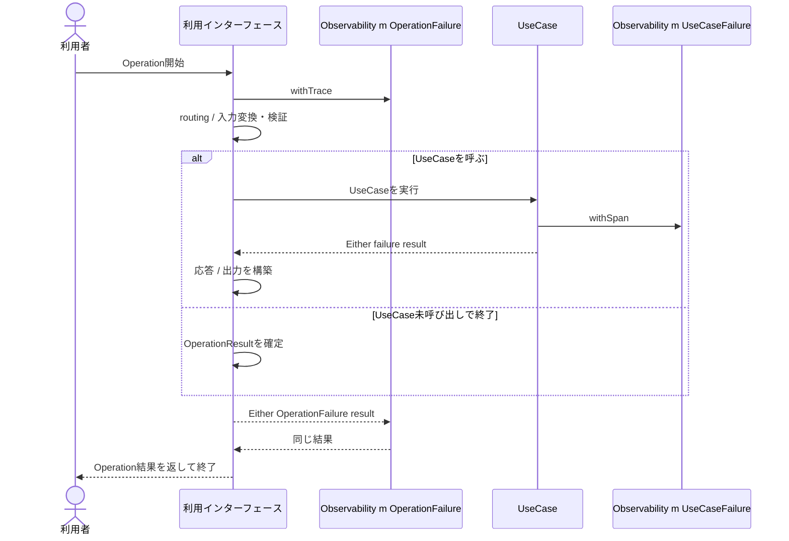
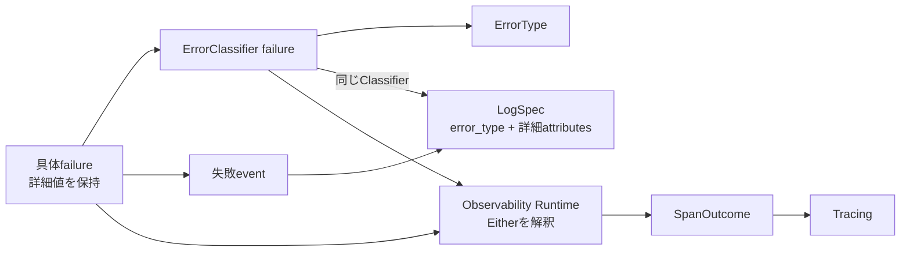
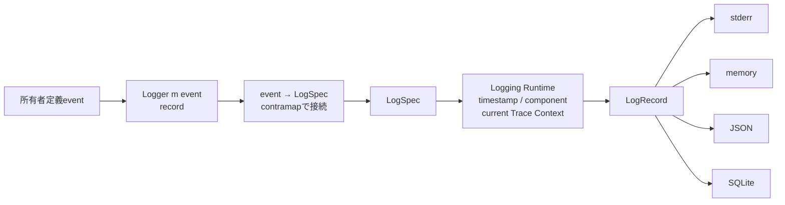

# 実行追跡・構造化ログ概要図

この図は、RS-0022で扱う処理の境界と値の流れを示す。現在仕様はRAGScope正本を基準とし、このNoteは作業用ビューとして使う。package / library / module間の静的依存は [[実行追跡・構造化ログ静的依存図]] を参照する。

## Operationとtrace / span

利用者の1回の操作を1つのtraceとして追跡する。利用インターフェースは、Operation開始時に`Observability m OperationFailure`の`withTrace`を使う。

UseCaseを呼ぶ場合は、その処理をroot spanの子spanとして追跡する。UseCaseにはそのUseCase固有failure型へ特殊化した`Observability m failure`を渡し、`withSpan`でUseCase実行を囲む。UseCase内部で作るspanはUseCaseのspan配下に置く。

UseCaseが成功した場合は、応答や出力の構築などの後処理へ進む。その後処理の結果も含めて、Operation全体の成功・失敗を確定する。UseCaseが失敗した場合はOperation全体の失敗を確定する。root spanはOperation全体の結果を観測してから終了する。

Applicationやサービスの起動・終了は利用者操作に含めず、traceに属さないeventとしてLoggingへ渡す。

## failureから観測・ログへの流れ

具体failureは`ErrorType`へ置き換えない。failure値そのものを保持したまま、名前付き`ErrorClassifier failure`で`ErrorType`を別途得る。failureのconstructor引数などの詳細値は、失敗eventから`LogSpec`を作るときに`error_type`以外のattributesへ利用できる。

Operation全体の失敗では、`OperationFailure`が具体failure値と対応Classifierを一緒に保持する。root span用の`operationFailureErrorClassifier`は、保存されたClassifierを同じfailure値へ適用する。

## 構造化ログの値の流れ

Lifecycle / Interface / UseCaseは、それぞれ自身のeventと、そのeventから`LogSpec`への純粋変換を定義する。Logging Runtimeが作る`Logger m LogSpec`へ変換関数を`contramap`で合成し、利用側ごとの`Logger m event`を作る。利用側は`record logger event`だけを呼び、Runtimeが実行時情報を加えて`LogRecord`を作り、各出力先へ渡す。

UseCaseが直接扱うのは、自身のevent、対応する`Logger m event`、failure型へ特殊化したObservabilityである。`ErrorClassifier`、`ErrorType`、`SpanOutcome`、`LogSpec`、`LogRecord`、TraceId / SpanId、OpenTelemetry SDK、JSON / SQLite表現はUseCase本体で直接扱わない。
