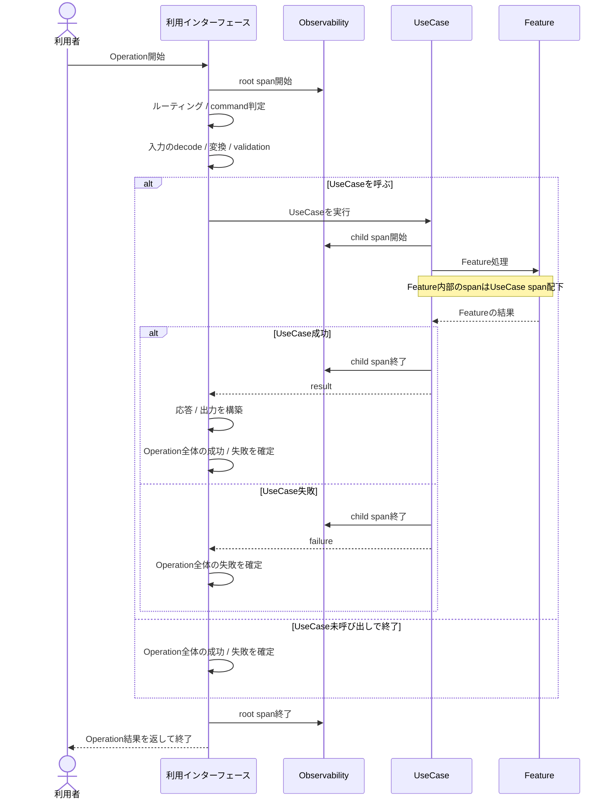
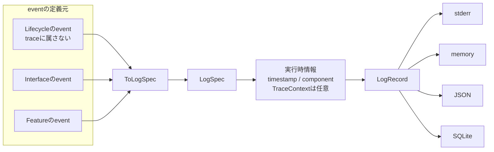

# 実行追跡・構造化ログ概要図

この図は、RS-0022で扱う処理の境界と値の流れを示す。正確な型・契約・未決定事項はRAGScope正本と [[実行追跡・構造化ログ設計ノート]] を参照する。package / library / module間の静的依存は [[実行追跡・構造化ログ静的依存図]] を参照する。

## Operationとtrace / span

利用者の1回の操作を1つのtraceとして追跡する。利用インターフェースは、Operation開始時にroot spanを開始する。

UseCaseを呼ぶ場合は、その処理をroot spanの子spanとして追跡する。Feature内部で作るspanはUseCaseのspan配下に置く。

UseCaseが成功した場合は、応答や出力の構築などの後処理へ進む。その後処理の結果も含めて、Operation全体の成功・失敗を確定する。UseCaseが失敗した場合は後処理を行わず、Operation全体の失敗を確定する。UseCase後の後処理も、root span内の同じOperationとして扱う。

root spanは、Operation全体の結果を確定したあとに終了する。

Applicationやserviceの起動・終了は利用者操作に含めず、traceに属さないeventとしてLoggingへ渡す。

## 構造化ログの値の流れ

Lifecycle / Interface / Featureは、それぞれ自身のeventを定義する。`ToLogSpec`はeventの意味を共通のログ表現である`LogSpec`へ変換する。そこへ実行時情報を加えて`LogRecord`を作り、各出力先へ渡す。

Feature / UseCaseからLogger、TraceId / SpanId、OpenTelemetry SDK、JSON / SQLite表現を直接扱わない。本番環境でObservability / Logging / Tracingを接続する処理はApplication側へ置く。
