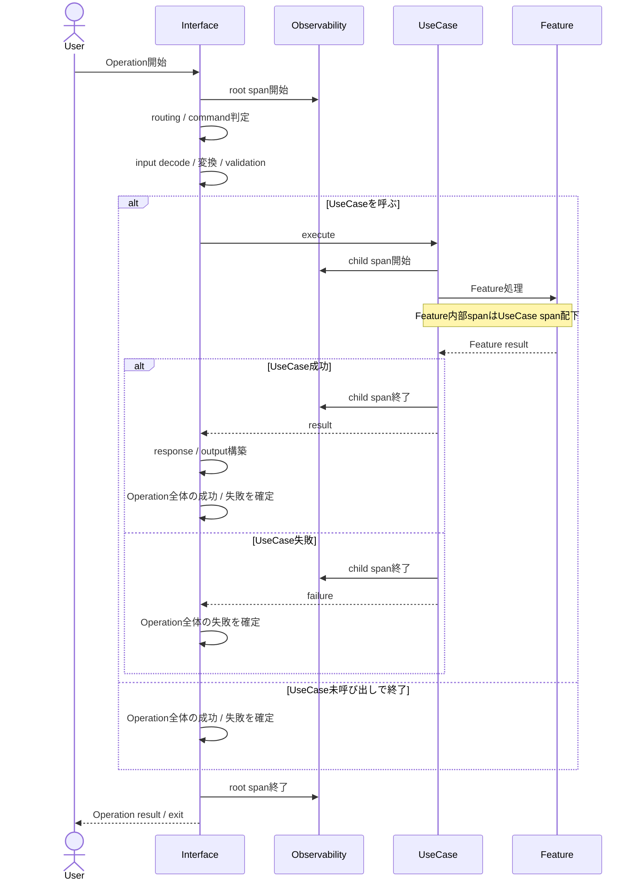
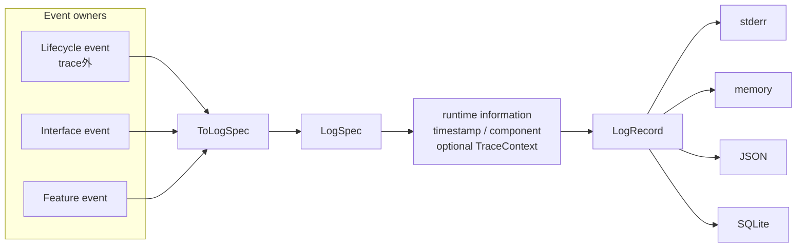

# 実行追跡・構造化ログ概要図

> [!note] Mermaid移行レビュー中
> このMarkdownを現在の参照先・更新先とする。同内容の [[RAGScope実行追跡・構造化ログ基盤.canvas]] は比較レビュー用として一時保持しており、設計の更新先にはしない。レビュー完了後にCanvasを削除する予定。

この図はRS-0022の処理境界と値の流れを示す。正確な型・契約・未決定事項はRAGScope正本と [[実行追跡・構造化ログ設計ノート]] を参照する。package / library / module間の静的依存は [[実行追跡・構造化ログ静的依存図]] を参照する。

## Operationとtrace / span

1 User Operationを1 traceとし、利用InterfaceがOperation開始時にroot spanを開始する。UseCaseを呼ぶ場合はrootの子spanとして追跡し、Feature内部spanはその配下に置く。UseCaseが成功した場合はresponse / output構築などのPost processingへ進み、その結果を含めてOperation全体の成功・失敗を確定する。UseCaseが失敗した場合はPost processingを通らずOperation全体の失敗を確定する。UseCase後のoutput構築などもroot span内の同じOperationに含める。Operation全体の成功・失敗を確定した後にroot spanを終了する。

Application / serviceの起動・終了などのLifecycle eventは利用者操作には含めず、trace外eventとしてLoggingへ渡す。

## 構造化ログの値の流れ

Lifecycle / Interface / Featureは、それぞれ自身が所有するeventを定義する。eventの意味を`ToLogSpec`で共通logging表現へ変換し、実行時情報を加えて`LogRecord`を完成させる。

Feature / UseCaseはLogger、TraceId / SpanId、OpenTelemetry SDK、JSON / SQLite表現を直接扱わない。本番環境でObservability / Logging / Tracingを接続する処理はApplication側へ置く。
