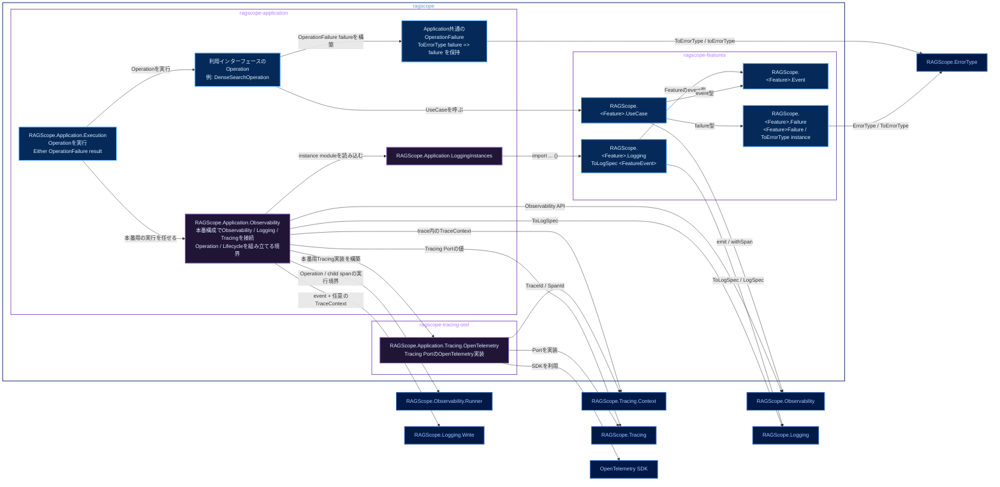

# 実行追跡・構造化ログ静的依存図 Application・Feature

全体: [[実行追跡・構造化ログ静的依存図]]

`ragscope` package内のmodule間依存を示す。矢印 `A → B` は、AがBをimportし、Bが公開する型・typeclass・APIを必要とすることを表す。右側のnodeは、別packageが公開しているmoduleまたは外部package。

色は、青系が公開module、紫系が非公開library / module、低彩度の濃色が別packageの公開moduleまたは外部package、青灰色の外枠がCabal packageを表す。

`RAGScope.<Feature>.Logging`はprivate `ragscope-features` libraryからexposeするmoduleとし、Feature eventに対する`ToLogSpec` instanceを定義する。`RAGScope.<Feature>.UseCase`、`RAGScope.<Feature>.Event`、`RAGScope.<Feature>.Failure`はLogging moduleをimportしない。Applicationは`RAGScope.Application.LoggingInstances`からFeatureごとのinstance moduleを読み込む。

OpenTelemetryによるTracing Portの具体実装は、`ragscope` package内のprivate `ragscope-tracing-otel` libraryにある`RAGScope.Application.Tracing.OpenTelemetry`へ置く。このmoduleだけがOpenTelemetry SDKへ直接依存する。

`OperationFailure`はApplicationで共通に使う型として確定しているが、正確なmodule名は未確定。Observability公開APIをFeature / Application / Interfaceごとにどう分けるかも未確定。

