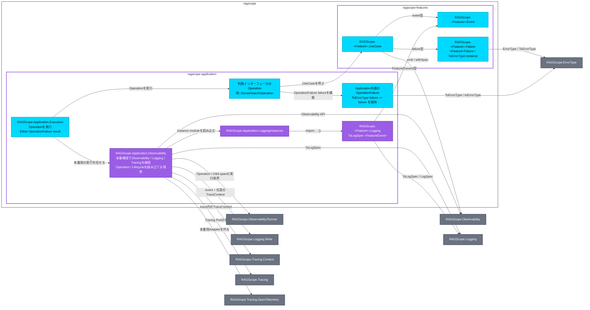

# 実行追跡・構造化ログ静的依存図 Application・Feature

全体: [[実行追跡・構造化ログ静的依存図]]

`ragscope` package内のmodule間依存を示す。矢印 `A → B` は、AがBをimportし、Bが公開する型・typeclass・APIを必要とすることを表す。右側のnodeは、別packageが公開しているmodule。

色は、シアンが公開module、紫が非公開library / module、グレーのnodeが別packageの公開module、グレーの外枠がCabal packageを表す。

`OperationFailure`はApplicationで共通に使う型として確定しているが、正確なmodule名は未確定。Observability公開APIをFeature / Application / Interfaceごとにどう分けるかも未確定。

