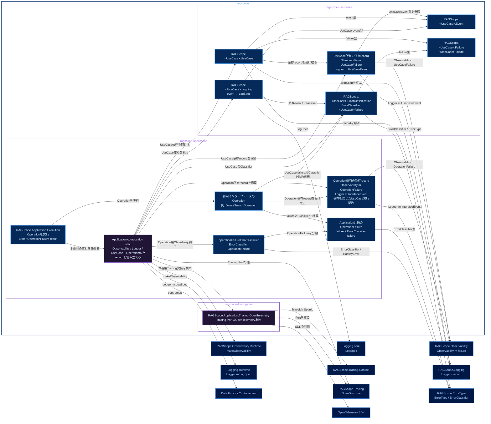

# 実行追跡・構造化ログ静的依存図 Application・UseCase

全体: [[実行追跡・構造化ログ静的依存図]]

`ragscope` package内のmodule間依存を示す。矢印 `A → B` は、AがBをimportし、Bが公開する型・関数・APIを必要とすることを表す。右側のnodeは、別packageが公開しているmoduleまたは外部package。

色は、青系が公開module、紫系が非公開library / module、低彩度の濃色が別packageの公開moduleまたは外部package、青灰色の外枠がCabal packageを表す。

UseCase固有failure型は`RAGScope.<UseCase>.Failure`が所有する。`RAGScope.<UseCase>.ErrorClassification`はfailure型と`RAGScope.ErrorType`を参照して名前付き`ErrorClassifier <UseCase>Failure`を定義する。`RAGScope.<UseCase>.Logging`はUseCase eventから`LogSpec`への名前付き純粋関数を定義し、失敗eventで`error_type`が必要な場合は同じClassifierを利用する。

UseCaseが実行時に必要とする能力はUseCase所有の依存recordへまとめる。Application composition rootが`Tracing m`とUseCase固有Classifierから`Observability m <UseCase>Failure`を作り、UseCase別Loggerとともに依存recordへ格納する。UseCase本体はClassifierやTracingを直接扱わない。

OperationもOperation固有の依存recordから実行時に必要な能力だけを受け取る。composition rootはUseCase依存recordをUseCase実行関数へ適用して依存を閉じ、その実行関数、Operation用Observability、Interface LoggerをOperation依存recordへ格納する。OperationはUseCase依存recordやApplication全体の`AppEnv`を受け取らず、failure所有側のClassifierはruntime依存recordへ入れず静的にimportする。

