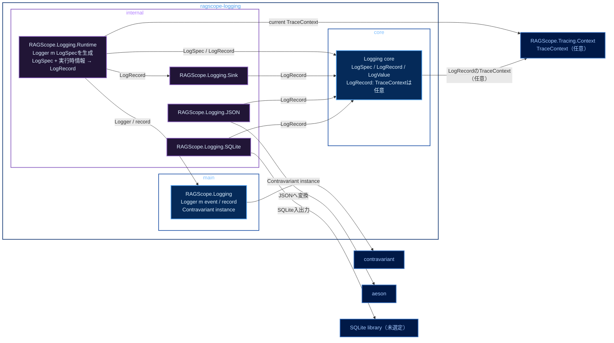

# 実行追跡・構造化ログ静的依存図 Logging

全体: [[実行追跡・構造化ログ静的依存図]]

`ragscope-logging` package内のmodule間依存を示す。矢印 `A → B` は、AがBを必要とすることを表す。JSONやSQLiteなど外部形式に依存する処理はcoreへ入れない。

色は、青系が公開library / module、紫系が非公開library / module、低彩度の濃色が別packageまたは外部package、青灰色の外枠がCabal packageを表す。

traceに属するログと、traceに属さないログは同じ`record`を使う。Logging Runtimeは記録時にcurrent Trace Contextを取得し、`TraceContext`を`LogRecord`へ全体として付けるか、付けないかのどちらかにする。

