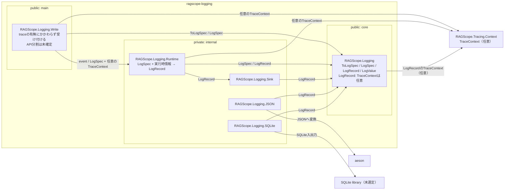

# 実行追跡・構造化ログ静的依存図 Logging

全体: [[実行追跡・構造化ログ静的依存図]]

`ragscope-logging` package内のmodule間依存を示す。矢印 `A → B` は、AがBを必要とすることを表す。JSONやSQLiteなど外部形式に依存する処理はcoreへ入れない。

traceに属するログと、traceに属さないログは同じLogging基盤を使う。`TraceContext`は`LogRecord`に全体として付くか付かないかのどちらかとし、TraceId / SpanIdの片方だけを持つ状態は作らない。

