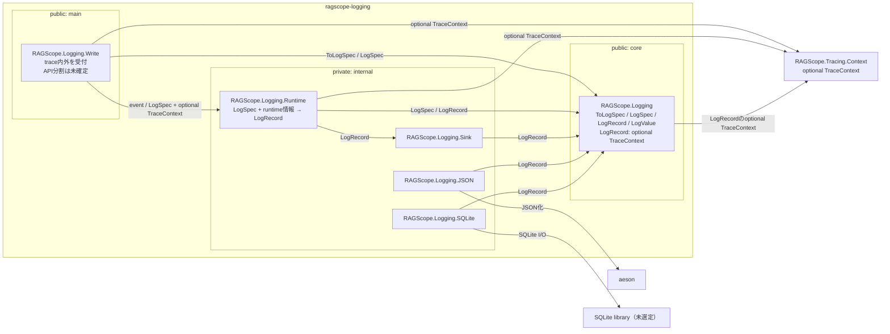

# 実行追跡・構造化ログ静的依存図 Logging

> [!note] Mermaid移行レビュー中
> このMarkdownを現在の参照先・更新先とする。同内容の [[実行追跡・構造化ログ静的依存 Logging.canvas]] は比較レビュー用として一時保持しており、設計の更新先にはしない。レビュー完了後にCanvasを削除する予定。

全体: [[実行追跡・構造化ログ静的依存図]]

`ragscope-logging` package内のmodule依存を示す。矢印 `A → B` はAがBを必要とする方向。外部形式の依存をcoreへ入れない。

trace内ログとtrace外ログは同じLogging基盤を使う。`TraceContext`は`LogRecord`で任意のまとまりとして扱い、TraceId / SpanId片方だけの状態は作らない。

