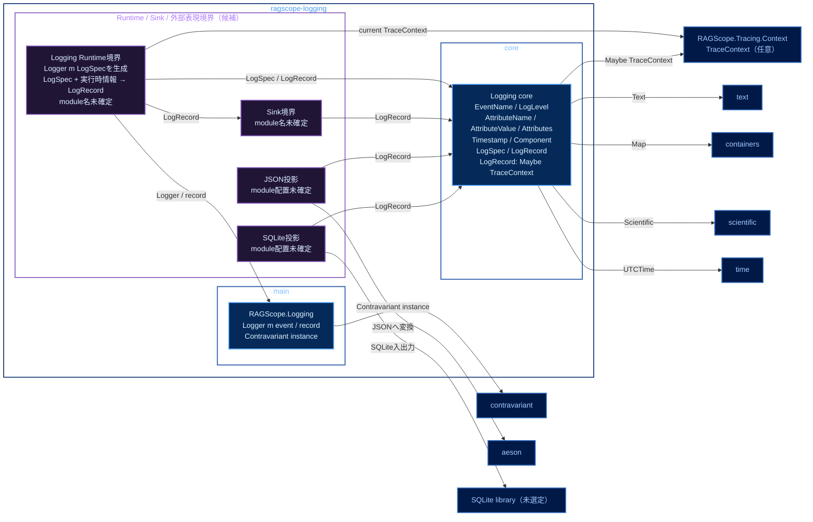

# 実行追跡・構造化ログ静的依存図 Logging

全体: [[実行追跡・構造化ログ静的依存図]]

`ragscope-logging` package内のmodule間依存候補を示す。矢印 `A → B` は、AがBを必要とすることを表す。JSONやSQLiteなど外部形式に依存する処理はcoreへ入れない。

正本で確定済みなのは、`RAGScope.Logging`が`Logger m event` / `record` / `Contravariant` instanceを公開すること、Logging coreが`EventName`、5値の`LogLevel`、`AttributeName`、再帰的`AttributeValue`、`Attributes`、`Timestamp`、`Component`、`LogSpec`、`LogRecord`を持つこと、Logging Runtimeが`Logger m LogSpec`を組み立ててcurrent Trace Contextを記録時に取得することである。Runtime / Sink / JSON / SQLiteの正確なmodule名とlibrary内配置はまだ固定していないため、図中では実装候補として示す。

色は、青系が公開library / module、紫系が非公開library / module、低彩度の濃色が別packageまたは外部package、青灰色の外枠がCabal packageを表す。

traceに属するログと、traceに属さないログは同じ`record`を使う。Logging Runtimeは記録時にcurrent Trace Contextを取得し、`TraceContext`を`LogRecord`へ全体として付けるか、付けないかのどちらかにする。

