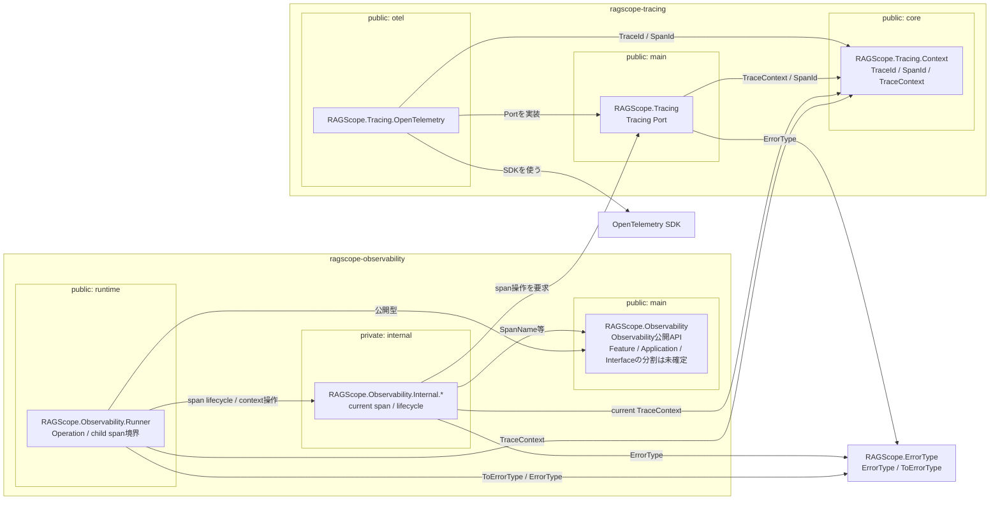

# 実行追跡・構造化ログ静的依存図 Observability・Tracing

全体: [[実行追跡・構造化ログ静的依存図]]

Observability RuntimeからOpenTelemetry SDKまでのmodule依存を示す。矢印はすべて依存方向。`Observability.Internal.* → OpenTelemetry Adapter`の直接依存は作らない。

Operation root spanとUseCase / Feature子spanを表せることを前提とし、公開APIをFeature / Application / Interfaceの利用主体ごとにどう分割するかはまだ固定しない。

