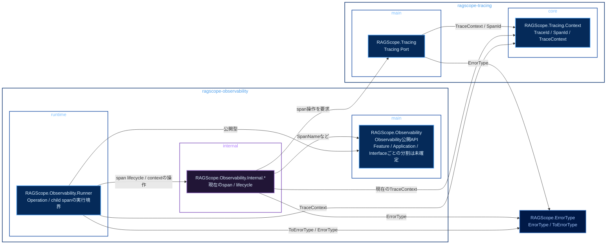

# 実行追跡・構造化ログ静的依存図 Observability・Tracing

全体: [[実行追跡・構造化ログ静的依存図]]

`ragscope-observability`と`ragscope-tracing`に属するmoduleを依存元とする静的依存を示す。矢印はすべて依存方向。OpenTelemetry Adapterは`ragscope` package側へ置くため、この図では依存元として扱わない。Adapter側の依存は [[実行追跡・構造化ログ静的依存図 Application・Feature]] を参照する。

色は、青系がpackage外から利用する公開library / module、紫系がpackage外へ公開しないprivate library / module、低彩度の濃色が別package、青灰色の外枠がCabal packageを表す。

Operationのroot spanとUseCase / Featureの子spanを表せることを前提とする。公開APIをFeature / Application / Interfaceごとにどう分けるかは未確定。

`ragscope-tracing` packageは、`RAGScope.Tracing`のTracing Portと`RAGScope.Tracing.Context`のTrace Context契約だけを公開する。OpenTelemetry SDKへ直接依存するmoduleはこのpackageに置かない。

