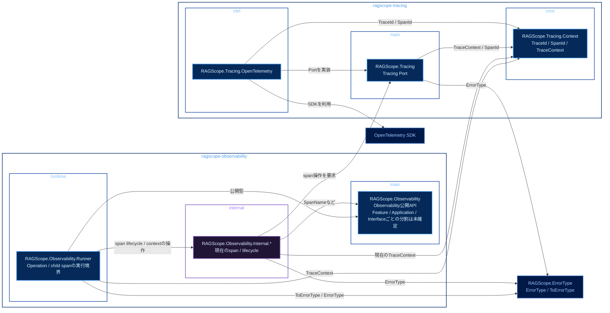

# 実行追跡・構造化ログ静的依存図 Observability・Tracing

全体: [[実行追跡・構造化ログ静的依存図]]

Observability / Tracing系moduleからOpenTelemetry SDKまでの依存関係を示す。矢印はすべて依存方向。`RAGScope.Observability.Internal.*`から`RAGScope.Tracing.OpenTelemetry`へは直接依存させない。

色は、青系が公開library / module、紫系が非公開library / module、低彩度の濃色が別packageまたは外部package、青灰色の外枠がCabal packageを表す。

Operationのroot spanとUseCase / Featureの子spanを表せることを前提とする。公開APIをFeature / Application / Interfaceごとにどう分けるかは未確定。

