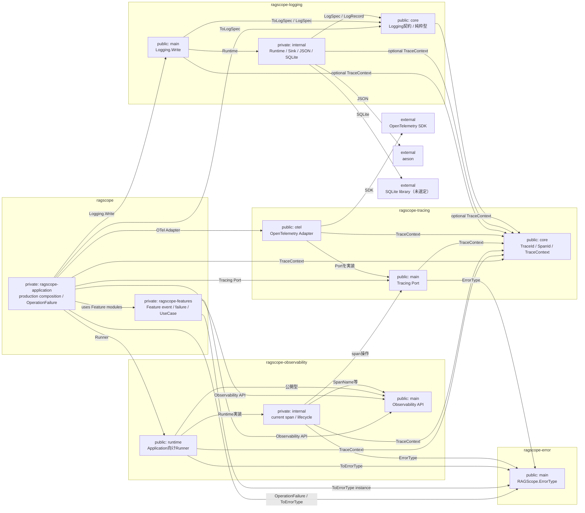

# 実行追跡・構造化ログ静的依存図

> [!note] Mermaid移行レビュー中
> このMarkdownを現在の参照先・更新先とする。同内容の [[実行追跡・構造化ログ静的依存.canvas]] は比較レビュー用として一時保持しており、設計の更新先にはしない。レビュー完了後にCanvasを削除する予定。

package / library間の**直接依存だけ**を示す。矢印 `A → B` は、AがBを`build-depends`で必要とする方向。逆向きの依存や循環がないかをこの図で確認する。

詳細なmodule依存は次を参照する。

- [[実行追跡・構造化ログ静的依存図 Application・Feature]]
- [[実行追跡・構造化ログ静的依存図 Observability・Tracing]]
- [[実行追跡・構造化ログ静的依存図 Logging]]

Observability公開APIの利用主体別分割と`Logging.Write`のoptional `TraceContext`表現は未確定。

