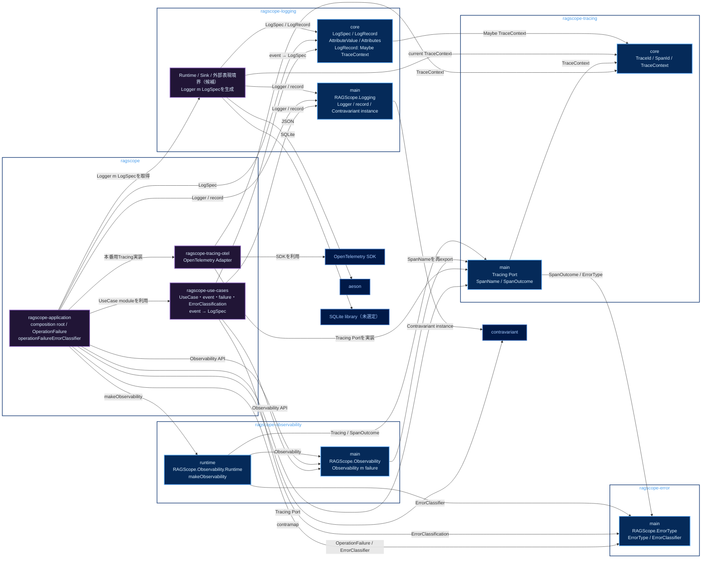

# 実行追跡・構造化ログ静的依存図

package / library間の**直接依存だけ**を示す。矢印 `A → B` は、Aの`build-depends`にBが必要であることを表す。この図では、逆向きの依存や循環がないかを確認する。

色は、青系が公開library、紫系が非公開library、低彩度の濃色が外部package、青灰色の枠がCabal packageを表す。

module間の依存関係は次の詳細図を参照する。

- [[実行追跡・構造化ログ静的依存図 Application・UseCase]]
- [[実行追跡・構造化ログ静的依存図 Observability・Tracing]]
- [[実行追跡・構造化ログ静的依存図 Logging]]

Observabilityはmainと`runtime`の2 libraryとし、UseCase側にはmainだけを許可する。mainの公開APIはClassifierを出さず、runtimeが`ErrorClassifier failure`を受けてfailure型ごとのObservabilityを組み立てる。Tracingは`SpanOutcome`だけを観測し、Applicationの`Either`や具体failureを扱わない。

