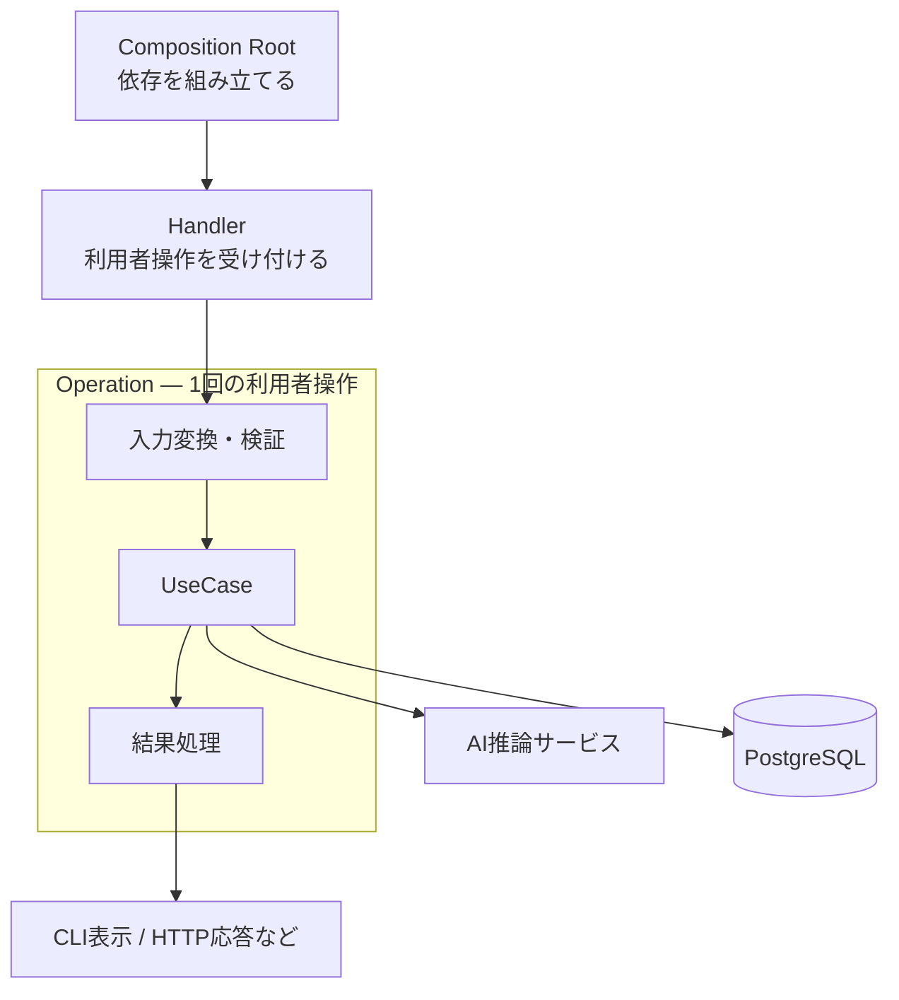
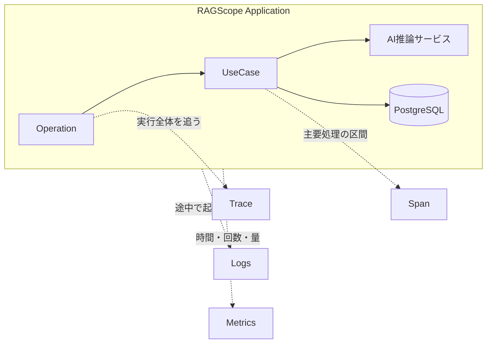
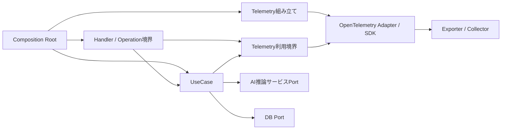
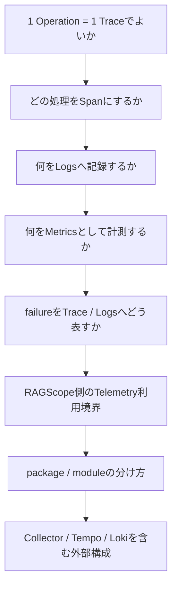
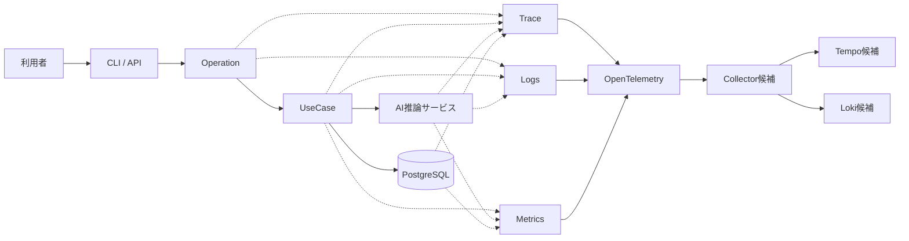

# RS-0023 Observability設計メモ

> [!note]
> これはRS-0023を考えるための**Workbench上の検討メモ**であり、RAGScopeの正本ではない。
> 旧RS-0022から再採用できそうな骨格をいったん見える形にし、OpenTelemetry Trace / Logs / Metricsをどう載せるか考えるための地図として使う。

## まず残したい骨格

旧RS-0022で問題だったのは、Applicationの処理の流れそのものより、TraceはOpenTelemetry、LogsはRAGScope独自基盤という半端な分割になっていた点だと考えている。

Application側の流れは、今のところ次を再採用する方向で考えたい。

| 役割 | ざっくり何をするか | 今の扱い |
|---|---|---|
| Composition Root | 必要な依存を組み立て、UseCaseやhandlerへ渡す | 再採用したい |
| Handler | 1回の利用者操作について、入力処理 → UseCase → 結果処理の順序を担当する | 再採用したい |
| Operation | 利用者の1回のトップレベル操作全体を表す境界。独立したApplication Serviceではない | 再採用したい |
| UseCase | 利用者がRAGScopeへ依頼する主要な処理を担当する | 再採用したい |
| Telemetry | Applicationの処理を制御せず、実行を横から観測する | 再採用したい |

## Applicationの流れ

まずはこの流れを土台として扱う。

ポイントは、OperationをUseCaseと並ぶ別のApplication Serviceにしないことだ。
Handlerが操作固有の流れを担当し、その全体をOperation境界として扱う。

## Telemetryを重ねるとどう見えるか

TelemetryはApplicationの実行経路そのものではなく、その実行を別角度から見る仕組みとして置きたい。

現時点では、かなり自然な第一候補として次の対応を考えている。

| RAGScope側 | Telemetry側の第一候補 |
|---|---|
| 1回のOperation | 1 Trace + root Span |
| UseCase | child Span |
| AI推論サービス呼び出し | child Span候補 |
| DB処理 | child Span候補 |
| 処理中の意味のある出来事 | LogRecord候補 |
| 段階別処理時間・生成時間・token数など | Metrics候補 |

ここはまだ確定ではない。ただ、設計を進めるための初期モデルとしては十分素直そうだ。

## 依存方向の候補

package名やpackage数はまだ決めない。
まずは「どの責務がどこへ依存してよいか」を先に見る。

この図で大事なのは、UseCaseがOpenTelemetry SDKそのものへ直接依存する形を最初から前提にしないことだ。
UseCaseから見えるのは「観測するために必要な能力」までに留め、OpenTelemetryの具体的な初期化やExporter設定は外側で組み立てる方向がよさそうだ。

一方で、旧RS-0022にあったObservability / Tracing / Loggingという分割をそのまま復活させるかは未決定である。
Trace / Logs / Metricsをまとめて考えると、別の境界の方が自然かもしれない。

## 旧RS-0022から、そのまま持ってこないもの

ここは一度きれいに忘れて、OpenTelemetry前提で必要性から決め直す。

| 旧設計の要素 | 今の扱い |
|---|---|
| 独自Logger | いったん白紙 |
| 独自LogSpec / LogRecord | いったん白紙 |
| Logging Runtime | OTel Logs SDKと責務が重なるため白紙 |
| 独自Sink | Exporter / Collectorとの役割分担から再検討 |
| 独自JSON Schema | 本当にRAGScope固有契約が必要かから再検討 |
| Trace ContextをLoggingへ手動で渡す仕組み | OTel Context / Logsとの関係から再検討 |
| Observability / Tracingの二重抽象 | Trace / Logs / Metrics全体を見て再検討 |
| ErrorType / ErrorClassifier | failure設計とTelemetry表現を分けて再検討 |
| 旧package分割 | 現在の責務と静的依存から決め直す |

## この先の設計で決めたいこと

次は細かいmodule名や型へ行く前に、まずこの辺を順番に決めたい。

Collector / Tempo / Lokiも視野には入れるが、まずはRAGScope Application側の責務とTelemetry境界を決める。
外側の構成を先に決めてApplication設計が引っ張られないようにしたい。

## 今の一枚絵

今のところ、目指している姿を一番雑に描くとこうなる。

まだ箱の数やpackage境界を決める段階ではない。
まずはこの絵を見ながら、「この責務は本当にRAGScope側が持つのか」「OTelへ任せられないか」を一つずつ削っていくのがよさそうだ。
