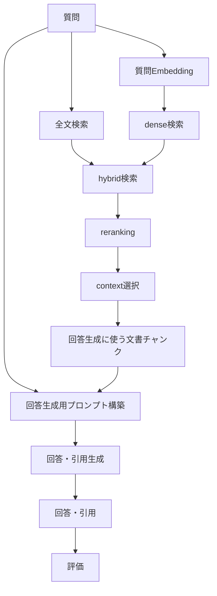

最初のSubtaskは、調査成果としては完了条件を満たせるところまで来ました。Workbenchのstatusはまだ変更していませんが、内容としては次のSubtaskへ進めます。

### Subtask 1の最終整理

まず、RAGScope全体の概念はこう整理します。

```text
RAGScope

アプリケーション
├─ RAGScopeアプリケーション
└─ AI推論サービス

データベース
└─ PostgreSQL

主なデータ
├─ 文書系
├─ 評価データ系
└─ 実験・結果系

主な処理
├─ 文書準備
├─ 検索
├─ 回答生成
├─ 評価
└─ 比較・レポート

処理の観測
├─ 共通エラー
├─ 構造化ログ
└─ 処理追跡
```

**PostgreSQLは「コンポーネント」から外します。** 現在のシステムアーキテクチャは「主要3コンポーネント」としていますが、後続の「システムアーキテクチャを概念モデルと整合させる」Subtaskで、RAGScopeアプリケーション／AI推論サービスとPostgreSQLの分類を分けます。

データ側は、木構造ではなく**関係**として捉えるのが正確です。

```text
文書集合 ── 文書をまとめる ──→ 文書
文書 ── 内容の版を持つ ──→ 文書バージョン
文書バージョン ── 分割される ──→ 文書チャンク
文書チャンク ── dense検索用に生成 ──→ 文書チャンクのEmbedding
```

要求として、文書・文書集合・文書バージョン・文書チャンク・分割条件は必要です。  
一方、1文書が複数の文書集合に所属できるか、IDをどう持つか、どのテーブルで保存するかは、**後続のデータモデル設計で決定します**。RS-0020中にデータモデル設計まで作らない場合は、Ticketの完了条件に従い後続Ticketとして切り出します。

評価側は決定済みの用語を使って、

```text
評価データセット
  └─ 評価データ
       ├─ 質問
       ├─ 参照回答
       ├─ 回答可能性
       └─ 正解根拠
```

とします。

`dev` / `test`は評価データを区分する概念です。DB上で別テーブルにするか属性にするかは、同じく後続のデータモデル設計で決定します。現在の要求は旧語「評価問題」のままですが、質問・参照回答・回答可能性・正解根拠という内容とdev/test区分は明確です。

実験側は、

```text
実験
├─ 実験条件
│  ├─ 文書分割条件
│  ├─ 検索条件
│  ├─ reranking条件
│  ├─ 回答生成条件
│  └─ 評価条件
│
├─ 評価データごとの実行結果（仮称）
│  ├─ 各検索段階の結果
│  ├─ 回答生成に渡した文書チャンク
│  ├─ 回答生成用プロンプト
│  ├─ 回答
│  ├─ 引用
│  ├─ 評価結果
│  ├─ 処理時間
│  ├─ 状態
│  └─ エラー
│
└─ 実験全体の集計結果
```

と整理できます。要求も「質問ごとの詳細な実行結果」を保存し、そこから再集計することを要求しています。

ここに残っている**「評価データごとの実行結果」の正式名称は、次の用語集Subtaskで決定します。**

### 処理フローも修正します

前回の一本線より、こちらが正確です。


現在のアーキテクチャにも、質問→検索→`context`選択→プロンプト構築→回答・引用生成、という流れがあります。

次の用語集では、単なる「プロンプト構築」ではなく、**「回答生成用プロンプト構築」**として意味を限定する方向で整理します。

### 問題のある既存用語の行き先

ここも判断先を固定しておきます。

|現在の語|扱い|
|---|---|
|`context`|**次の用語集Subtask**で、回答生成へ実際に渡す文書チャンクだけを指す正式語として残すか、日本語の別名称へ置き換えるかを決定する。他用途の`Context`は別名化候補|
|`source`|**次の用語集Subtask**で、元文書・引用・正解根拠を別概念として命名し直す|
|文書集合 / コーパス|**次の用語集Subtask**で正式名称を一本化する|
|質問ごとの生データ / 詳細な実行結果 / 質問ごとの結果|**次の用語集Subtask**で1件の正式名称を決定する|
|`execution_id`|**「要求と外部標準から論理契約を設計する」Subtask**で、存続・削除・TraceId等への置換を再検討する|
|`TraceId` / `SpanId`|同じ**論理契約Subtask**で、OpenTelemetryを採用するか、採用する場合どの処理をtrace/spanにするかを決定する|
|ドメイン参照|同じ**論理契約Subtask**で、そもそも汎用参照が必要かから再検討する|
|`ExecutionOutcome`|同じ**論理契約Subtask**で、「機能処理成功＋ログ失敗を全体失敗にする」という設計ルール自体を再検討する。型名は用語集へ入れない|

現在の`execution_id`は実装上、「CLIコマンド1回」を識別するIDです。  
しかし、それは**既存実装の事実であって、RS-0020完了後も残す決定ではありません**。

`ExecutionOutcome`もHaskell内部型です。現在は機能処理結果と必須ログ結果を合わせて最終結果を決めていますが、これも今回の再設計対象です。

### 用語集へ渡す候補

次のSubtaskでは、まずこの範囲から正式用語を作ります。

|分類|候補|
|---|---|
|アプリケーション|RAGScopeアプリケーション、AI推論サービス、RAGScope API、RAGScope CLI|
|文書|文書集合、文書、文書バージョン、文書チャンク、分割条件|
|検索|検索、全文検索、dense検索、hybrid検索、reranking、検索結果、検索用データ、文書チャンクのEmbedding、質問Embedding|
|評価データ|評価データセット、評価データ、質問、参照回答、回答可能性、正解根拠|
|実験|実験、実験条件、評価データごとの実行結果（仮称）、回答、引用、評価結果、集計結果|
|回答生成|回答生成用プロンプト、回答生成|
|共通|共通エラー|

`PostgreSQL`、HTTP、JSON、Embedding、OpenTelemetry、trace/spanなどは一般技術用語そのものなので、用語集で再定義はしません。RAGScope固有の使い方を説明する必要がある場合だけ触れます。

これで**Subtask 1からSubtask 2へ渡す材料は揃いました**。次は `RS-0020 subtask RAGScope用語集を作成する` の内容に沿って、実際の用語集の責務・用語・定義を組み立てる段階です。Workbench上でも、このSubtaskはSubtask 1を`blockedBy`に持っています。

現時点では正本リポジトリにもWorkbenchにも変更を加えていません。