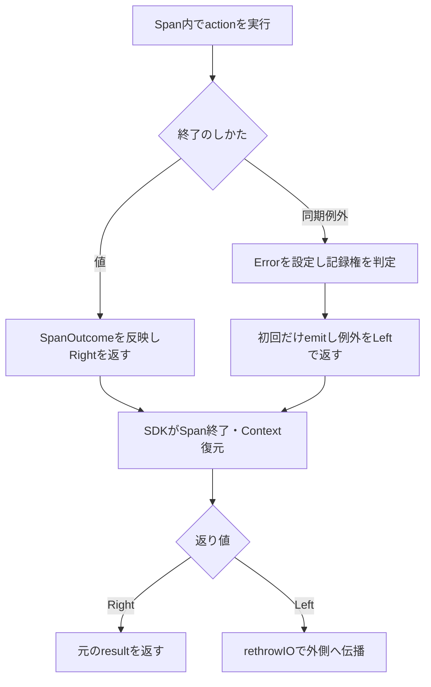

# RS-0024 exception EventRecord exactly-once 設計案

この文書は未採用の設計提案であり、RAGScopeの現在仕様ではない。RAGScopeの実装・テスト・正式な進捗は変更していない。

## 1. 推奨する構造

**例外をSDKのSpan終了処理の間だけ値として運び、Span終了後に元の例外として再throwする。記録主体の選択には、例外に属する型付きannotationを使う。**

対象は `RS-0024/exception-event-once`、確認したHEADは `9f6517a4dc9c2fbaa70479eea8cf7c1d3a7acc78`。引き継ぎと一致する。

変更の中心は `runOpenTelemetrySpan` と例外handlerの返り値である。

- Span内：同期例外を `ExceptionWithContext SomeException` として捕捉し、Status・属性・必要ならEventRecordを記録して、`Left` で返す。
- SDK：callbackの返り値を解釈せず、Span終了とContext復元を行う。
- Span外：`Left` の例外を `rethrowIO` する。`Right` は元の結果を返す。

`inSpan''`を廃止する必要はない。SDKの例外処理を通過しないよう、**値として返す範囲と、例外として伝播する範囲を配置し直す**。

全面的な実装し直しも比較したが、現在の公開型と要求からは、この構造を推奨する。既存コードを残すこと自体を選定理由にはしていない。

## 2. 実ファイルから確認した現在地

| 項目 | 確認した内容と状態 |
|---|---|
| 公開境界 | `SpanRunner = forall result. SpanName -> (result -> SpanOutcome) -> IO result -> IO result`。結果型は任意であり、SDK型は公開していない。決定済み。 |
| Logs接続 | `mkOpenTelemetryTraceBoundary :: TracerProvider -> EventRecordEmitter -> TraceBoundary`、`EventRecordEmitter = EventRecord -> IO ()`。決定済み。 |
| 同期例外処理 | `catchNoPropagate`で捕捉し、`ExceptionEventRecorded`を`ExceptionContext`へ追加して、callback内から`rethrowIO`している。 |
| SDK境界 | callbackの外側に`inSpan''`のcatch/rethrowがある。 |
| 最初の記録主体 | 統合テストは`internal-span`を要求している。一般設計は重複禁止を定義し、このテストが今回の具体的なownerを定める。 |
| recovery | `internal-span`外のapplication codeが`TestException`をcatchして復旧するテストがある。外側2 Spanの`Unset`を検証している。 |
| SDKの返り値 | behavior testは`inSpan''`が返された`Left`をSpanのErrorとして解釈しないことを検証対象にしている。 |
| 実行結果 | 21 examples / 1 failure、期待1件に対して3件という結果はユーザーの実測報告。この環境では再実行していない。 |
| バージョン | DockerfileはGHC 9.12.4。Cabalは`base ^>=4.21.2.0`、`hs-opentelemetry-api ^>=1.0.0.0`。実際に解決されたAPI 1.0.0.0は引き継ぎの情報。Cabalの範囲指定だけでは完全固定にならない。 |

主要な正本：

- [Trace Adapter](https://github.com/takashit16833/RAGScope/blob/9f6517a4dc9c2fbaa70479eea8cf7c1d3a7acc78/ragscope-app/opentelemetry-adapter/RAGScope/Telemetry/OpenTelemetry/Trace.hs)
- [Trace利用境界](https://github.com/takashit16833/RAGScope/blob/9f6517a4dc9c2fbaa70479eea8cf7c1d3a7acc78/ragscope-app/telemetry-boundary/RAGScope/Telemetry/Trace.hs)
- [Logs利用境界](https://github.com/takashit16833/RAGScope/blob/9f6517a4dc9c2fbaa70479eea8cf7c1d3a7acc78/ragscope-app/telemetry-boundary/RAGScope/Telemetry/Logs.hs)
- [例外統合テスト](https://github.com/takashit16833/RAGScope/blob/9f6517a4dc9c2fbaa70479eea8cf7c1d3a7acc78/ragscope-app/test/RAGScope/Telemetry/OpenTelemetryExceptionEventSpec.hs)
- [SDK behavior test](https://github.com/takashit16833/RAGScope/blob/9f6517a4dc9c2fbaa70479eea8cf7c1d3a7acc78/ragscope-app/test/RAGScope/Telemetry/OpenTelemetryBehaviorSpec.hs)
- [Cabal](https://github.com/takashit16833/RAGScope/blob/9f6517a4dc9c2fbaa70479eea8cf7c1d3a7acc78/ragscope-app/ragscope.cabal)

## 3. 原因：記録状態そのものより、状態を渡す経路

GHC 9.12.4では、`Exception SomeException`の`toException`が既存の`ExceptionContext`を空にする。一方、`ExceptionWithContext`のinstanceは、明示されたContextを例外へ付け直す。`rethrowIO`はこの明示Contextを使い、再throwのための新しいbacktraceを追加しない。

API 1.0.0.0のrelease tagが指すcommit `484370c7faf8af6ca4cb7bede8f5f29099ede5c0`の`inSpanInternal`では、callbackから出た例外を`SomeException`としてcatchし、Span終了・Context復元後に`EUnsafe.throwIO someEx`する。

したがって、内側のRAGScope handlerで追加したannotationが、このSDKの再throwで失われる。外側のhandlerは未記録と判定し、再度emitする。このコード経路は、ユーザーが観測した3件と整合する。各handlerのannotationを直接計測したログや、修正後の成功実測までは今回取得していない。

SDKの`ignoreExceptionMatching`は自動Status・Span Eventを制御するが、catch/rethrow自体を取り除かない。ignore設定の変更だけでは、この問題は解決しない。

確認したライブラリソース：

- [GHC 9.12.4 Exception.Type](https://github.com/ghc/ghc/blob/ghc-9.12.4-release/libraries/ghc-internal/src/GHC/Internal/Exception/Type.hs)
- [GHC 9.12.4 IO：catchNoPropagate・rethrowIO](https://github.com/ghc/ghc/blob/ghc-9.12.4-release/libraries/ghc-internal/src/GHC/Internal/IO.hs)
- [API 1.0.0.0 Trace.Core](https://github.com/iand675/hs-opentelemetry/blob/484370c7faf8af6ca4cb7bede8f5f29099ede5c0/api/src/OpenTelemetry/Trace/Core.hs)
- [API 1.0.0.0 ExceptionHandler](https://github.com/iand675/hs-opentelemetry/blob/484370c7faf8af6ca4cb7bede8f5f29099ede5c0/api/src/OpenTelemetry/Trace/ExceptionHandler.hs)

## 4. 型と処理順序

SDKとの内部的な受け渡しだけに次を使う。

```haskell
type CapturedException = ExceptionWithContext SomeException
type SpanExit result = Either CapturedException result
```

`Right result`はIO actionが値を返したことを意味する。`result`が業務上の`Left failure`であることはあり得る。例えば、`Right (Left failure)`と`Left capturedException`は別の状態である。

`SpanOutcome`は返された結果の観測用分類として継続利用する。例外を`SpanFailed Text`へ変換して捨てたり、共通`AppError`へ押し込んだりしない。



この図の同期例外経路でSDKが受け取るのは通常の返り値である。RAGScopeが設定したSpan Statusは`Error`のままであり、「SDK callbackの正常return」と「観測対象Spanの成功」を混同しない。確認したSDKの通常終了処理はStatusを成功へ書き換えない。

### 記録主体と親Span

1. `internal-span`が最初に例外を捕捉する。
2. そのSpanを`Error`とし、`error.type`を設定する。
3. annotationがなければ、このSpanを記録主体として選ぶ。
4. **まだinternal-spanがcurrentの間に**EventRecordをemitする。
5. annotation付き例外を`Left`でSDKへ返す。
6. SDKがinternal-spanを終了し、UseCaseのContextへ戻す。
7. `rethrowIO`する。
8. UseCase、rootもそれぞれErrorを設定するが、annotationがあるのでemitしない。

Context復元後までemitを遅らせると、現在のLogs Adapterでは親Spanへ関連付いてしまう。emitは必ずcallback内、rethrowはcallback外とする。

### recovery

application codeが内側の`withSpan`から出た例外をcatchして値を返せば、外側Spanのactionは正常に終了する。外側が`SpanSucceeded`と分類すれば`Unset`のままになる。子の失敗を共有状態から親へ伝える処理は存在しない。

## 5. FP・型・数学的構造の使いどころ

### 5.1 例外という制御効果を、一時的に直和の値へ移す

`IO result`の正常終了と例外終了を、SDKを通る短い区間で`Either CapturedException result`にする。これによって、例外を独自にcatch/rethrowする高階関数でも、通常の返り値として元の例外とContextを運べる。

これはactionの失敗をrecoverする操作ではない。内側の計算が終了したあと、管理処理を挟んで同じ例外を再開する操作である。`ExceptT`へアプリケーション全体を書き換えずに使える。

成功と例外を別々の`Maybe`にすると「どちらもない」「両方ある」を作れてしまう。`Either`ならその不正な組合せを表せない。

`capture`と`resume = either rethrowIO pure`は、対象の同期例外・結果値に関して往復を構成する。ただし、実行時間、非同期割り込み、遅延評価、挿入する観測処理まで含む無条件の同型ではない。

### 5.2 記録権は例外伝播に属する単調な状態

一つの伝播について、状態は次の一方向に進む。

```haskell
data RecordingState = Unclaimed | Claimed
```

`Unclaimed <= Claimed`と順序を置けば、状態更新はBoolean OR相当の冪等な結合で表せる。何度外側へ進んでも`Claimed`は変わらない。

しかし、**状態更新が冪等であることと、IOによるemitが冪等であることは別**である。emitするのは`Unclaimed -> Claimed`の遷移だけとし、外側へは更新後の状態を渡す必要がある。今回壊れていたのは、この受け渡しである。

連続した単一のstack unwindingでは、handlerは内側から外側へ順番に実行される。共有`IORef`やatomicなclaimは不要であり、`ExceptionContext -> Maybe ExceptionContext`という純粋な関数で足りる。この関数名のclaimは、並行処理でのatomicな獲得を意味しない。

### 5.3 exactly-onceの条件付きの説明

前提を「同一の伝播」「annotationが保存される」「emitが正常に完了する」「その伝播を複製しない」とする。

- 最内のhandlerではannotationがなく、emitが1回行われる。
- その後のhandlerはannotationを受け取るため、emitを0回行う。
- handlerの数に関する帰納法で、全体のemit回数は1になる。

同じ帰納法で各SpanのError設定も説明できる。Error設定はclaim判定の外側なので、全handlerが自分のSpanに対して実行する。

### 5.4 強い型でも保証しないもの

- `EventRecord -> IO ()`という型から、配送成功や非throwは証明できない。
- constructorを隠したmarkerでも、任意の外部ライブラリがContextを保持することは証明できない。
- `forall result`は戻り値の型を統一しないことを表すが、actionの二重実行を型だけで禁止しない。
- `LinearTypes`を加えても、通常の`IO`、例外API、SDKの副作用全体が自動で線形になるわけではない。

この問題に必要なのは、直和、型付きannotation、純粋な遷移判定、狭いIO境界である。証明できる範囲を増やさない型クラスや型レベルの状態機械は追加しない。

## 6. 方式比較

| 方式 | 元の型でcatch | recovery後の別例外 | 依存・責務 | 検証と実装量 | 評価 |
|---|---|---|---|---|---|
| **callback内で捕捉・値として返し、SDK外で再throw** | 維持できる | Contextが新しくなれば別件として扱える | `base`と既存SDK。Context・Span終了はSDK | 変更はTrace Adapter中心。既存統合テストが直接使える | **推奨** |
| SDKのcatch/rethrowをContext保持型へ修正 | 維持できる | 同上 | SDK側が例外透明性を保証する | SDK修正版の提供・固定・更新時検証が必要 | ライブラリ改善として有効だが、今回の設計を配布待ちにしない |
| `createSpan`・`endSpan`とContextスコープを直接組み立てる | 維持できる | 同上 | Adapterが取得・current化・復元・終了順序を管理 | 正常、例外、割り込み、取得途中失敗、終了失敗の検証範囲が広い | 正確な終了制御が別途必要なら候補。今回のSDK再throwだけなら過剰 |
| 例外本体を独自wrapperで包む | 任意の既存例外では維持できない | wrapper寿命の設計が必要 | applicationのcatch契約まで影響 | 例外階層ごとの互換性が必要 | `catch @TestException`などを壊すので不採用 |
| thread/Trace単位の記録済みBool | 元の型は維持 | 復旧後の別件を誤って抑制し得る | 状態の設定・解除、スレッド継承を自作 | 透明なapplication catchを観測する必要がある | 不採用 |
| 型名・message・StableNameによる重複除去 | 元の型は維持 | 同じ値を別々にthrowする場合を識別できない | registryと寿命管理が増える | 例外値の同一性と伝播の同一性は異なる | 不採用 |
| 全処理を`ExceptT`/独自効果へ変更 | 既存IO catchとの契約を変更 | 明示的な失敗経路なら扱いやすい | featureの返り値・呼び出し方法まで変わる | 移行量大。IO由来の想定外例外処理は依然必要 | 今回の要求では推奨しない |
| rootだけで記録 | 元の型は維持 | rootまで届かない例外は記録できない | 小さいがownerをrootへ変更する | recoveryケースとinternal owner要件に不適合 | 不採用 |
| `First`/`Writer`で後から最初の記録を選ぶ | 設計次第 | recovery前に記録を失わない経路が必要 | owner Context・時刻を別に保持する必要 | 「最初を選ぶ」だけではIOの一回実行を保証しない | 今回はその場でclaimする方が直接的 |

## 7. moduleと依存

| 場所 | 所有する処理・型 |
|---|---|
| `telemetry-boundary/RAGScope/Telemetry/Trace.hs` | 現在の`SpanRunner`・`SpanOutcome`・`TraceBoundary`を維持する。 |
| `telemetry-boundary/RAGScope/Telemetry/Logs.hs` | `EventRecord`・`EventRecordEmitter`を維持する。 |
| `opentelemetry-adapter/.../Trace.hs` | 例外捕捉、Span Error反映、記録権判定、例外EventRecord作成、SDK終了後の再throw。 |
| `opentelemetry-adapter/.../Logs.hs` | `EventRecord`からSDKのLogRecord引数への変換と、現在Contextでのemit。 |
| 初期化側・テストfixture | `emitEventRecord logsBoundary`をTrace Adapterへ注入する。 |

Trace AdapterはLogs Adapterをimportせず、境界の`EventRecordEmitter`だけに依存する。feature固有の失敗型やLoggerProviderをTraceの公開引数へ追加しない。

Cabal上では、既存の`opentelemetry-adapter -> telemetry-boundary`とSDK依存を維持する。追加packageは不要。既存private libraryの構成はlibrary間の依存を制約できるが、同じAdapter library内のTrace moduleとLogs moduleのimport方向までCabalが禁止するわけではない。現状のimportで確認し、今回のためだけにlibraryを細分化しない。

## 8. 保証範囲と例外処理の残る条件

### 8.1 一回の記録と、一回の配送は別

現在の`EventRecordEmitter :: EventRecord -> IO ()`は、backendで保存されたことを返さない。正常系での一回emitと、flush後にテストExporterで1件観測できることをまず保証する。ネットワーク切断やbackendの再試行まで含む配送exactly-onceは、この変更では保証しない。

この点は既存のLogs SDKへの責務委譲と整合する。

### 8.2 emit失敗時は元の例外を優先し、親で再試行しない案

[Observability設計](https://github.com/takashit16833/RAGScope/blob/9f6517a4dc9c2fbaa70479eea8cf7c1d3a7acc78/project-docs/design/observability/Observability%E8%A8%AD%E8%A8%88.md)とRS-0024は、Telemetry失敗で機能結果を変更せず、同じTelemetryへ再帰的に記録しないことを定めている。

現在の`markSynchronousException`はemit後に再throwするので、emitterが同期例外をthrowすれば元の例外へ戻れない。この問題はコード順序から分かるが、今回の3件とは別の問題であり、実測した故障ではない。

推奨は、記録権を選んだ時点で`Claimed`とし、同期的なTelemetry失敗を局所的に処理して、元の例外を伝播すること。親では再emitしない。emitが「受理したあとにthrow」した場合もあり得るため、親での再試行では重複を防げない。

この場合、marker名は`ExceptionEventRecorded`より`ExceptionEventClaimed`が正確である。正常時は一回記録、障害時は高々一回の試行となる。markerは保存成功証明ではない。これは提案する障害時方針であり、現在のコードの意味を読み替えたものではない。

本書末尾のコード案では、問題の核を切り分けるため、現在の正常emit前提とmarker名を維持している。**Telemetry失敗耐性を完成させた置換コードではない。** 実装採用時は、この節の方針を同期的なemitter失敗テストで先に具体化する。

### 8.3 非同期例外・キャンセルを同時に作り替えない

現在のRAGScope handlerは`SomeAsyncException`を同期例外から除外している。しかしSDKのignore設定は同期例外と`UserInterrupt`だけであり、他の型について同じ扱いを保証する設定ではない。全ての`SomeAsyncException`を「意図されたキャンセル」と断定できない。例えば`AsyncException`にはruntime failureも含まれる。

末尾の最小コード案は、同期例外だけを`Left`へ変換し、非同期例外は従来どおりSDKの例外経路へ渡す。これによってexactly-once修正とキャンセル分類の変更を分ける。同期例外の保証を、そのまま非同期例外にも拡張したとは主張しない。

全例外を値に捕捉する構造へ拡張する場合は、`UserInterrupt`、`ThreadKilled`、利用するキャンセル型、runtime failureを具体的な型ごとに分類し直す必要がある。SDKの自動処理を通らなくなるため、この判断は省略できない。

### 8.4 maskと遅延評価

`mask`でSpan scope全体を包み、元のactionと分類の評価は`restore`して実行する。これにより、callbackの捕捉を抜けてからSDKへ`Left`を返すまでの間に、通常の非同期割り込みを受ける隙間を減らす。action全体を割り込み禁止にしない。

`mask`でもブロックするIOは割り込まれ得る。`uninterruptibleMask`でSDKやExporter全体を包むと終了できなくなる危険があるので採用しない。

`IO result`が未評価の値を返し、その値がSpan外で初めて評価されて例外を出した場合、このSpanからの例外escapeではない。任意の`result`に`NFData`を追加して強制評価する案は、公開契約と評価のタイミングを変えるため採用しない。処理契約上必要な評価はaction側で行う。

### 8.5 外部ライブラリのcatch/rethrow

この案はRAGScopeが作る各`inSpan''`境界によるContext喪失を防ぐ。applicationや外部計装がその間に`SomeException`をcatchして`throwIO`する場合、同じ喪失は残る。

Contextと元の型だけを受け取る外側の処理から、「一度記録してContextが消えた例外」と「まだ記録していない新しい例外」を常に区別することはできない。共有Boolや型名の比較でも解消しない。

したがって対応する伝播経路は、Contextを保存するcatch/rethrowで構成する。外部ライブラリを導入するときは、その実コードを確認し、必要なら同じ値による隔離またはライブラリ修正を行う。単なるcatch後の復旧は、伝播をそこで終えるので問題ない。

新しいthrowと同じ伝播の再開は、値の`Eq`ではなくContextの引き継ぎで区別する。新しくthrowし直すコードまで常に同一伝播として扱いたい要求なら、明示的なpropagation tokenまたは専用catch/rethrow契約が必要になる。今回は要求追加を行わない。

### 8.6 標準計装が先に記録した場合

[ログ・イベント設計](https://github.com/takashit16833/RAGScope/blob/9f6517a4dc9c2fbaa70479eea8cf7c1d3a7acc78/project-docs/design/observability/%E3%83%AD%E3%82%B0%E3%83%BB%E3%82%A4%E3%83%99%E3%83%B3%E3%83%88%E8%A8%AD%E8%A8%88.md)は、標準計装の記録とも重複しないことを要求する。これは決定済みの要求である。

一方、RAGScope独自のannotationを、任意の標準計装が自動的に付けることはない。今回の`ExceptionEventRecorded`と既存の2ケースだけでは、この要求全体の実装完了を示せない。具体的に採用する計装が記録した事実をどのAPIから受け取れるかは、その計装を確認して接続する必要がある。今回確認した型には、その通知用引数はない。

この点を、現在のnested RAGScope Spanで重複する原因と混同しない。

### 8.7 SDKの取得・終了自体の失敗

値として運ぶ案は、SDKが返り値を返すまで正常に終了することを前提とする。`endSpan`にはprocessor失敗を捕捉するコードがあるが、それだけで任意のSDK・diagnostic logger・非同期割り込みによる失敗を排除できない。

終了処理がthrowすれば、callbackから返した元の結果を外側で受け取れない場合がある。その場合に単純にactionを再実行してはならない。SDK終了失敗まで完全に制御する必要が実測で判明した場合は、低水準APIによる取得・利用・終了の分離、またはSDKの終了処理修正を比較し直す。これは実測前に共有状態を追加する理由にはしない。

## 9. 検証計画

まず既存の失敗ケースをそのまま使い、変更の効果を確認する。今回の実行環境にはGHC、Cabal、Dockerがなく、build/testは未実施。

| 検証 | 期待する観測 |
|---|---|
| 既存の3階層未処理例外 | 各SpanがError + error.type、EventRecord 1件、ownerがinternal、Span Event 0件、元の型でcatch可能 |
| 既存のrecovery | internalのみError、外側2 SpanはUnset、EventRecord 1件 |
| Context保存の直接検証 | 同期例外に独自のテストannotationも付け、外側の`catchNoPropagate`で元annotationの保存を確認。privateな記録済みannotationは公開せず、1件という観測で効果を検証 |
| EventRecordの内容 | EventName `exception`、Severity Error、`exception.type`・`exception.message`、ownerのTraceId / SpanIdを確認 |
| 実データを持つ例外 | 引数を持つ例外をthrowし、外側で同じconstructor・引数を確認。現在のnullary TestExceptionだけより強い検証にする |
| 同じ値を2回、新しくthrow | 同じ親Spanで一回目をrecoverし、次の子Spanからもう一度throw。EventRecord合計2件、各ownerはそれぞれの子 |
| Context付きで意図的にrethrow | 一回目の記録済みContextを引き継ぎ、同じ伝播としてEventRecordを追加しない |
| 純粋な例外をaction内で評価 | `evaluate`などでSpan内に評価を置いた同期例外も1件となる |
| 元の成功値・処理失敗値 | 元の値を維持し、`Right (Left failure)`相当のケースから例外EventRecordを生成しない |
| masking state | 通常呼び出しではactionがUnmasked、呼び出し元がmaskしていればその状態を維持 |
| 既存のUserInterrupt | 元の中断を再throwし、Status・error.type・Span Eventについて既存期待を維持 |
| 異なる実行の並行失敗 | 独立した例外伝播が互いの記録を抑制しない。Contextの各ownerも確認 |
| 同期emitter失敗 | 8.2を実装する段階で、記録前throwと記録後throwを分け、元の例外維持・再試行なし・再帰ログなしを確認 |

「annotationを失う外部catch/rethrow」は保証限界を示す検証にする。根拠なく通常成功テストへ変えない。

`make check-app`を実行する前に、[Makefile](https://github.com/takashit16833/RAGScope/blob/9f6517a4dc9c2fbaa70479eea8cf7c1d3a7acc78/Makefile)の`find "#(APP_DIR)"`がformat対象を正しく探索しないことに注意する。この誤記は実ファイルでも確認した。今回は変更していない。既存のチェックが全部動いたとの判断には使わず、必要ならformatter、build、testを明示的に実行する。

## 10. 採用判断

推奨案は、**同期例外をSpan callbackの返り値へ移し、SDK終了後にContext付きで再throwする方式**である。

採用前の必須確認は既存2ケースとannotation保存テスト。Telemetryの同期失敗に対する記録権の扱いは8.2の案で具体化する。標準計装との連携やSDK終了失敗は、確認していない範囲まで解決済みとしない。

この文書を正式採用するときは、必要な内容そのものをRAGScopeの設計・コード・テストへ反映する。正本からこのWorkbench Noteを参照先にはしない。

## 11. コード案の位置づけ

以下は確認したTrace Adapterを基に、同期例外の経路を変更する**未コンパイルの全文案**である。RAGScopeのファイルへは反映していない。

変更点は次のとおり。

- `CapturedException`と`SpanExit`を導入する。
- `runOpenTelemetrySpan`を`mask`で包み、SDK終了後に`either rethrowIO pure`する。
- handlerは同期例外なら`Left`で返す。非同期例外は従来の経路へ再throwする。
- `markSynchronousException`は例外をthrowせず、Context付き例外の値を返す。
- EventRecordの内容、公開境界、依存、SDKのignore設定は現在のものを使用する。

8.2のTelemetry失敗方針はこの全文案にはまだ含めていない。まず原因となる境界だけを変更して検証するための案であり、RS-0024全体の完成実装として扱わない。

```haskell
{-# LANGUAGE OverloadedStrings #-}
{-# OPTIONS_GHC -Wno-name-shadowing #-}

module RAGScope.Telemetry.OpenTelemetry.Trace (mkOpenTelemetryTraceBoundary) where

import Control.Exception (
  AsyncException (UserInterrupt),
  Exception (displayException, fromException),
  ExceptionWithContext (ExceptionWithContext),
  SomeAsyncException,
  SomeException (..),
  catchNoPropagate,
  mask,
  rethrowIO,
 )
import Control.Exception.Annotation (
  ExceptionAnnotation,
 )
import Control.Exception.Context (
  ExceptionContext,
  addExceptionAnnotation,
  getExceptionAnnotations,
 )
import Data.Data (typeOf)
import Data.Map.Strict qualified as Map
import Data.Text (Text)
import Data.Text qualified as Text
import OpenTelemetry.Trace.Core (
  ExceptionHandler,
  Span,
  SpanStatus (Error),
  Tracer,
  TracerOptions (tracerExceptionHandlerOptions),
  TracerProvider,
  addAttribute,
  defaultSpanArguments,
  inSpan'',
  makeTracer,
  setStatus,
  tracerOptions,
 )
import OpenTelemetry.Trace.ExceptionHandler (
  ignoreExceptionMatching,
 )

import RAGScope.Telemetry.Logs (
  EventName,
  EventRecord (..),
  EventRecordEmitter,
  EventTimestamp (EventNow),
  LogValue (LogText),
  mkEventName,
 )
import RAGScope.Telemetry.Logs qualified as Logs
import RAGScope.Telemetry.Trace (
  SpanName (SpanName),
  SpanOutcome (SpanFailed, SpanSucceeded),
  SpanRunner,
  TraceBoundary,
  mkTraceBoundary,
 )

-- | Preserve both the original exception and its propagation context.
type CapturedException = ExceptionWithContext SomeException

-- | Adapter-local transport across the SDK's normal return path.
-- Right may itself contain an application-level Left failure.
type SpanExit result = Either CapturedException result

-- | Marks one exception propagation after its exception EventRecord has been
-- recorded.
--
-- The annotation belongs to ExceptionContext rather than to the exception type
-- because recording state differs between individual exception propagations.
data ExceptionEventRecorded
  = ExceptionEventRecorded
  deriving (Show)

instance ExceptionAnnotation ExceptionEventRecorded

-- | Build the RAGScope Trace boundary backed by OpenTelemetry.
mkOpenTelemetryTraceBoundary ::
  TracerProvider ->
  EventRecordEmitter ->
  TraceBoundary
mkOpenTelemetryTraceBoundary tracerProvider eventRecordEmitter =
  mkTraceBoundary $
    runOpenTelemetrySpan
      tracer
      eventRecordEmitter
 where
  tracer =
    makeTracer
      tracerProvider
      "ragscope"
      tracerOptions
        { tracerExceptionHandlerOptions =
            [ ignoreSynchronousException
            , ignoreIntentionalInterruption
            ]
        }

-- | Run one RAGScope action inside an OpenTelemetry Span.
runOpenTelemetrySpan ::
  Tracer ->
  EventRecordEmitter ->
  SpanRunner
runOpenTelemetrySpan tracer eventRecordEmitter (SpanName spanName) classify action =
  mask $ \restore -> do
    exit <-
      inSpan''
        tracer
        spanName
        defaultSpanArguments
        $ \span ->
          handleSynchronousException
            eventRecordEmitter
            span
            $ restore $ do
              result <- action

              applySpanOutcome span (classify result)

              pure result

    -- The SDK has ended this Span and restored its parent Context.
    -- Rethrowing here avoids the SDK's SomeException/throwIO path.
    either rethrowIO pure exit

-- | Reflect the final RAGScope result on the Span.
applySpanOutcome ::
  Span ->
  SpanOutcome ->
  IO ()
applySpanOutcome _ SpanSucceeded =
  pure ()
applySpanOutcome span (SpanFailed errorType) = do
  setStatus span $ Error ""

  addAttribute
    span
    "error.type"
    errorType

-- | Capture synchronous exceptions as values before leaving the SDK callback.
-- Non-synchronous exceptions retain the existing SDK exception path.
handleSynchronousException ::
  EventRecordEmitter ->
  Span ->
  IO result ->
  IO (SpanExit result)
handleSynchronousException eventRecordEmitter span action =
  (Right <$> action) `catchNoPropagate`
    \exceptionWithContext@(ExceptionWithContext _ exception) ->
      if isSynchronousException exception
        then
          Left <$>
            markSynchronousException
              eventRecordEmitter
              span
              exceptionWithContext
        else
          rethrowIO exceptionWithContext

-- | Mark one Span as failed by a synchronous exception and record the
-- exception EventRecord only when this Span gets the first claim.
markSynchronousException ::
  EventRecordEmitter ->
  Span ->
  CapturedException ->
  IO CapturedException
markSynchronousException
  eventRecordEmitter
  span
  exceptionWithContext@(ExceptionWithContext exceptionContext exception@(SomeException inner)) = do
    let
      exceptionMessage =
        Text.pack $
          displayException inner

      exceptionType =
        Text.pack $
          show $
            typeOf inner

    setStatus
      span
      (Error exceptionMessage)

    addAttribute
      span
      "error.type"
      exceptionType

    case claimExceptionEvent exceptionContext of
      Nothing ->
        pure exceptionWithContext
      Just claimedContext -> do
        emitExceptionEvent
          eventRecordEmitter
          exceptionType
          exceptionMessage

        pure $
          ExceptionWithContext
            claimedContext
            exception

-- | Claim exception EventRecord ownership for one exception propagation.
--
-- Nothing means that another inner Span already recorded the EventRecord.
-- Just returns the ExceptionContext carrying the marker for the first claim.
claimExceptionEvent ::
  ExceptionContext ->
  Maybe ExceptionContext
claimExceptionEvent exceptionContext =
  case getExceptionAnnotations @ExceptionEventRecorded exceptionContext of
    [] ->
      Just $
        addExceptionAnnotation
          ExceptionEventRecorded
          exceptionContext
    _ ->
      Nothing

-- | Record the generic OpenTelemetry exception EventRecord.
emitExceptionEvent ::
  EventRecordEmitter ->
  Text ->
  Text ->
  IO ()
emitExceptionEvent eventRecordEmitter exceptionType exceptionMessage =
  eventRecordEmitter $
    EventRecord
      { eventName = exceptionEventName
      , eventTimestamp = EventNow
      , eventSeverity = Logs.Error
      , eventAttributes =
          Map.fromList
            [ ("exception.type", LogText exceptionType)
            , ("exception.message", LogText exceptionMessage)
            ]
      }

-- | Generic OpenTelemetry exception EventName.
exceptionEventName :: EventName
exceptionEventName =
  case mkEventName "exception" of
    Right eventName ->
      eventName
    Left failure ->
      error $
        "exceptionEventName: failed to construct static exception EventName: "
          <> show failure

-- | hs-opentelemetry must not automatically add another exception Span Event
-- for synchronous exceptions already handled above.
ignoreSynchronousException :: ExceptionHandler
ignoreSynchronousException =
  ignoreExceptionMatching @SomeException isSynchronousException

-- | UserInterrupt represents an intentional user interruption and must not
-- be recorded as a Span error.
ignoreIntentionalInterruption :: ExceptionHandler
ignoreIntentionalInterruption =
  ignoreExceptionMatching @AsyncException (== UserInterrupt)

isSynchronousException :: SomeException -> Bool
isSynchronousException exception =
  case fromException exception :: Maybe SomeAsyncException of
    Just _ ->
      False
    Nothing ->
      True
```
