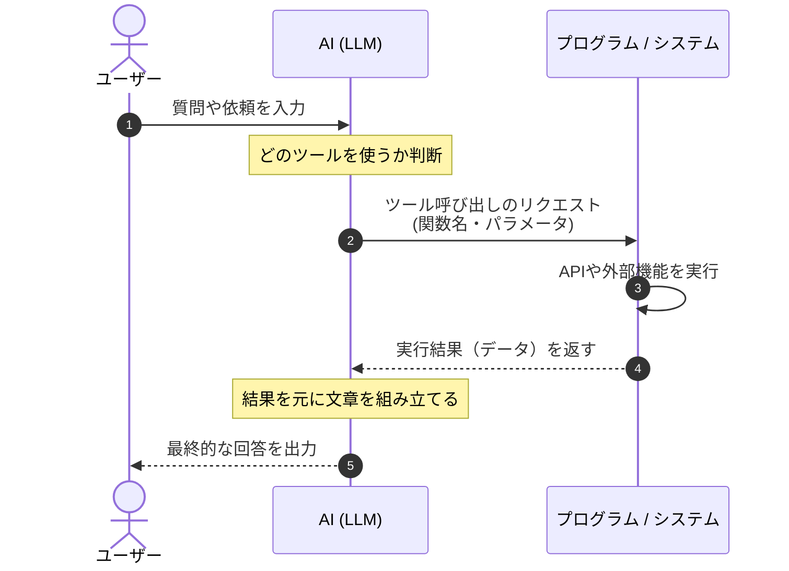

# Tool Calling
LLMが単にテキストを生成するだけでなく、外部のツールやAPIを自動的に判断して呼び出して、その実行結果を取り込んで回答を生成する仕組み。

モデル自体が`Tool Calling(Function Calling)`専用のフォーマットを出力する機能を定義している。

## 基本的な仕組み
1. **ツールの定義をAIに渡す**
	- システム開発者がAIに対して、「天気検索機能」「計算機能」「検索機能」などの使い方（ツール名や必要な引数）を提示しておる。
2. **AIが必要なツールを判定・パラメータを出力**
	- ユーザーから質問が来ると、AIは「どのツールを使えば解決できるか」を判断し、「`get_weather(city="Tokyo")`を実行して」という命令（JSONデータなど）を出力する。
3. システムが実行して結果をAIに返す
	- アプリ側が実際にその関数を実行して結果を取得し、そのデータをAIに渡す。AIはその結果を元に自然な文章を組み立ててユーザーに回答する。



##  Ollamaでの実際のやり取りの例
### ① リクエスト（アプリ側からOllamaへ送信）
ユーザーの質問と一緒理、「使えるツールの定義（関数名や引数の説明）」を渡す。
```json
{
  "model": "llama3.3",
  "messages": [
    { "role": "user", "content": "明日の東京の天気は？" }
  ],
  "tools": [
    {
      "type": "function",
      "function": {
        "name": "get_weather",
        "description": "指定した都市の天気を取得する",
        "parameters": {
          "type": "object",
          "properties": {
            "city": { "type": "string", "description": "都市名（例: Tokyo）" }
          },
          "required": ["city"]
        }
      }
    }
  ]
}
```
### ② レスポンス（Ollama / モデルからの返答）
モデルが「この質問には`get_weather`ツールが必要だ」と判断すると、**通常の文章ではなく、専用の`tool_calls`というフォーマットで返答**する。
```json
{
  "message": {
    "role": "assistant",
    "content": "",
    "tool_calls": [
      {
        "function": {
          "name": "get_weather",
          "arguments": {
            "city": "Tokyo"
          }
        }
      }
    ]
  }
}
```

アプリケーション側はこの`tool_calls`を受け取ると「`get_weather(city="Tokyo")`を実行しろということか」とプログラムで検知し、実際の天気予報APIを叩きに行く。