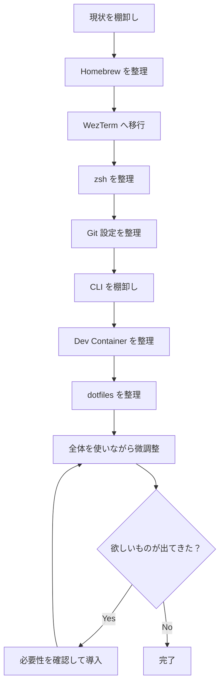

---

status: inbox  
priority: medium  
scheduled: 2026-08-12  
dateCreated: 2026-08-12T06:12:28.479+09:00  
dateModified: 2026-08-12T08:15:00+09:00  
tags:

- task
    

---

# 開発環境刷新

## 目的

Mac の開発環境を一度棚卸しし、現在の開発スタイルに合わせて整理する。

今回のテーマは、

> **余分な贅肉を落として、選び抜かれた道具でシンプルにする。**

新しいツールを大量に導入して「モダンな環境」を作ること自体は目的にしない。

まず既存の設定・ツールを整理し、そのうえで、

- 今も必要なもの
    
- 改めて導入したいもの
    
- 作業中に見つかった便利そうなもの
    

を一つずつ判断していく。

最終構成は最初から固定しない。

---

## 現在の構成

現在は主に以下を利用している。

- kitty
    
- tmux
    
- zsh
    
- VS Code
    
- Dev Container
    
- Git
    
- lazygit
    
- git worktree
    
- Homebrew
    
- 各種 CLI / dotfiles
    

以前は Terminal / Neovim 中心の環境だったため、その頃の設定や CLI も残っている。

これらを現在の使い方に合わせて整理する。

---

# 基本方針

## 1. まず削る

最初から理想構成を設計しない。

現在存在する、

- Homebrew package
    
- shell 設定
    
- alias
    
- function
    
- plugin
    
- Git 設定
    
- CLI
    
- dotfiles
    

を確認し、不要なものを削る。

判断基準は、

> **今使っているか、または今後使いたい理由が明確か。**

とする。

---

## 2. 必要なものは普通に残す

「最小構成」にすること自体を目的にはしない。

便利で実際に使うものは残す。

現時点では、少なくとも以下は Mac に残す。

- fzf
    
- zoxide
    
- lazygit
    

作業中に、

- lazydocker
    
- その他の CLI
    
- WezTerm の便利機能
    

などを使いたくなった場合も、その都度検討する。

---

## 3. 新しいものを追加することも禁止しない

今回の中心は整理だが、

> 棚卸ししていたら、今の開発スタイルに合うもっと良い道具が見つかった

という場合は普通に導入する。

ただし、

> 流行っているからとりあえず入れる

ではなく、

> **自分の現在の作業を実際に楽にするか**

で判断する。

---

## 4. Terminal を過度に作り込まない

現在の開発作業の中心は VS Code。

Git 操作についても lazygit + worktree を中心にする。

そのため、

- 大量の Git alias
    
- 大量の shell function
    
- Terminal 内だけで完結する複雑なワークフロー
    

は原則として整理対象とする。

一方で、fzf や zoxide のように Terminal 操作そのものを素直に快適にするものは残す。

---

## 5. Dev Container はプロジェクト環境として扱う

Mac と Dev Container を完全に同じ環境にはしない。

Dev Container には基本的に、

- language runtime
    
- application dependencies
    
- build tools
    
- test tools
    
- lint / formatter
    
- debugger
    
- プロジェクト開発に必要な CLI
    

を入れる。

Mac の個人環境をそのままコンテナへ再現することは目指さない。

ただし、

> Mac 側の設定が Dev Container に引き継がれた結果、逆に壊れる

という状態はなくす。

特に Git / `gh` 周辺は今回整理する。

---

# 作業の流れ



---

# 1. Homebrew の棚卸し

まず Mac に何が入っているか確認する。

```bash
brew list --formula
brew list --cask
brew leaves
brew services list
```

必要に応じて依存関係も確認する。

各 package を、

- 残す
    
- 削除する
    
- 用途を調べる
    

に分類する。

### 確認したいこと

- 昔の開発環境でしか使っていないもの
    
- runtime manager の重複
    
- 使っていない database / server
    
- 不要になった CLI
    
- 不要な GUI application
    
- 常駐している Homebrew service
    
- 重複しているツール
    

### Brewfile

棚卸し後、必要であれば Brewfile を作成する。

現在入っているものをそのまま記録するのではなく、整理後の状態を記録する。

---

# 2. kitty / tmux から WezTerm へ移行

kitty の代わりに WezTerm を導入する。

tmux は一旦外し、WezTerm の機能だけで普段の操作が足りるか確認する。

### 最初に設定するもの

- font
    
- font size
    
- appearance
    
- Window
    
- Tab
    
- Pane
    
- Tab 移動
    
- Pane 移動
    
- Pane resize
    
- copy / paste
    
- 必要最低限の keybinding
    

### 最初からやらないもの

- 複雑な Workspace 管理
    
- multiplexer の高度な利用
    
- session persistence の作り込み
    
- 大量の Lua customization
    

必要になったら後から追加する。

---

# 3. zsh の棚卸し

現在の shell 設定を確認する。

対象:

- `.zshrc`
    
- `.zprofile`
    
- `.zshenv`
    
- その他 source している設定
    

### 確認項目

- PATH
    
- environment variable
    
- alias
    
- function
    
- completion
    
- prompt
    
- plugin
    
- runtime manager
    
- Homebrew 初期化
    
- fzf 初期化
    
- zoxide 初期化
    
- その他 CLI 初期化
    

fzf と zoxide は利用する前提で、新しい構成でも適切に設定する。

### 方針

設定は可能な限り読みやすくする。

> この行は何のためにあるのか

を説明できないものは削除候補。

過去の alias や function も一度棚卸しし、現在使っているものだけ残す。

---

# 4. Git 設定の棚卸し

`.gitconfig` を一度全体的に確認する。

### 主な確認対象

- user.name
    
- user.email
    
- init
    
- branch
    
- pull
    
- push
    
- fetch
    
- rebase
    
- merge
    
- diff
    
- credential
    
- signing
    
- include
    
- includeIf
    
- alias
    
- GitHub CLI 関連設定
    
- worktree 関連設定
    

Git 操作の中心は lazygit とするため、操作短縮用の alias は必要性を改めて確認する。

---

## Dev Container の Git / gh 問題

今回の重要項目。

現在、

```text
Mac の Git 設定
        ↓
Dev Container に引き継がれる
        ↓
gh 等、Mac 側にしか存在しないものを参照
        ↓
Container 内でエラー
```

となることがある。

まず設定の出所を確認する。

```bash
git config --show-origin --show-scope --list
```

credential:

```bash
git config --show-origin --show-scope --get-all credential.helper
```

必要に応じて、

```bash
git config --show-origin \
  --get-regexp '^(credential\.|gpg\.|user\.signingkey|commit\.gpgsign)'
```

も確認する。

### 目標

- Mac では必要な Git / GitHub 設定が使える
    
- Dev Container 内でも通常の Git 操作ができる
    
- Mac 固有の `gh` 等に Dev Container が不必要に依存しない
    
- 認証設定がどこから来ているのか分かる
    

---

# 5. CLI ツールの棚卸し

現在入っている CLI を確認する。

例:

- fzf
    
- zoxide
    
- fd
    
- ripgrep
    
- bat
    
- jq
    
- tree
    
- gh
    
- lazygit
    
- その他
    

fzf と zoxide は残す。

その他については、

> **今の自分が使うか**

で判断する。

### 新規導入候補

作業中に欲しくなったものもここで検討する。

現時点の候補:

- lazydocker
    

候補は候補のまま管理し、最初から導入前提にはしない。

---

# 6. Dev Container の整理

Dev Container 周辺も棚卸しする。

### 確認対象

- `devcontainer.json`
    
- Dockerfile
    
- compose file
    
- Features
    
- mounts
    
- environment variables
    
- VS Code extensions
    
- shell
    
- Git
    
- credentials
    
- PATH
    
- インストールしている CLI
    

### 方針

Dev Container には、

> **そのプロジェクトを開発するために必要なもの**

を中心に置く。

個人用 CLI を無理に Mac と共有しない。

ただし、コンテナ内でも頻繁に必要になるものが見つかった場合は普通に追加する。

---

# 7. dotfiles の整理

dotfiles の構成は最初に決めない。

ここまでの棚卸しを終え、

> 結局、自分が管理したい設定は何か

が見えた段階で整理する。

対象候補:

- WezTerm
    
- zsh
    
- Git
    
- その他必要な設定
    

### 方針

```text
先に dotfiles の理想構造を作る
```

のではなく、

```text
現在の設定を確認
        ↓
不要なものを削除
        ↓
必要なものを整理
        ↓
残ったものを dotfiles にする
```

という順番にする。

---

# 8. 作業しながら追加・変更する

今回の刷新では、最終形を固定しない。

実際に使いながら、

- この操作が面倒
    
- この CLI はやっぱり欲しい
    
- この設定はいらなかった
    
- WezTerm でもう少し便利にできそう
    
- lazydocker を入れたい
    
- Dev Container にこれだけは欲しい
    

などが出てきたら、その時点で検討する。

重要なのは、

> **最初に完璧な環境を設計することではなく、実際の使い方に合わせて環境を小さく育て直すこと。**

---

# 完了条件

厳密な「最終構成」は決めない。

代わりに、以下を満たした段階を一区切りとする。

-  Homebrew の用途不明な package を整理できている
    
-  kitty から WezTerm に移行できている
    
-  tmux が必要か不要か判断できている
    
-  zsh の古い設定を整理できている
    
-  PATH が整理されている
    
-  alias / function を棚卸しできている
    
-  fzf を新しい構成で利用できている
    
-  zoxide を新しい構成で利用できている
    
-  Git 設定を一通り見直せている
    
-  Dev Container の Git / `gh` 問題を解消できている
    
-  CLI ツールを一通り棚卸しできている
    
-  Dev Container の設定を整理できている
    
-  dotfiles を現在の構成に合わせて整理できている
    
-  何のために存在するのか分からない設定がほぼなくなっている
    

---

# 作業順

1. Homebrew 棚卸し
    
2. WezTerm 移行
    
3. zsh 棚卸し
    
4. Git 設定見直し
    
5. CLI 棚卸し
    
6. Dev Container 整理
    
7. dotfiles 整理
    
8. 実際に使いながら追加・削除・微調整
    

この順番を基本とするが、作業中に関連する項目が見つかった場合は柔軟に前後してよい。