はい。そこです。たぶん今まで混ざって見えていたのは、OpenTelemetryに **3つの層** が同時に出てくるからです。

1つは「SpanやLogRecordって何を持っているの？」という**データモデル**。  
もう1つは `TracerProvider` や `LoggerProvider` のような**SDKのオブジェクトモデル**。  
そして最後が `Exporter → Collector → Backend` という**配送経路**です。

ここを分けてから繋ぐと、かなり見通しが良くなります。

## まず全体像

OpenTelemetryをかなり大づかみに描くと、こうです。

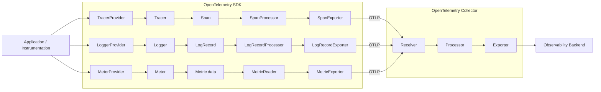

OpenTelemetry公式でも、Collectorは **Receiver → Processor → Exporter** というPipelineで動きます。SDK側にもExporterが存在するので、**「Exporterが2か所に出てくる」**のが最初かなり紛らわしいところです。 ([opentelemetry.io](https://opentelemetry.io/docs/concepts/components/?utm_source=chatgpt.com))

つまり、

```text
アプリ内
SDK Exporter
    ↓
ネットワーク
    ↓
Collector Receiver
    ↓
Collector Processor
    ↓
Collector Exporter
    ↓
Tempo / Prometheus / Loki / etc.
```

という関係です。

---

## では、実際に何が流れているのか

Traceの場合、基本単位は **Span** です。

Spanには、

| データ | 意味 |
|---|---|
| Name | 何の処理か |
| SpanContext | TraceId / SpanIdなど |
| Parent | 親Span |
| SpanKind | SERVER / CLIENT / INTERNALなど |
| Start / End | 開始・終了時刻 |
| Attributes | その処理の属性 |
| Events | Span中に起きた時点イベント |
| Links | 他Spanとの非親子関係 |
| Status | Unset / Ok / Error |

などが入ります。 ([opentelemetry.io](https://opentelemetry.io/docs/specs/otel/trace/api/?utm_source=chatgpt.com))

概念的には、

```text
Span
├─ trace_id
├─ span_id
├─ parent_span_id
├─ name
├─ kind
├─ start_time
├─ end_time
├─ attributes
├─ events
├─ links
└─ status
```

です。

そしてSDKでは、

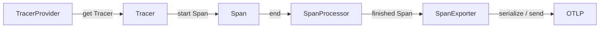

という流れになります。

ここで重要なのが、**`TracerProvider` 自体がTraceデータではない**ということです。

`TracerProvider` は、Tracerを作り、ResourceやProcessorなどTrace SDK全体の設定を保持する「親オブジェクト」です。

---

## Logsはかなり似ています

Logsの基本単位は `LogRecord` です。

現在のOpenTelemetry Logs Data Modelでは、主に次のフィールドがあります。

| データ | 意味 |
|---|---|
| Timestamp | 実際にイベントが起きた時刻 |
| ObservedTimestamp | OTelが観測した時刻 |
| TraceId | 関連Trace |
| SpanId | 関連Span |
| TraceFlags | sampling等 |
| SeverityText | `"ERROR"` など元の表現 |
| SeverityNumber | OTelで正規化したseverity |
| Body | メッセージ・構造化データ |
| Resource | どのサービス等から出たか |
| InstrumentationScope | どの計装元か |
| Attributes | その他属性 |
| EventName | 名前付きイベントの場合の名前 |

となっています。 ([opentelemetry.io](https://opentelemetry.io/docs/specs/otel/logs/data-model/))

SDK内部はこうです。

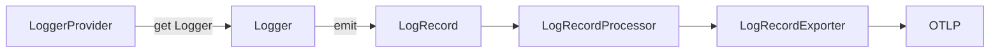

Traceとの大きな違いは、Spanのように「開始して、処理して、終了する」ものではないことです。

LogRecordは、

```text
今ここで
severity = Error
body = "connection failed"
attributes = ...
```

という**一発の記録**です。

---

## そしてTraceとLogsを繋いでいるのがContext


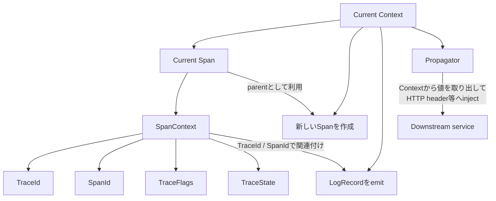
---

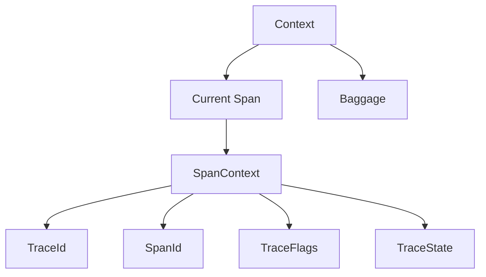

---

## ResourceとInstrumentationScopeはさらに外側にある

もちろんです。かなり圧縮するとこうです。

- `Resource`  
  **どのサービス・実行環境から出たTelemetryか**  
  例: `service.name = ragscope-app`

- `InstrumentationScope`  
  **どの計装コードがそのTelemetryを作ったか**  
  例: `ragscope.telemetry`、HTTP計装、DB計装

- `SpanContext`  
  **Trace内のどのSpanかを識別する情報**  
  例: `TraceId`、`SpanId`

関係はこんな感じです。

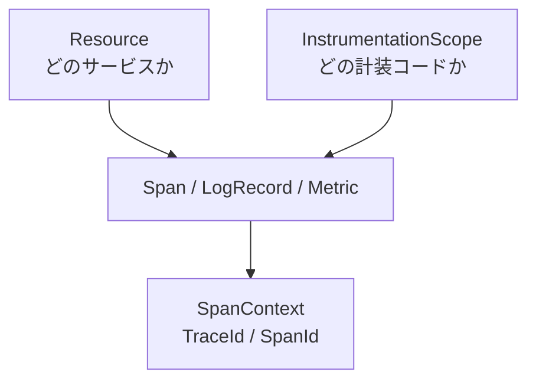

覚え方は、

> `Resource` = 出どころ  
> `InstrumentationScope` = 作ったコード  
> `SpanContext` = Trace内の住所

で十分です。

---
違います。**`Context` は Resource / InstrumentationScope を持つ場所ではありません。**

ざっくり整理すると、

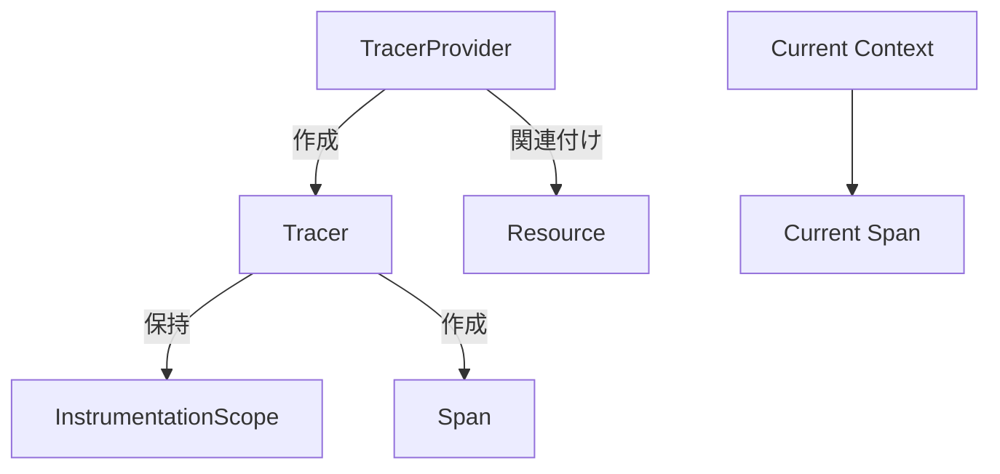

役割はこうです。

- **Resource**  
  `TracerProvider / LoggerProvider / MeterProvider` に紐づきます。  
  そのProviderから作られるTelemetryすべてに共通で付きます。 :chatgpt-content-reference{index="0"}

- **InstrumentationScope**  
  `Tracer / Logger / Meter` が持ちます。Providerからそれらを取得するときに指定します。そこから作られたSpan / LogRecord / Metricに紐づきます。 :chatgpt-content-reference{index="1"}

- **Context**  
  現在の処理に紐づく値を伝播するためのものです。TracingではCurrent Spanなどを持ち回ります。 :chatgpt-content-reference{index="2"}

なので、かなり単純化すると、

```text
Provider
└─ Resource        「どのサービス？」

Tracer / Logger / Meter
└─ InstrumentationScope
                    「どの計装コード？」

Context
└─ Current Span
   └─ SpanContext   「今どのTrace / Span？」
```

という分担です。

つまり **Resource / InstrumentationScope は「Telemetryの出所」側、Context / SpanContext は「現在の処理の流れ」側** と考えると整理しやすいです。

---

## 実際のOTLPデータもだいたいこの形

そしてこれが面白いところなんですが、ネットワークに流れるOTLPのデータ構造も、その考え方をかなりそのまま反映しています。

Traceなら概念上、

```text
ExportTraceServiceRequest
└─ ResourceSpans
   ├─ Resource
   └─ ScopeSpans
      ├─ InstrumentationScope
      └─ Span
         ├─ Span
         ├─ Span
         └─ ...
```

Logsなら、

```text
ExportLogsServiceRequest
└─ ResourceLogs
   ├─ Resource
   └─ ScopeLogs
      ├─ InstrumentationScope
      └─ LogRecord
         ├─ LogRecord
         ├─ LogRecord
         └─ ...
```

Metricsなら、

```text
ExportMetricsServiceRequest
└─ ResourceMetrics
   ├─ Resource
   └─ ScopeMetrics
      ├─ InstrumentationScope
      └─ Metric
         └─ DataPoint ...
```

です。OTLPはTrace / Metrics / LogsをProtobufベースで送るためのプロトコルで、HTTPなら通常 `/v1/traces`、`/v1/metrics`、`/v1/logs` へそれぞれ送ります。 ([github.com](https://github.com/open-telemetry/opentelemetry-proto?utm_source=chatgpt.com))

なので、

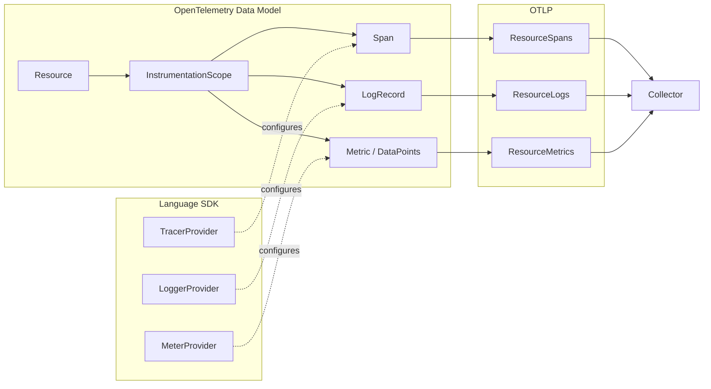

という対応で考えるとかなり整理できます。

---

## Metricsだけ少し毛色が違う

Metricsは、

```text
MeterProvider
    ↓
Meter
    ↓
Instrument
    ↓
measurement
    ↓
SDK aggregation
    ↓
Metric / DataPoints
    ↓
MetricReader
    ↓
MetricExporter
```

となります。

つまりTraceのように、

```text
Spanを作った
→ SpanをそのままExporterへ
```

ではありません。

例えばアプリ側で、

```text
duration = 120ms
duration = 80ms
duration = 200ms
```

とmeasurementを記録したとして、SDKがそれらを集約して、

```text
Histogram
count = 3
sum = 400ms
buckets = ...
```

のような **Metric DataPoint** にしてから外へ流します。OpenTelemetry MetricsではSum、Gauge、Histogram、ExponentialHistogramなどのデータモデルが定義されています。 ([opentelemetry.io](https://opentelemetry.io/docs/specs/otel/metrics/data-model/?utm_source=chatgpt.com))

そのためMetricsだけ `Processor` ではなく、主に **`MetricReader`** が登場します。

---

## Collectorは「もう一段外側のパイプライン」

SDKから送ったあとに、

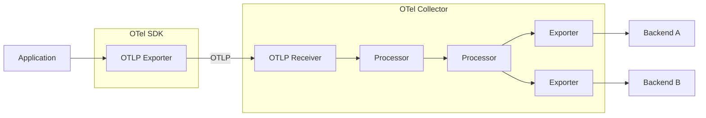

となります。

CollectorのProcessorでは、attribute追加・削除、filter、sampling、batchingなどを行えますし、複数Exporterへのfan-outも可能です。 ([opentelemetry.io](https://opentelemetry.io/uk/docs/collector/architecture/?utm_source=chatgpt.com))

なのでSDKとCollectorを分けて覚えるなら、

```text
SDK
「アプリの出来事をTelemetryデータにする」

Collector
「届いたTelemetryデータを加工・配送する」

Backend
「保存・検索・可視化する」
```

くらいが最初はちょうどいいです。

---

ここまでを一枚にすると、私はこの図が一番重要だと思います。

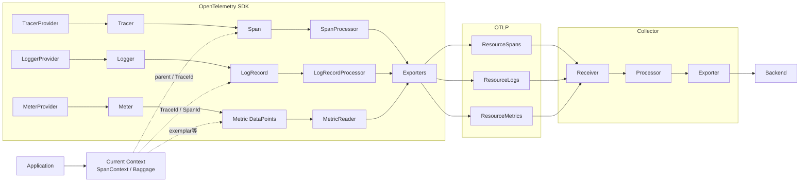

これを土台にすると、次にRAGScopeへ戻ったとき、

> `TracerProvider` はどこで作る？  
> `Resource` は何を入れる？  
> `Tracer` は誰が持つ？  
> `SpanProcessor` と `SpanExporter` はどう組む？  
> Logsは現在ContextからどうTraceId/SpanIdを取る？  
> `MeterProvider` / `MetricReader` は誰が所有する？  
> flush/shutdownすべきなのは誰？

という **RS-0024で実際に決めるべき詳細設計**へ、かなり自然につながります。

たぶん前回いきなりRAGScopeへ降りるより、**まずこのOpenTelemetryオブジェクトモデルとデータフローを固める方が正解**です。次はこの図を基準に、`Provider / Tracer(Logger, Meter) / Processor / Exporter` がそれぞれ「何を所有して、いつ生成され、いつ破棄されるか」まで掘ると、lifecycle設計にも直接つながります。　

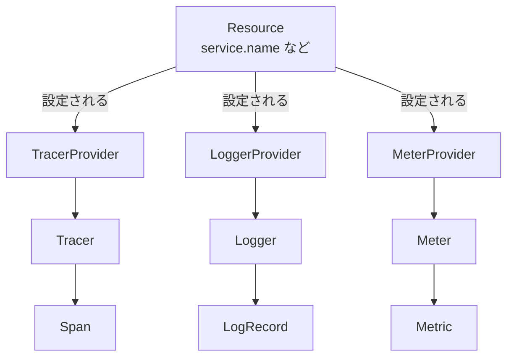

```
TracerProvider
├─ getTracer("ragscope.usecase")
│    └─ Tracer
│         └─ InstrumentationScope = "ragscope.usecase"
│
├─ getTracer("http-client")
│    └─ Tracer
│         └─ InstrumentationScope = "http-client"
│
└─ getTracer("postgres")
     └─ Tracer
          └─ InstrumentationScope = "postgres"
```