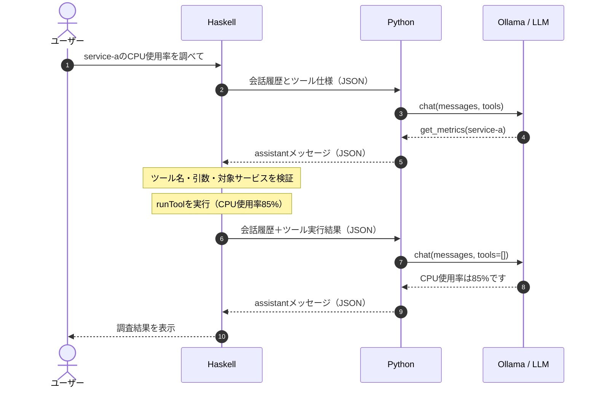

# Tool Callingのシーケンス図


# HaskellとPython間でやりとりするJSONの型

今回の設計では、やりとりするJSONは大きく2種類です。

| 方向               | データ           | Haskell側 | Python側            |
| ---------------- | ------------- | -------- | ------------------ |
| Haskell → Python | 会話履歴とツール仕様    | `Value`  | `InferenceRequest` |
| Python → Haskell | LLMの応答メッセージ1件 | `Value`  | `dict[str, Any]`   |
## ① Haskell → Python：最初の問い合わせ
```json
{
  "messages": [
    {
      "role": "system",
      "content": "For runtime metrics, use the available tool. Never invent measured values."
    },
    {
      "role": "user",
      "content": "service-aのCPU使用率を調べて"
    }
  ],
  "tools": [
    {
      "type": "function",
      "function": {
        "name": "get_metrics",
        "description": "Get CPU usage for a service",
        "parameters": {
          "type": "object",
          "properties": {
            "service": {
              "type": "string",
              "enum": ["service-a"]
            }
          },
          "required": ["service"],
          "additionalProperties": false
        }
      }
    }
  ]
}
```
## ② Python → Haskell：ツール要求
```json

{
  "role": "assistant",
  "content": "",
  "tool_calls": [
    {
      "function": {
        "name": "get_metrics",
        "arguments": {
          "service": "service-a"
        }
      }
    }
  ]
}
```
## ③ Haskell内部：ツール実行結果
```json
{
  "service": "service-a",
  "cpu_percent": 85
}
```
## ④ Haskell → Python：2回目の問い合わせ
```json

{
  "messages": [
    {
      "role": "system",
      "content": "For runtime metrics, use the available tool. Never invent measured values."
    },
    {
      "role": "user",
      "content": "service-aのCPU使用率を調べて"
    },
    {
      "role": "assistant",
      "content": "",
      "tool_calls": [
        {
          "function": {
            "name": "get_metrics",
            "arguments": {
              "service": "service-a"
            }
          }
        }
      ]
    },
    {
      "role": "tool",
      "tool_name": "get_metrics",
      "content": "{\"service\":\"service-a\",\"cpu_percent\":85}"
    }
  ],
  "tools": []
}
```
## ⑤ Python → Haskell：最終回答
```json
{
  "role": "assistant",
  "content": "service-aのCPU使用率は85%です。"
}
```